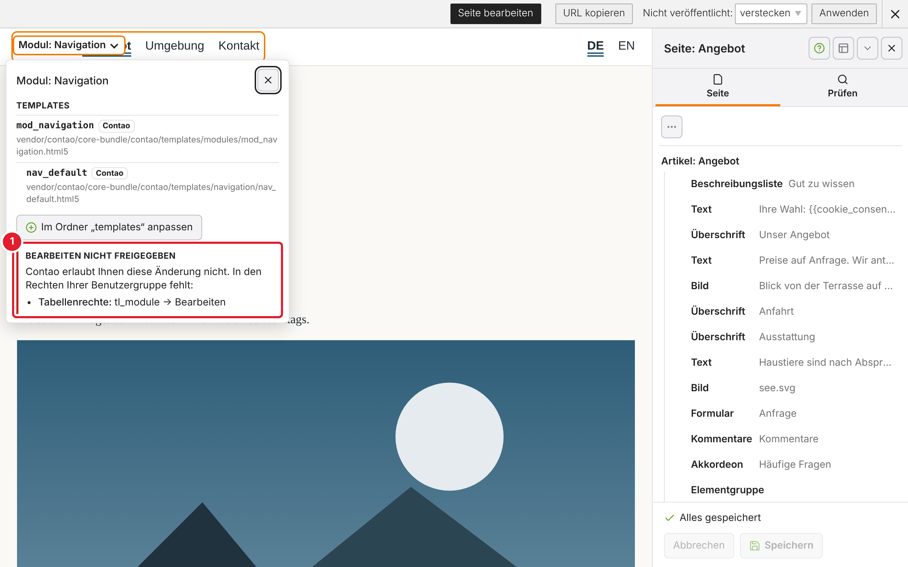

# Rechte

## Wie Rechte im Editor wirken

- Der Editor hat **kein eigenes Rechtesystem**. Was ein Benutzer auf der Seite
  darf, ist genau das, was Contao ihm im Backend erlaubt, geprüft Datensatz für
  Datensatz und Feld für Feld.
- Die Schalter der Erweiterung (Bereich **Frontend Editor** einer Benutzergruppe
  oder eines Benutzers, Feld **Erlaubte Funktionen**) **schränken** das nur ein.
  Sie erlauben nie etwas, das Contao verbietet.
- Eine Funktion braucht deshalb **beides**: ihren Schalter und Contaos Rechte.
- Fehlt ein Recht, erscheint der Knopf nicht. Bei Modulen, dem Layout,
  Formularfeldern und Kommentaren nennt die Karte **Info** das fehlende Recht
  mit Contaos eigener Bezeichnung (dafür ist der Schalter **Templates und Module
  (für Webdesigner)** nötig).

Administratoren haben jede Funktion.

Alle Contao-Rechte unten werden im Backend unter **Benutzergruppen** (oder
**Benutzer**) eingestellt. Die Namen sind die, die Contao dort zeigt.

## Die Schalter der Erweiterung

| Schalter | Was er erlaubt | Stufe |
| --- | --- | --- |
| **Frontend-Bearbeitung erlaubt** | **Frontend Editor** oben im Backend und den Knopf **Seite bearbeiten** in der Vorschau; ohne ihn sieht der Benutzer den Editor nicht | Basic |
| **Texte und Bilder ändern** | In Überschriften und Texten schreiben, Bilder ändern, **Alle Felder** | Basic |
| **Elemente anlegen, verschieben und löschen** | Elemente einfügen, verschieben, duplizieren, ausblenden und löschen, auch Elemente in einem Akkordeon, einem Slider oder einer Elementgruppe | Basic |
| **Artikel anlegen** | **Artikel anlegen** | Basic |
| **Templates und Module (für Webdesigner)** | **Info** mit den Templates, Rahmen um Module, Formularfelder und Kommentare mit ihren Formularen, **Layout bearbeiten**, **Templates der Seite** | Basic |
| **Sprachversionen bearbeiten (Plus)** | Die Ansicht **Sprachen** und das Übersetzungsfenster: nebeneinander, Texte übersetzen und speichern, verknüpfen, übernehmen, als aktuell markieren | Plus |
| **Übersetzung anfordern (Plus)** | **Alle Felder übersetzen**, **Dieses Feld übersetzen** und **Ganze Seite übersetzen** (mit dem Übersetzungsdienst der Einstellungen) | Plus |
| **Seiten anlegen und veröffentlichen (Plus)** | **Neue Seite**, **Veröffentlichen**, **Zurückziehen**, **Seiteneinstellungen**, **Seite duplizieren**, **Seite löschen** | Plus |
| **Beiträge bearbeiten (Plus)** | Die Ansicht **Beiträge** und **Beitrag bearbeiten** in Listen | Plus |
| **Module öffnen (Plus)** | Die Ansicht **Module** | Plus |
| **Stil der Seiten bearbeiten (Pro)** | **Stil der Seite (CSS)** | Pro |

Die Schalter von Plus und Pro erscheinen mit einer Lizenz für die jeweilige
Stufe (auf einer Entwicklungsadresse immer). Ohne sie sind sie ausgeblendet; ein
angehakter Schalter behält beim Speichern seinen Zustand und gilt mit der Lizenz
wieder.

Die Prüfungen für Suchmaschinen und Barrierefreiheit, die Bildschirmgrößen und
die Schreibhilfe (Pro) brauchen keinen eigenen Schalter: Wer den Editor nutzen
darf, darf sie nutzen. Änderungen, zu denen sie führen, laufen über die Rechte
unten.

## Contaos Rechte je Funktion

### Texte und Bilder (Basic)

| Contao-Recht | Einstellung |
| --- | --- |
| **Backend-Module** | Artikel |
| **Pagemounts** | die Seiten (oder der Startpunkt) der Website, an der die Gruppe arbeitet |
| **Zugriffsrechte** der Seiten | *Artikel bearbeiten* für die Gruppe (an den Seiten oder unter **Standard-Zugriffsrechte**) |
| **Inhaltselemente** | die Elementtypen, die die Gruppe bearbeiten darf |
| **Erlaubte Felder**, Tabelle `tl_content` | mindestens: Überschrift (`headline`), Text (`text`); für Bilder außerdem Quelldatei (`singleSRC`), Alternativer Text (`alt`), Bildunterschrift (`caption`), Metadaten überschreiben (`overwriteMeta`); für weitere Textfelder eines Elements auf der Seite (Einleitungstexte, Beschriftungen, Listen, Tabellen, auch anderer Erweiterungen) diese Felder; für die Datensätze der Kind-Tabelle eines Elements und für Datensätze, die es über eine Verknüpfung aus einer anderen Tabelle zeigt (eine FAQ-Kategorie und ihre Fragen), die Rechte dieser Tabelle (Backend-Modul, Tabellenrechte, erlaubte Felder der Tabelle); für die Texte von Frontend-Modulen die Rechte eines Frontend-Moduls wie unten unter *Frontend-Module, Layout, Formularfelder, Kommentare*, mit den erlaubten Feldern von `tl_module`, die die Texte enthalten |
| **Tabellenrechte** (ab Contao 5.7) | `tl_content` → Bearbeiten |

### Struktur: einfügen, verschieben, duplizieren, ausblenden, löschen (Basic)

Alles aus *Texte und Bilder*, dazu:

| Contao-Recht | Einstellung |
| --- | --- |
| **Tabellenrechte** | `tl_content` → Anlegen und → Löschen (Verschieben ist ein Bearbeiten) |
| **Erlaubte Felder**, `tl_content` | Elementtyp (`type`), um den Typ eines neuen Elements zu wählen; Unsichtbar (`invisible`) zum Ausblenden |

Elemente in einem Akkordeon, einem Slider oder einer Elementgruppe einzufügen,
zu duplizieren und zu löschen braucht dieselben Rechte; Contao prüft außerdem,
ob der Elementtyp in dieses Element gesetzt werden darf.

### Artikel anlegen (Basic)

| Contao-Recht | Einstellung |
| --- | --- |
| **Zugriffsrechte** der Seite | *Artikel bearbeiten* und *Hierarchie der Artikel ändern* |
| **Erlaubte Felder**, `tl_article` | mindestens Titel (`title`); Anzeigen in (`inColumn`), wenn das Layout mehrere Spalten hat |

Seiten und Artikel haben in Contao keine **Tabellenrechte**; es entscheiden die
Zugriffsrechte der Seiten.

### Seiten (Plus)

| Contao-Recht | Einstellung |
| --- | --- |
| **Backend-Module** | Seiten |
| **Pagemounts** | die Website oder der Teil davon, an dem die Gruppe arbeitet |
| **Erlaubte Seitentypen** | mindestens *Reguläre Seite* |
| **Zugriffsrechte** der Seiten | *Seite bearbeiten*; für **Neue Seite** außerdem *Hierarchie der Seiten ändern* an der übergeordneten Seite; für **Seite löschen** *Seite löschen* |
| **Erlaubte Felder**, `tl_page` | Seitenname (`title`), Seitenalias (`alias`), Seitentitel (`pageTitle`), Beschreibung der Seite (`description`), Seite veröffentlichen (`published`), Anzeigen ab/bis (`start`, `stop`); für Pro außerdem Robots-Tag (`robots`) und die Google Suchergebnis-Vorschau (`serpPreview`) |
| **Erlaubte Felder**, `tl_article` | mindestens Titel (`title`): Den Artikel einer neuen Seite legt Contao nur für Benutzer an, die Artikel anlegen dürfen |

### Beiträge: Nachrichten, Events, FAQ (Plus)

Gezeigt am Beispiel der Nachrichten; Events und FAQ funktionieren genauso, mit
ihrem eigenen Modul, Archivfeld und ihren eigenen Tabellen.

| Contao-Recht | Einstellung |
| --- | --- |
| **Backend-Module** | Nachrichten |
| **Erlaubte Archive** | die Archive, in die die Gruppe schreibt |
| **Tabellenrechte** | `tl_news` → Anlegen, Bearbeiten, Löschen |
| **Erlaubte Felder**, `tl_news` | mindestens Titel (`headline`), Nachrichtenalias (`alias`), Beitrag veröffentlichen (`published`) und die Felder, die die Gruppe ausfüllt |
| Für den Inhalt eines Beitrags | dasselbe wie bei *Texte und Bilder* und *Struktur* |

### Module (Plus)

Die Ansicht **Module** zeigt die Backend-Module der Menügruppe der
Erweiterungen, die der Benutzer öffnen darf (**Backend-Module**), außer den
Einstellungen des Editors selbst und der Seite „Zugänge und Lizenzen“. Mit Pro
zeigt sie auch die Backend-Module der Website und anderer Erweiterungen (jedes
Modul, das nicht zu Contao selbst gehört); ihre Datensätze werden dort mit dem
Schalter **Sprachversionen bearbeiten (Plus)** und Contaos Rechten an der
Tabelle des Moduls übersetzt (**Tabellenrechte** → Bearbeiten, **Erlaubte
Felder**).

### Frontend-Module, Layout, Formularfelder, Kommentare (Basic, für Webdesigner)

Schalter **Templates und Module (für Webdesigner)**, dazu:

| Teil | Contaos Rechte |
| --- | --- |
| Frontend-Modul | **Backend-Module**: Themes; **Theme-Module**: Frontend-Module; **Frontend-Module**: der Modultyp (z. B. Navigationsmenü); **Erlaubte Felder**: mindestens ein Feld von `tl_module` (z. B. `name`); **Tabellenrechte**: `tl_module` → Bearbeiten |
| Layout | **Backend-Module**: Themes; **Theme-Module**: Seitenlayouts; **Erlaubte Felder**: mindestens ein Feld von `tl_layout`; **Tabellenrechte**: `tl_layout` → Bearbeiten |
| Formularfeld | **Backend-Module**: Formulare; **Erlaubte Formulare**: das Formular; **Formularfelder**: der Feldtyp (z. B. Textfeld); **Erlaubte Felder**: mindestens ein Feld von `tl_form_field` (z. B. `label`); **Tabellenrechte**: `tl_form_field` → Bearbeiten; für **Feld danach einfügen** und **Feld löschen** außerdem → Anlegen und → Löschen |
| Kommentar | **Backend-Module**: Kommentare; bei Kommentaren eines Inhaltselements *Artikel bearbeiten* an seiner Seite; **Erlaubte Felder**: mindestens ein Feld von `tl_comments`; **Tabellenrechte**: `tl_comments` → Bearbeiten |
| Template Studio | **Backend-Module**: Templates |

Contaos Formular in der Seitenleiste zeigt nur die erlaubten Felder.

### Sprachversionen (Plus)

Schalter **Sprachversionen bearbeiten (Plus)**, dazu *Texte und Bilder* für die
Seiten jeder Sprache, die die Gruppe bearbeitet (**Pagemounts** aller
Startpunkte der Sprachen). **Element übernehmen** braucht außerdem *Struktur* in
der Zielsprache, **In (Hauptsprache) übernehmen** *Struktur* in der
Hauptsprache. **Übersetzung anfordern (Plus)** braucht zusätzlich einen
eingerichteten Übersetzungsdienst (Azure Translator, DeepL oder die
KI-Verbindung, siehe [Einrichtung](setup.md)).

**Sprachversionen anlegen** bei einer neuen Seite (siehe
[Seiten](usage/pages.md#sprachversionen-gleich-mit-anlegen)) braucht:

| Contao-Recht | Einstellung |
| --- | --- |
| Schalter | **Seiten anlegen und veröffentlichen (Plus)**; für die Namensvorschläge außerdem **Übersetzung anfordern (Plus)** |
| **Pagemounts** | die Startpunkte aller Sprachen, in denen die Gruppe Seiten anlegt |
| **Zugriffsrechte** der Seiten | in jeder Sprache *Seite bearbeiten* und *Hierarchie der Seiten ändern* an der übergeordneten Seite der neuen Sprachversion |
| **Erlaubte Felder**, `tl_page` | Seitenname (`title`); Seite in Hauptsprache (`languageMain`) zum Verknüpfen; Seitenalias (`alias`), um den Alias selbst einzutragen (ohne bildet Contao ihn aus dem Namen) |
| **Erlaubte Felder**, `tl_article` | mindestens Titel (`title`), für den Artikel jeder Sprachversion |

### Prüfungen und Schreibhilfe (Pro)

- Fokus-Suchbegriff: *Seite bearbeiten* an der Seite.
- Korrekturen, die die Barrierefreiheits-Prüfung anbietet (zum Beispiel
  **Ebene 2 setzen**, **Alternativtext eingeben**): die Rechte am Element.
- Schreibhilfe: *Texte und Bilder*; die KI-Verbindung muss eingerichtet sein.

### Stil der Seite (Pro)

| Contao-Recht | Einstellung |
| --- | --- |
| Schalter | **Stil der Seiten bearbeiten (Pro)** |
| **Backend-Module** | Stile der Seiten |
| **Zugriffsrechte** der Seite | *Seite bearbeiten* |

Die Backend-Liste **Stile der Seiten** zeigt nur die Stile der Seiten, die der
Benutzer bearbeiten darf. Dieses Recht nur Webdesignern geben: Ein Fehler im
Stil kann die Seite für Besucher verstellen.

### Einstellungen und Liste der Übersetzungen

- **Frontend Editor** (Einstellungen: Adresse des Backends, Modell und Grenze
  der Schreibhilfe): nur für Administratoren oder die Person, die die Website
  einrichtet.
- **Übersetzungen** (Liste der verknüpften Elemente, Plus): für alle, die
  veraltete Übersetzungen prüfen. Eine Zeile zu löschen löst die Verknüpfung,
  nicht die Elemente.

## Beispielgruppen

### „Redakteure – nur Texte“

Für Personen, die Texte korrigieren und Bilder austauschen.

1. Schalter: **Frontend-Bearbeitung erlaubt**, **Texte und Bilder ändern**.
2. **Backend-Module**: Artikel.
3. **Pagemounts**: der Startpunkt der Website.
4. **Inhaltselemente**: die Typen, die auf der Website verwendet werden.
5. **Erlaubte Felder** (`tl_content`): `headline`, `text`, `singleSRC`, `alt`,
   `caption`, `overwriteMeta`.
6. **Tabellenrechte**: `tl_content` → Bearbeiten.
7. **Zugriffsrechte** der Seiten (oder **Standard-Zugriffsrechte** neuer
   Seiten): *Artikel bearbeiten* für die Gruppe.

### „Redakteure – Inhalt und Struktur“

Wie oben, dazu:

1. Schalter: **Elemente anlegen, verschieben und löschen**, **Artikel anlegen**.
2. **Erlaubte Felder** (`tl_content`): außerdem `type`, `invisible`;
   (`tl_article`): `title`.
3. **Tabellenrechte**: `tl_content` → Anlegen, Löschen.
4. **Zugriffsrechte**: außerdem *Hierarchie der Artikel ändern*.

### „Redakteure – Plus“

Wie oben, dazu die Schalter und Rechte von *Seiten*, *Beiträge* und
*Sprachversionen*, die die Gruppe haben soll.

### „Webdesign“

1. Schalter: nach Bedarf, dazu **Templates und Module (für Webdesigner)** und,
   mit Pro, **Stil der Seiten bearbeiten (Pro)**.
2. Die Rechte von *Frontend-Module, Layout, Formularfelder, Kommentare* und
   *Stil der Seite* oben.

Nach dem Einrichten einer Gruppe mit einem Testbenutzer dieser Gruppe anmelden
und die [Bedienungsanleitung](usage/README.md) durchgehen: Jeder Knopf, den die
Gruppe haben soll, muss da sein. Fehlt einer, siehe
[Fehlersuche](troubleshooting.md).

