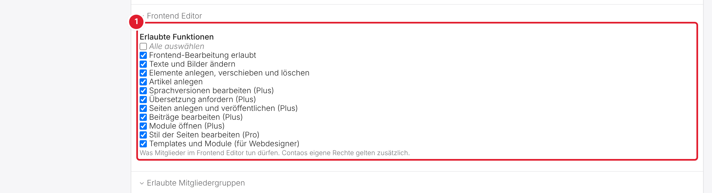
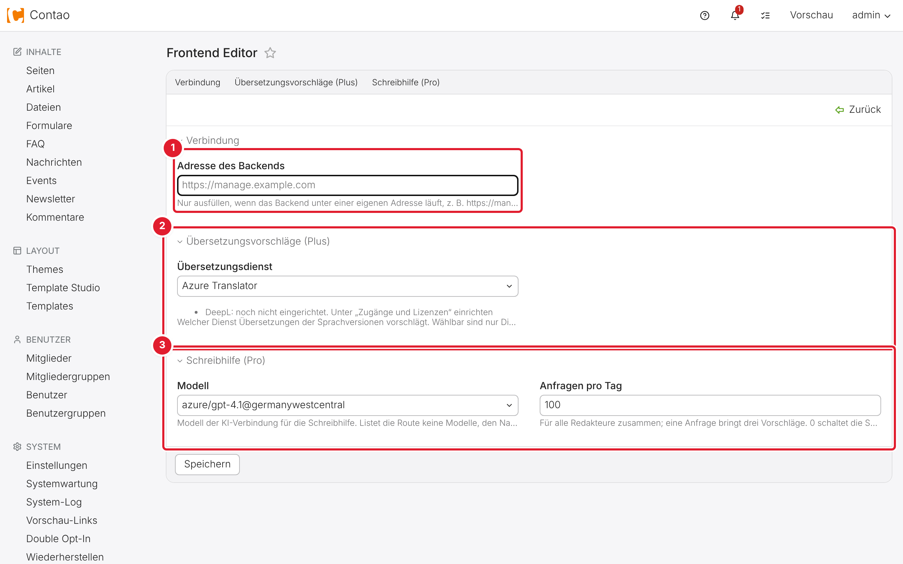

# Einrichtung

Die Schritte in dieser Reihenfolge ausführen. Für die kostenlose Stufe (Basic)
genügen die Schritte 1 und 2.

## 1. Den Editor für eine Benutzergruppe freigeben

1. Im Backend **Benutzergruppen** öffnen und die Gruppe der Redakteure
   bearbeiten.
2. Im Bereich **Frontend Editor** unter **Erlaubte Funktionen** anhaken, was
   die Gruppe darf (die vollständige Liste mit den Contao-Rechten, die jede
   Funktion braucht, steht unter [Rechte](permissions.md)):
   - **Frontend-Bearbeitung erlaubt** zeigt den Knopf **Seite bearbeiten** in
     der Vorschau. Ohne diesen Schalter sieht der Benutzer den Editor gar nicht.
   - **Texte und Bilder ändern**: in Überschriften und Texten schreiben, Bilder
     ändern, **Alle Felder** öffnen.
   - **Elemente anlegen, verschieben und löschen**: Elemente einfügen,
     verschieben, duplizieren, ausblenden und löschen.
   - **Artikel anlegen**.
   - Die übrigen Schalter gehören zu Plus und Pro und zu den Webdesignern;
     siehe [Rechte](permissions.md). Die Schalter von Plus und Pro erscheinen
     mit einer Lizenz für die jeweilige Stufe.
3. Speichern.

Dieselben Schalter gibt es beim einzelnen Benutzer. Wie bei Contaos eigenen
Rechten bekommt ein Benutzer die Schalter des Benutzers, die der Gruppen oder
beide, je nach **Rechtevererbung**.

Administratoren haben jede Funktion; sie brauchen keinen Schalter.

Die Schalter **schränken** nur ein, was Contao erlaubt. Jede Funktion braucht
außerdem Contaos eigene Rechte, genau wie im Backend. Fehlt ein Knopf, steht
unter [Rechte](permissions.md) und [Fehlersuche](troubleshooting.md), welches
Recht es ist.

## 2. Ausprobieren

1. Mit einem Benutzer der Gruppe im Backend anmelden.
2. Die Vorschau einer Seite öffnen (**Vorschau** im Backend oder das
   Vorschau-Symbol einer Seite im Seitenbaum).
3. In Contaos Vorschauleiste oben auf **Seite bearbeiten** klicken.

Der Editor öffnet sich; weiter in der [Bedienungsanleitung](usage/README.md).

## 3. Lizenz (Plus und Pro)

**Lizenzschlüssel für Plus und Pro:** <https://store.neo-digital.at/extensions/frontend-editor>

1. In der Menügruppe der Erweiterungen **Zugänge und Lizenzen** öffnen.
2. Unter **Lizenzen** den Lizenzschlüssel des Frontend Editors eintragen und
   speichern.

Die Lizenz gilt für die Domains der Website. Auf Entwicklungsadressen
(`localhost`, Loopback-Adressen, `*.localhost`, `*.test`, `*.local`)
funktioniert jede Funktion ohne Schlüssel; Plus und Pro lassen sich so vor dem
Kauf ausprobieren.

Schalter und Einstellungen einer Stufe, die die Lizenz nicht enthält, zeigt das
Backend nicht. Was dort eingestellt war, bleibt gespeichert und gilt mit einer
Lizenz für diese Stufe wieder. Im Backend zählt die Lizenz ohne Prüfung der
Domain, weil das Backend unter einer anderen Adresse laufen kann; auf einer
Entwicklungsadresse erscheint alles. Das gilt auch für das Menü und für
**Zugänge und Lizenzen**: **Übersetzungen** erscheint mit Plus, **Stile der
Seiten** mit Pro; die Übersetzungsdienste (Azure Translator, DeepL) und die
KI-Verbindung erscheinen mit Plus, außer eine andere Erweiterung nutzt sie. Im
Editor selbst bleiben Funktionen einer Stufe, die die Lizenz nicht enthält,
mit ihrer Stufe sichtbar und gesperrt. Was jede Stufe dazubringt, steht in der
Lizenzzeile unter **Zugänge und Lizenzen**.

## 4. Übersetzungsvorschläge (Plus)

Übersetzungsvorschläge kommen von einem von drei Diensten: Microsoft Azure
Translator, DeepL oder einem Sprachmodell der KI-Verbindung. Den gewünschten
Dienst einrichten und dann in den Einstellungen des Editors wählen.

1. Den Zugang unter **Zugänge und Lizenzen** einrichten:
   - **Azure Translator**: im Azure-Portal eine *Translator*-Ressource
     anlegen, ihren Schlüssel eintragen, **Verarbeitung** wählen (Vorgabe
     *Europa*) und die Region der Ressource eintragen.
   - **DeepL**: den Schlüssel des DeepL-API-Kontos eintragen (Free oder Pro;
     Schlüssel des kostenlosen Tarifs enden auf `:fx`).
   - **KI-Modell**: der Abschnitt **KI-Verbindung** (Route und Schlüssel),
     dieselbe Verbindung wie für die Schreibhilfe.
2. In diesem Abschnitt auf **Verbindung prüfen** klicken. Die Meldung muss mit
   „Verbindung in Ordnung“ beginnen.
3. In der Menügruppe der Erweiterungen **Frontend Editor** öffnen → Bereich
   **Übersetzungsvorschläge (Plus)** → **Übersetzungsdienst** und den Dienst
   wählen. Ein Dienst ohne eingerichteten Zugang steht in der Liste, lässt sich
   aber nicht wählen; die Zeile unter dem Feld sagt, was fehlt, und führt zum
   Abschnitt. Ohne Auswahl gilt der erste eingerichtete Dienst, in der
   Reihenfolge Azure Translator, DeepL, KI-Modell.
4. Für **KI-Modell (KI-Verbindung)**: das **Modell für Übersetzungen** wählen
   (aus den Modellen der Route). Ohne KI-Verbindung ist das Feld gesperrt und
   sagt, warum.
5. Auf **Speichern** klicken.

Die Zugänge gelten gemeinsam für alle Erweiterungen der Familie.

## 5. Schreibhilfe (Pro)

1. **Zugänge und Lizenzen** öffnen → Bereich **KI-Verbindung** und Route und Schlüssel der
   KI-Verbindung eintragen.
2. In der Menügruppe der Erweiterungen **Frontend Editor** öffnen → Bereich
   **Schreibhilfe (Pro)** (erscheint mit einer Lizenz für Pro).
3. Das **Modell** wählen. Die Liste kommt aus der KI-Verbindung; listet die
   Route keine Modelle, den Namen des Modells eintippen. Ohne KI-Verbindung sind
   die Einstellungen der Schreibhilfe gesperrt und sagen, warum.
4. **Anfragen pro Tag** festlegen (für alle Redakteure zusammen; eine Anfrage
   bringt drei Vorschläge; 0 schaltet die Schreibhilfe ab). Vorgabe: 100.

## 6. Nur bei eigener Adresse des Backends

Läuft das Backend unter einer eigenen Adresse (zum Beispiel
`https://manage.example.com` zur Website `https://example.com`):

1. In der Menügruppe der Erweiterungen **Frontend Editor** öffnen.
2. Die Adresse unter **Adresse des Backends** eintragen.
3. Prüfen, dass bei jedem Startpunkt der Website der **Domainname** ausgefüllt
   ist.

Der Editor lädt Contaos Formulare dann von dieser Adresse. Nur die Domains der
Startpunkte dürfen sie einbetten; jede andere Website wird abgewiesen. Das Feld
leer lassen, wenn Backend und Website dieselbe Adresse haben.

## 7. Bei mehreren Websites oder Sprachen

Enthält die Installation mehrere Websites oder eine Website in mehreren
Sprachen, vor dem Einrichten der Gruppen
[Mehrere Websites und Sprachen](websites-and-languages.md) lesen.
