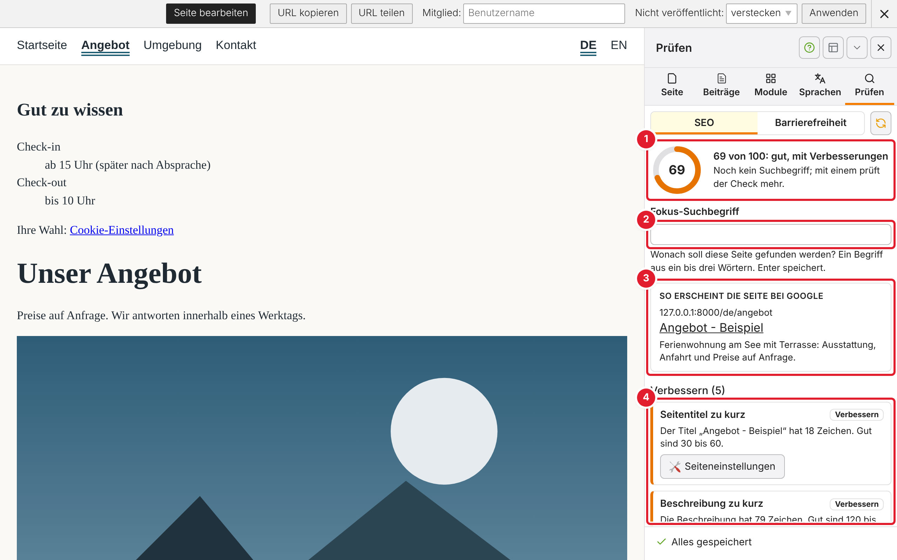
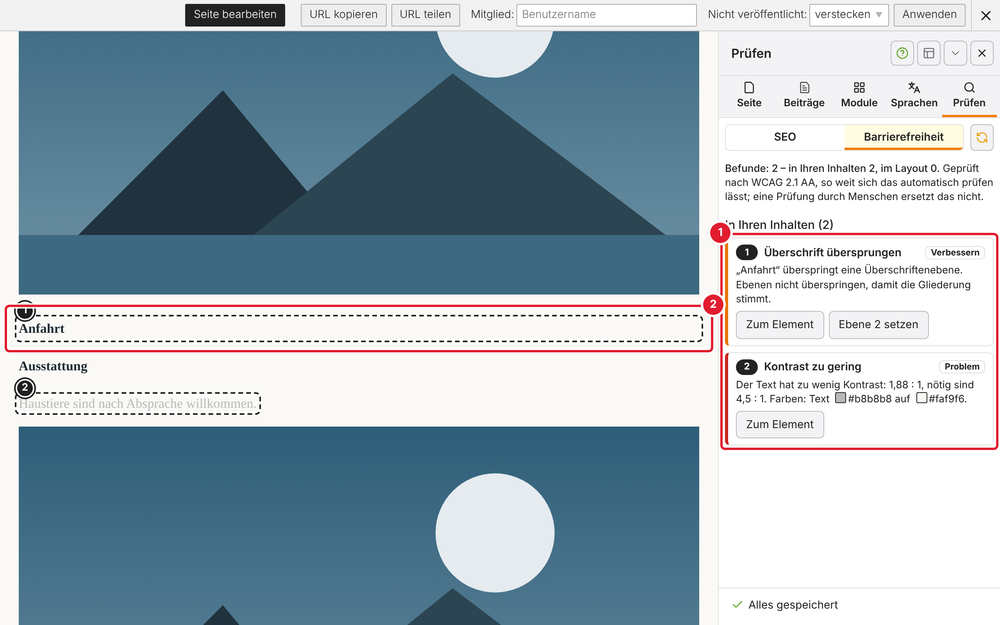
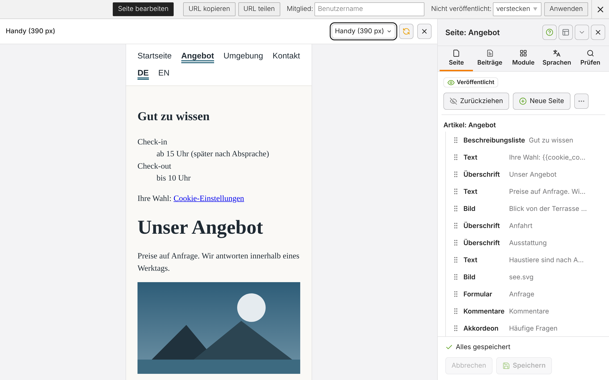

# Prüfen und Bildschirmgrößen

**Stufe:** Pro. Kein Schalter nötig: Wer den Editor nutzen darf, darf prüfen.

Die Ansicht **Prüfen** im Kopf der Seitenleiste hat zwei Reiter, **SEO** und
**Barrierefreiheit**. Geprüft wird die Seite im eigenen Browser, so wie die
Vorschau sie zeigt: beim Öffnen der Ansicht, nach jedem Speichern und mit
**Erneut prüfen**.

Jeder Befund ist mit **Problem**, **Verbessern** oder **In Ordnung** markiert
(als Wort, nicht nur als Farbe), mit einem Satz Erklärung und, wo möglich, dem
Weg zur Lösung: **Seiteneinstellungen**, **Zum Element** (wählt das Element auf
der Seite) oder einer Korrektur gleich dort.

## SEO

1. **Punktzahl** von 0 bis 100 (siehe die Tabelle unten).
2. **Fokus-Suchbegriff**: Wonach soll diese Seite gefunden werden? Einen Begriff
   aus ein bis drei Wörtern eintragen und Enter drücken. Er wird mit der Seite
   gespeichert (braucht *Seite bearbeiten*).
3. **So erscheint die Seite bei Google**: Adresse, Seitentitel und Beschreibung.
4. **Befunde**: zuerst Probleme, dann Verbesserungen, dann, was in Ordnung ist.

So entsteht die Punktzahl: Jeder Prüfpunkt hat ein Gewicht; **In Ordnung** zählt
voll, **Verbessern** halb, **Problem** gar nicht. Die Punktzahl ist der Anteil an
den erreichbaren Punkten. Prüfpunkte zum Suchbegriff zählen nur, wenn ein
Suchbegriff eingetragen ist. Die Hauptüberschrift zählt so, wie Suchmaschinen
sie lesen: jede `h1` im Quelltext der Seite, auch eine, die das Layout nur bei
manchen Breiten zeigt (eine Fassung fürs Handy); nicht eine, die für alle
verborgen ist (`hidden`, `aria-hidden="true"`).

| Prüfpunkt | Gewicht | Problem | Verbessern | In Ordnung |
| --- | --- | --- | --- | --- |
| Seitentitel | 10 | fehlt | unter 30 oder über 60 Zeichen | 30 bis 60 Zeichen |
| Beschreibung | 10 | fehlt | unter 120 oder über 158 Zeichen | 120 bis 158 Zeichen |
| Hauptüberschrift (h1) | 10 | keine oder mehrere | – | genau eine |
| Überschriftenebenen | 5 | – | eine Ebene übersprungen | keine Ebene übersprungen |
| Textmenge | 10 | – | unter 300 Wörtern | 300 Wörter oder mehr |
| Alternativtexte | 5 | – | ein Bild im Inhalt ohne | alle Bilder |
| Links auf andere Seiten | 5 | – | keiner | mindestens einer |
| Indexierung | 10 | „noindex“ | – | wird indexiert |
| Suchbegriff im Seitentitel | 10 | – | fehlt | vorhanden |
| Suchbegriff in der Beschreibung | 5 | – | fehlt | vorhanden |
| Suchbegriff in der Hauptüberschrift | 5 | – | fehlt | vorhanden |
| Suchbegriff in der Adresse | 5 | – | fehlt | vorhanden |
| Suchbegriff im ersten Absatz | 5 | – | fehlt | vorhanden |
| Suchbegriff nur auf dieser Seite | 5 | – | auch auf einer anderen Seite der Website | nur hier |

Ein Suchbegriff gilt als vorhanden, wenn alle seine Wörter vorkommen, auch in
längeren Wörtern, ohne Rücksicht auf Groß- und Kleinschreibung und Akzente.

Überschriften und Bilder zählen nur dort, wo ein Besucher oder ein Screenreader
sie bekommt: auf der Seite angezeigt (nicht ausgeblendet, mit einer Größe) und
nicht vor Screenreadern verborgen (`aria-hidden="true"` am Element oder darum
herum). Ein Bild braucht einen Alternativtext, außer es ist als Schmuck
gekennzeichnet (`role="presentation"` oder `none`); ein leeres `alt=""` an einem
angezeigten Bild gilt als fehlend, denn Contao schreibt es, wenn kein Text
eingetragen wurde. Bei mehreren Befunden geht **Zum Element (1 von 3)** einen
nach dem anderen an. Ist eine Stelle beim Klick ausgeblendet, sagt das die
Zeile unten in der Seitenleiste.

## Barrierefreiheit

Die Seite wird nach WCAG 2.1 AA geprüft, so weit sich das automatisch prüfen
lässt: Kontraste, Alternativtexte, Texte von Links und Knöpfen, Reihenfolge der
Überschriften, Sprache, Beschriftungen von Formularfeldern, Titel eingebetteter
Inhalte.

- **In Ihren Inhalten**: Elemente, die Sie bearbeiten dürfen. Einfache Fälle
  lassen sich gleich dort beheben: **Ebene n setzen** bei einer übersprungenen
  Überschrift, **Alternativtext eingeben** bei einem Bild.
- **Im Layout**: Befunde, die nur der Webdesigner ändern kann.
- Jeder Befund hat eine Nummer; dieselbe Nummer markiert die Stelle auf der
  Seite.
- Bei Kontrasten stehen das Verhältnis, der nötige Wert und beide Farben da.

Die Prüfung ersetzt keine Prüfung durch Menschen; die Ansicht sagt das auch.

## Bildschirmgrößen

1. Im Kopf der Seitenleiste auf **Bildschirmgröße** klicken.
2. **Handy** (390 px) oder **Tablet** (820 px) wählen. Die Seite neben der
   Seitenleiste wird so breit wie das Gerät; es gilt das Layout der Seite für
   diese Breite. **Drehen** stellt die Breite des quer gehaltenen Geräts ein
   (844 px oder 1180 px); ist das Fenster schmäler, lässt sich die Seite seitlich
   rollen.
3. **Computer**, **Schließen** (×) oder Esc in der Leiste über der Seite führt
   zur normalen Breite zurück.

In dieser Breite funktioniert alles wie in der normalen: auswählen, bearbeiten,
speichern, die Prüfungen. Bildschirmgrößen werden auf Bildschirmen breiter als
768 px angeboten.

## Häufige Probleme

| Anzeichen | Ursache | Lösung |
| --- | --- | --- |
| „Die Prüfung konnte nicht laufen.“ | Die Prüfdatei lässt sich nicht laden (öffentliche Dateien fehlen, oder eine Content-Security-Policy sperrt sie) | Administrator: siehe [Fehlersuche](../troubleshooting.md). |
| Der Fokus-Suchbegriff lässt sich nicht speichern | Ihnen fehlt *Seite bearbeiten* für diese Seite | Beim Administrator nachfragen. |
| Keine **Bildschirmgröße** | Das Fenster ist 768 px breit oder schmäler, oder es gibt keine Pro-Lizenz | Ein breiteres Fenster nutzen. |
| Ein Befund unter „Im Layout“ | Er kommt aus dem Layout, nicht aus dem Inhalt | Dem Webdesigner Bescheid geben. |
