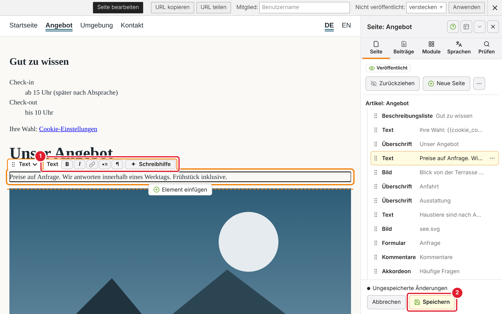
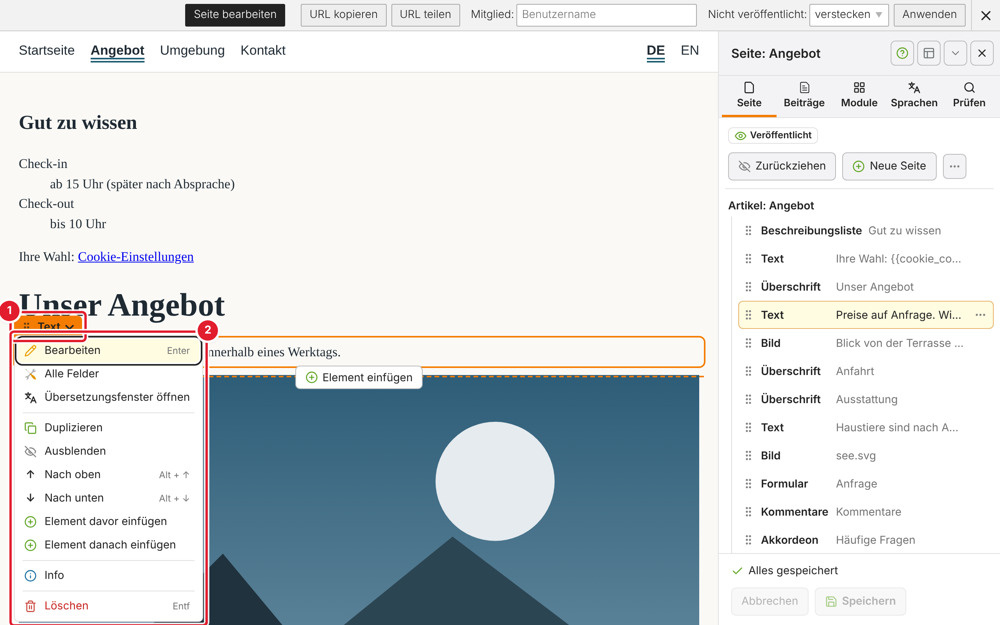
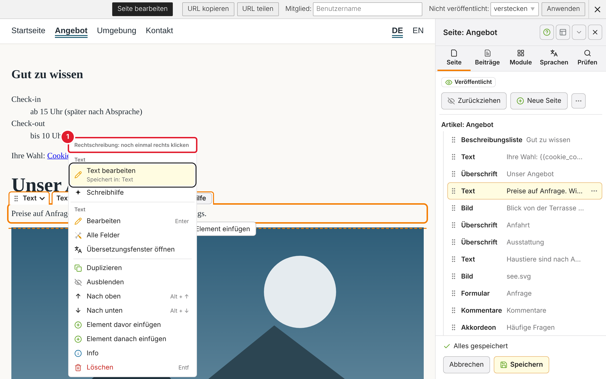
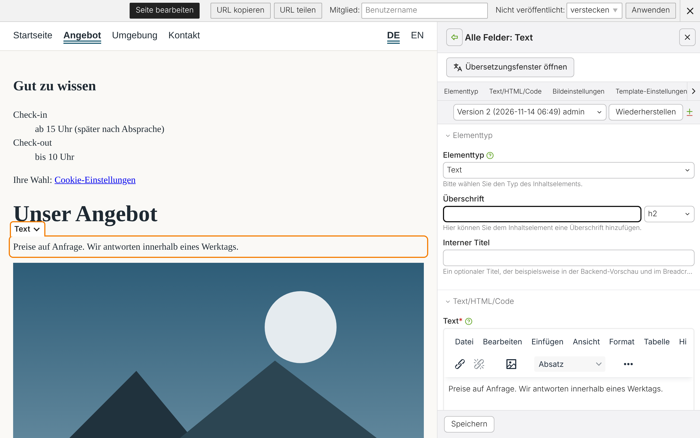

# Texte, Bilder und Links bearbeiten

**Stufe:** Basic. **Braucht:** den Schalter **Texte und Bilder ändern**.

## Eine Überschrift oder einen Text ändern

1. Das Element auf der Seite anklicken, dann seinen Reiter (den Typ auf der
   Linie seines Rahmens) und **Bearbeiten**. Oder auf dem gewählten Element
   Enter drücken, auf der Seite oder in der Seitenleiste.
2. In den Text klicken und schreiben. Neben dem Reiter, auf der Linie des
   Rahmens, erscheinen die Textwerkzeuge des Feldes, in dem Sie schreiben; vorne
   steht sein Name.
3. Auf **Speichern** klicken oder Strg+S drücken (Cmd+S auf dem Mac).

Die Textwerkzeuge hängen vom Feld ab:

- in der Überschrift: die **Ebene der Überschrift** (h1 bis h6);
- in einem formatierten Text: **Fett**, **Kursiv**, **Link** (öffnet Contaos
  Link-Picker; eine Seite der Website wählen oder eine Adresse eingeben),
  **Liste**, **Absatz**.

Ein Feld ohne Formatierung bekommt keine Textwerkzeuge; was Sie dort
schreiben, wird als reiner Text gespeichert. Eingefügter Text kommt als reiner Text an, ohne die Formatierung der Quelle.

**Ergebnis:** Die Änderung wird in Contao als Version gespeichert, wie eine
Änderung im Backend. Zeigt die Seite schon genau das, was Contao für den
gespeicherten Text ausgibt, bleibt sie, wie sie ist. Sonst (das Template oder ein
Insert-Tag verändert den Wert, Skripte der Website bewegen das Element, **Alle
Felder**, ein neues Bild) lädt die Seite im Rahmen neu, an derselben Stelle, mit
demselben gewählten Element und der Seitenleiste wie vorher: Sie sieht dann genau
so aus wie nach neuem Öffnen.

**Einen Text verlassen:** Esc drücken. Die Änderung wartet, bis Sie
speichern; ein zweites Esc hebt die Auswahl des Elements auf. **Abbrechen**
verwirft jede wartende Änderung, und die Seite zeigt wieder, was vorher
gespeichert war.

**Contaos Editor für einen Text:** Ein formatierter Text (ein Feld mit Contaos
TinyMCE im Backend, etwa der Text eines Text-Elements oder der Teaser eines
Beitrags; nicht das HTML-Element, das hat keinen TinyMCE) hat in der
Werkzeugleiste des Textes Fett, Kursiv, Link, Liste und Absatz. **HTML-Editor**
schaltet dort auf Contaos eigenen TinyMCE auf der Seite um, mit der
Werkzeugleiste und den Menüs, die Contaos Formular für dieses Feld hat: Bilder
und Links über Contaos Auswahl (mit Hochladen), Tabellen und der Quellcode.
Seine Werkzeugleiste steht in einer Leiste über den Reitern des Elements,
bündig mit dem Rahmen und immer zuoberst auf der Seite; am Griff links lässt sie sich überallhin im Fenster
ziehen (auch mit den Pfeiltasten), ein Doppelklick auf den Griff setzt sie
zurück. **HTML-Editor** noch einmal schaltet zurück; der Text bleibt, wie er ist.
Der Browser merkt sich die Wahl und den Platz der Leiste. Ist Contaos Editor für
formatierten Text ausgeschaltet (**System › Einstellungen**), fehlt der Knopf.
Ein anderes Feld, dessen Wert HTML-Tags enthält, bietet **HTML-Quelltext** an:
Contaos Formular des Elements öffnet sich in der Seitenleiste bei diesem Feld.
Was noch auf Speichern wartet, wird vorher gespeichert oder verworfen.

**Am Handy** stehen die Werkzeuge eines Textes hinter einem Knopf mit dem Namen
des Feldes neben dem Reiter des Elements; er öffnet sie als Aufklappmenü darunter
(Fett, Kursiv, Link, Liste, Absatz, die Ebene einer Überschrift, die
Schreibhilfe), ein Werkzeug schließt das Menü wieder. Contaos TinyMCE wird am Handy nicht
angeboten: Seine Werkzeugleiste hat dort keinen Platz.

## Weiterarbeiten, während Sie schreiben

Das Bearbeiten sperrt den Editor nie. Während Sie in einem Text schreiben:

- wählt ein Klick auf ein anderes Element auf der Seite oder in der Struktur
  dieses Element; der Text, in dem Sie geschrieben haben, wird verlassen, und
  Ihre Änderung wartet (der Status sagt **Ungespeicherte Änderungen**);
- bleiben das Menü im Reiter des Elements, die Struktur mit ihren Griffen und „…“, die
  Reiter (**Seite**, **Beiträge**, **Module**, **Prüfen**) und die
  Bildschirmgröße bedienbar; wer einen davon nutzt, verlässt zuerst den Text;
- stehen **Speichern** und **Abbrechen** unten in der Seitenleiste und
  speichern oder verwerfen alle wartenden Änderungen auf einmal.

Aktionen, die die Seite neu laden oder Contaos Formular öffnen (Element
einfügen, verschieben, duplizieren, ausblenden oder löschen, **Alle Felder**,
die Seiteneinstellungen, eine neue Sprachversion), fragen einmal, wenn
Änderungen warten: **Speichern**, **Verwerfen** oder **Abbrechen** (die Aktion
unterbleibt, Ihre Änderungen bleiben).

## Jeder weitere Text eines Teils

Neben Überschrift und Text zeigt ein Teil der Seite weitere Texte: einen
Einleitungstext, eine Beschriftung, eine Bildunterschrift, die Zeilen einer
Liste, die Zellen einer Tabelle, die Einträge eines Elements, das sie in einer
eigenen Tabelle führt (die Karten einer Kartenliste), die Texte eines
Frontend-Moduls (Kopf- oder Fußzeile), auch aus anderen Erweiterungen. Den Teil
anklicken, um ihn zu wählen, dann noch einmal auf den Text klicken: Er wird an
Ort und Stelle bearbeitbar, und Speichern legt ihn in dem Feld ab, aus dem er
stammt.

- Der Editor weiß, woher jeder Text kommt: Im Bearbeitungsmodus rendert Contao
  den Teil ein zweites Mal mit unsichtbaren Marken um die Werte seiner
  Textfelder und merkt sich, wo sie landen. So wird ein Wert auch gefunden, wenn
  das Template ihn verändert (Sonderzeichen, Großschrift, Zeilenumbrüche,
  Anführungszeichen, Insert-Tags), und derselbe Text in zwei Feldern landet im
  richtigen. Wo die Marken ändern würden, was das Template mit einem Wert tut,
  wird dieser Wert wie bisher über seinen Text gefunden. Besucher bekommen die
  Marken nie.
- Der Text wird dort bearbeitet, wo er steht. Markup, Klassen und Effekte des
  Templates bleiben, wie sie sind: Ein Akzentwort behält seinen Marker, ein
  fettes Wort bleibt fett, ein Link sieht aus wie vorher. Texte in anderen
  Texten werden ebenfalls an Ort und Stelle bearbeitet, und jeder landet in
  seinem Feld: das Akzentwort in seinem `span` im Feld des Akzentworts, der
  Rest der Überschrift in der Überschrift. Wer einen Text ohne Änderung
  verlässt, hinterlässt die Seite genau so, wie sie war.
- Was das Template oder ein Insert-Tag (`{{…}}`) selbst einsetzt, steht da wie
  auf der Seite und bleibt erhalten. Eine Änderung an so einer Stelle lässt sich
  nicht ins Feld übernehmen; **Speichern** nennt dann das Feld, und Sie ändern
  es unter **Alle Felder**.
- Eine Überschrift, die das Template als reinen Text liest (manche Elemente
  anderer Erweiterungen speichern sie so), wird wieder als reiner Text
  gespeichert.
- Was Sie ändern dürfen, entscheidet Contao wie im Backend: der Datensatz
  (Element, Eintrag, Modul) und das Feld (**Erlaubte Felder** Ihrer
  Benutzergruppe). Module ändert nur, wer die Rechte für Themes und Module hat.
- Ein Modul erscheint auf jeder Seite, die es zeigt; der Editor sagt das vor dem
  Speichern. Ein Inhaltselement, das einen Wert eines Moduls zeigt (etwa die
  Erreichbarkeit aus der Fußzeile), ändert dieses Modul.
- Gespeichert wird wie beim Text: Contao prüft die Eingabe nach den Regeln des
  Feldes, legt eine Version an und die Seite zeigt das Ergebnis.

Ein Klick auf einen Text, der sich dort nicht bearbeiten lässt, sagt, warum,
zum Beispiel: Der Text kommt aus dem Template oder einer Sprachdatei der
Website; Sie dürfen das Feld nicht ändern; der Text ist der Titel einer Seite
(die Navigation ändern Sie in den Seiteneinstellungen); der Text gehört zu einem
Beitrag (**Beiträge**). Solche Texte und Felder für Code, Links, Daten oder
Farben ändern Sie unter **Alle Felder** oder dort, wo der Hinweis es sagt.

## Das Menü eines Elements

Der Reiter mit dem Typ des Elements, auf der Linie seines Rahmens, ist der
Knopf seines Menüs: anklicken, oder fokussieren und Enter, Leertaste oder eine
Pfeiltaste drücken. Das Menü enthält jede Aktion für das Element: **Bearbeiten**,
**Alle Felder**, **Bild ändern** für jedes Bildfeld, **Übersetzungsfenster
öffnen** (Plus); dann **Duplizieren**, **Ausblenden**, **Nach oben**, **Nach
unten**, **Element davor einfügen**, **Element danach einfügen**; **Info**
(Webdesigner); zuletzt **Löschen**. Rechts an einem Eintrag stehen die Tasten,
die dasselbe am gewählten Element tun: Enter bearbeitet es, Alt+Pfeil nach oben
oder Alt+Pfeil nach unten verschiebt es, Entf löscht es nach einer Rückfrage.
Ein Eintrag, den Ihre Rechte nicht erlauben, steht ausgegraut mit dem Grund da.
Dieselben Einträge sind der untere Teil des Kontextmenüs (Rechtsklick).

Am Griff links im Reiter ziehen Sie das Element an eine andere Stelle. Während
Sie schreiben, stehen die Werkzeuge des Textes (oder des Bildes) als zweiter
Reiter daneben. Die Reiter liegen nie über dem Text, in dem Sie schreiben. Wo
über dem Element kein Platz ist (der obere Rand des Fensters oder ein
Kopfbereich, der oben stehen bleibt), rollt die Seite beim Auswählen oder beim
Beginn des Schreibens gerade so weit, dass sie darüber Platz haben. Geht das
nicht (das Element steht ganz oben auf der Seite), hängen die Reiter beim
Schreiben an der unteren Linie des Rahmens; ein nur gewähltes Element hat
seinen Reiter dann in seinem oberen Rand.

## Das Kontextmenü

Ein Rechtsklick auf der Seite öffnet das Menü des Editors für das, was unter
dem Zeiger liegt, das Nächste zuerst:

| Unter dem Zeiger | Einträge |
| --- | --- |
| Ein Text | **Text bearbeiten** (mit dem Feld, in das er gespeichert wird), **Schreibhilfe** (Pro) |
| Ein Bild, auch eines, das das Template als Hintergrund oder Maske zeigt | **Bild ändern** (mit dem Feld), **Alternativtext**, **Bildunterschrift**, **Bild entfernen**, wo das Feld leer sein darf |
| Ein Link | **Link bearbeiten** (Contaos Link-Picker; das Feld, in das er gespeichert wird), **Linktext bearbeiten**, **Link öffnen** |
| Immer, darunter, mit dem Typ des Elements als Überschrift: das Menü aus dem Reiter des Elements | **Bearbeiten**, **Alle Felder**, **Bild ändern** für jedes Bildfeld, **Übersetzungsfenster öffnen** (Plus); **Duplizieren**, **Ausblenden**, **Nach oben** / **Nach unten**, **Element davor einfügen** / **danach einfügen**; **Info** (Webdesigner); **Löschen** |
| Ein Modul (Kopf-, Fußzeile …) | **Texte bearbeiten**, **Modul bearbeiten**; der Hinweis sagt, dass es sich auf jeder Seite ändert, die das Modul zeigt; **Info** (Webdesigner) |
| Eine leere Stelle eines Artikels | **Artikel-Einstellungen**, **Element einfügen** |

Ein Eintrag, den Ihre Rechte oder Ihre Stufe nicht erlauben, steht ausgegraut
mit dem Grund da (zum Beispiel „Mit der Lizenz Pro“); ein Eintrag, der nicht
passt (**Nach oben** beim ersten Element), fehlt.

- Tastatur: Die Kontextmenü-Taste oder Umschalt+F10 öffnet das Menü dessen, was
  den Fokus hat (oder des Textes, in dem Sie schreiben); im Menü wirken
  Pfeiltasten, Enter und Esc, und der Fokus kehrt dorthin zurück, wo er war.
- Touch: den Finger auf der Stelle halten.
- Überall auf der Seite, auch im Text, in dem Sie schreiben, in einer
  Tabellenzelle, auf den Reitern des Elements und mit Umschalt, öffnet sich das
  Menü des Editors. Hat der Editor für die Stelle nichts (ein Text des
  Templates), sagt ein kurzer Hinweis, warum er dort nicht bearbeitet wird.
- Rechtschreibung: Im Text, in dem Sie schreiben, beginnt das Menü des Editors
  mit dem Hinweis „Rechtschreibung: noch einmal rechts klicken“. Ein zweiter
  Rechtsklick auf den Text, während dieses Menü offen ist, schließt es und
  öffnet das Menü des Browsers mit seinen Rechtschreibvorschlägen. Sonst
  erscheint das Menü des Browsers im Editor nicht.

Bilder, Alternativtexte, Bildunterschriften und Links aus dem Menü werden
sofort gespeichert (als Version in Contao); ein Text, der aus dem Menü heraus
bearbeitet wird, mit **Speichern**.

## Ein Bild ändern

Mit der rechten Maustaste auf das Bild klicken (oder auf die Stelle, an der das
Template es als Hintergrund zeigt) und **Bild ändern** wählen: Contaos
Dateiverwaltung öffnet sich, dort ein Bild wählen oder ein neues hochladen.
Oder:

1. Im Reiter eines Bildelements **Bearbeiten** wählen.
2. Neben dem Reiter auf **Bild auswählen** klicken. Contaos Dateiverwaltung öffnet sich; ein
   Bild wählen oder im Dialog ein neues hochladen.
3. Den **Alternativtext** eintragen: was auf dem Bild zu sehen ist, für
   Menschen, die es nicht sehen können, und für Suchmaschinen.
4. Eine Bildunterschrift, die unter dem Bild steht, wird direkt an Ort und Stelle
   bearbeitet.
5. Auf **Speichern** klicken.

Wer einen Alternativtext oder eine Bildunterschrift speichert, schaltet beim
Element **Metadaten überschreiben** ein, wie im Backend-Formular; die Texte aus
der Dateiverwaltung werden für dieses Element dann nicht mehr verwendet.

## Alle Felder eines Elements

Alles, was auf der Seite nicht zu sehen ist (zum Beispiel das Template, die
CSS-Klasse, die Bildgröße, der Anzeigezeitraum), steht in Contaos eigenem
Formular:

1. Im Reiter des Elements **Alle Felder** wählen (der Eintrag mit Contaos
   Symbol für Einstellungen).
2. Contaos Formular öffnet sich in der Seitenleiste, neben der Seite.
3. Die Felder ändern und im Formular auf **Speichern** (oder **Speichern und
   schließen**) klicken.

**Ergebnis:** Das Element wird auf der Seite aktualisiert. **Zurück zur
Struktur** (Pfeil im Kopf der Seitenleiste) schließt das Formular.

Das Formular hat jedes Feld, das Sie ändern dürfen, die Versionen des Elements
und jeden Elementtyp, auch die anderer Erweiterungen.

Mit Sprachversionen (Plus) öffnet **Übersetzungsfenster öffnen** über dem
Formular das Übersetzungsfenster des Elements (siehe [Sprachen](languages.md)).
Ist eine Übersetzung in dieses Element gespeichert, lädt das Formular neu und
zeigt die neuen Texte; noch nicht gespeicherte Änderungen im Formular gehen
dabei verloren, speichern Sie sie also vorher.

## Mit ungespeicherten Änderungen verlassen

Wer die Seite verlässt oder den Editor schließt, während eine Änderung nicht
gespeichert ist, wird vorher gefragt (Speichern, Verwerfen, Abbrechen; beim
Schließen des Fensters fragt der Browser). Ein anderes Element zu wählen fragt
nicht: Die Änderung wartet.

## Häufige Probleme

| Anzeichen | Ursache | Lösung |
| --- | --- | --- |
| Kein **Bearbeiten** an einem Element, aber **Alle Felder** | Das Element zeigt auf der Seite keine Überschrift, keinen Text und kein Bild, und keines seiner anderen Textfelder steht dort genau einmal | **Alle Felder** nutzen. |
| Kein **Bearbeiten** und kein **Alle Felder** | Sie dürfen dieses Element nicht ändern (Typ, Felder oder Seite) | Beim Administrator nachfragen; siehe [Rechte](../permissions.md). |
| „Speichern fehlgeschlagen. Die Verbindung zum Server ist unterbrochen.“ | Die Verbindung ist abgerissen | Die Änderung steht noch im Text; auf **Erneut speichern** klicken. |
| Nach **Speichern** nennt eine Meldung ein Feld und sagt, dass die Seite die Stelle selbst einsetzt | Sie haben Text geändert, der aus einem Insert-Tag oder dem Template kommt | Diesen Teil der Änderung zurücknehmen und das Feld unter **Alle Felder** ändern. |
| Das Bild bleibt nach dem Speichern gleich | Das Element zeigt ein Bild aus einem anderen Feld (z. B. eine Galerie) | **Alle Felder** nutzen. |
| Nach dem Speichern nennt eine Fehlermeldung ein Feld | Contao prüft die Eingabe wie im Backend (z. B. ein Pflichtfeld) | Die Eingabe korrigieren und erneut speichern. |
