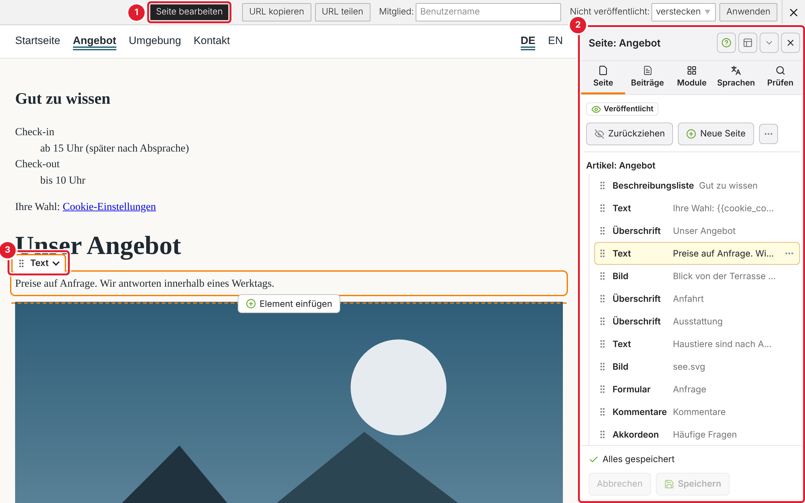

# Erste Schritte

**Stufe:** Basic.

Der Editor funktioniert nur in Contaos **Vorschau**. Die Website, die Besucher
sehen, ändert sich während der Arbeit nicht; Änderungen erscheinen dort, sobald
sie gespeichert sind.

## Den Editor öffnen

**Voraussetzung:** Sie können sich im Backend anmelden, und Ihre Benutzergruppe hat
**Frontend-Bearbeitung erlaubt** (beim Administrator nachfragen).

1. Im Backend anmelden.
2. Oben im Backend auf **Frontend Editor** klicken (neben **Vorschau**). Es
   öffnet die Vorschau mit eingeschaltetem Editor, und zwar die Seite, die das
   Backend gerade zeigt, sonst die Startseite. Auf einem Handy oder in einem
   schmalen Fenster steht dort nur das Symbol: ein Bildschirm mit Stift.

Der andere Weg: die Vorschau öffnen (**Vorschau** oben im Backend oder das
Vorschau-Symbol neben einer Seite im Seitenbaum) und in Contaos Vorschauleiste
auf **Seite bearbeiten** klicken.

**Ergebnis:** Die Editoransicht öffnet sich. Contaos Vorschauleiste bleibt oben,
die Seitenleiste steht rechts, und die Seite wird daneben gezeigt, um die Breite
der Seitenleiste schmäler (oder die Seitenleiste liegt über der Seite, siehe
unten). Ein Element der
Seite anklicken: Es bekommt einen Rahmen mit einem Reiter, der seinen Typ nennt und sein Menü öffnet.

1. **Seite bearbeiten** schaltet den Editor ein und aus.
2. Die **Seitenleiste** zeigt die Artikel und Elemente der Seite in ihrer
   Reihenfolge. Ausgeblendete Elemente sind mit *ausgeblendet* markiert.
3. Der **Rahmen** eines Elements hat einen Reiter mit seinem Typ. Ein Klick auf
   den Reiter öffnet das Menü des Elements: **Bearbeiten**, **Alle Felder**,
   **Duplizieren**, **Ausblenden**, **Nach oben**, **Nach unten**, **Löschen**
   und mehr (siehe [Bearbeiten](editing.md#das-menü-eines-elements)); Einträge,
   die Ihre Rechte nicht erlauben, stehen ausgegraut mit dem Grund da. Am Griff
   im Reiter ziehen Sie das Element. Der Reiter steht auf der Linie des Rahmens,
   über dem Element; wo darüber kein Platz ist, rollt die Seite gerade so weit
   (Einzelheiten unter [Bearbeiten](editing.md#das-menü-eines-elements)).

## Ein Element finden

- Ein Element in der Seitenleiste anklicken: Es wird auf der Seite
  hervorgehoben und in den sichtbaren Bereich gerollt.
- Oder das Element auf der Seite anklicken oder es mit der Tab-Taste erreichen.
  Fährt die Maus über die Seite, wird das Element darunter nur umrandet; das
  gewählte Element bleibt gewählt, auch auf dem Weg zu seinem Reiter.
- Ein Klick auf einen Link oder Knopf der Seite führt nicht weg: Der erste Klick
  wählt das Element, ein weiterer bearbeitet den Text des Links oder Knopfs, wo
  das geht; sonst sagt ein kurzer Hinweis, wie Sie dem Link folgen.
- Zu einer anderen Seite: **Strg-Klick** (Mac: **⌘-Klick**) auf einen Link, oder
  **Link öffnen** im Kontextmenü (Rechtsklick). Die Seitenleiste zeigt dann die
  Struktur der neuen Seite. Ein Link auf eine andere Website verlässt den Editor.

**Kurzanleitung:** Der Knopf mit dem Fragezeichen im Kopf der Seitenleiste
erklärt in einem Fenster, wie Sie auswählen, bearbeiten, Links folgen, das Menü
eines Elements öffnen und mit der Tastatur arbeiten, auf einer Seite mit
Sprachversionen (Plus) auch, wie Sie ein Element übersetzen. Beim ersten Öffnen des
Editors in einem Browser weist ein Hinweis darauf hin.

## Die Seitenleiste

- Der Streifen am rechten Rand hat zwei Knöpfe. Der obere (Pfeil) klappt die
  Seitenleiste ein und wieder aus; eingeklappt zeigt eine Leiste unter der
  Seite den Stand mit **Abbrechen** und **Speichern**.
- Die Nadel darunter legt fest, wo die Seitenleiste steht:
  - **Angeheftet** (Voreinstellung): neben der Seite. Die Seite wird um ihre
    Breite schmäler; nichts vom Editor verdeckt sie. Der Browser merkt sich, ob
    sie eingeklappt ist.
  - **Gelöst:** über der Seite. Die Seite behält ihre ganze Breite. Die
    Seitenleiste ist zu Beginn eingeklappt, öffnet sich von selbst, wenn eine
    Ansicht sie braucht (**Alle Felder**, **Sprachen**, **Beiträge** …), und
    klappt wieder ein, wenn diese Ansicht verlassen wird. Ein Klick in die Seite
    klappt sie ebenfalls ein, außer sie zeigt ein Formular, die Schreibhilfe
    oder die Sprachen.

  Der Browser merkt sich die Wahl.
- Ihre Breite lässt sich ändern: am Griff am linken Rand ziehen, oder den Rand
  fokussieren und die Pfeiltasten nutzen. Der Browser merkt sich die Breite.
- Über der Struktur steht Contaos Brotkrumen-Navigation des gewählten
  Elements: **Alle Seiten** › Seite › Artikel › Element. Ein Klick geht auf
  diese Ebene hinauf; **Alle Seiten** öffnet Contaos Seitenbaum, in dem neue
  Seiten angelegt werden (Plus).
- Mit Plus und Pro hat der Kopf der Seitenleiste Ansichten: **Seite**,
  **Beiträge**, **Module**, **Sprachen**, **Prüfen** (nur die, die Sie nutzen
  dürfen).
- Unten: **Alles gespeichert** oder **Ungespeicherte Änderungen**, mit
  **Abbrechen** und **Speichern**.

Auf einem Handy oder in einem schmalen Fenster steht die Seite oben und die
Seitenleiste als Blatt darunter (ohne den Streifen; der Pfeil in ihrem Kopf
klappt sie ein); der Reiter eines Elements und sein Menü
funktionieren genauso, mit größeren Knöpfen.

Eine Reihe von Knöpfen bleibt immer einzeilig: Wo nicht alle Knöpfe Platz haben
(am Handy, in einer schmalen Seitenleiste, bei den Werkzeugen eines Textes in
einer schmalen Spalte), stehen die letzten hinter **…** am Ende der Reihe;
**Speichern** bleibt immer in der Reihe.
Contaos Vorschauleiste wird dort beim Start des Editors einmal je
Browsersitzung geschlossen; ihr Knopf oben rechts öffnet sie wieder.

## Beenden

In der Vorschauleiste erneut auf **Seite bearbeiten** klicken oder auf
**Bearbeiten beenden** (×) im Kopf der Seitenleiste. Ist noch etwas nicht
gespeichert, fragt der Editor vorher nach.

## Häufige Probleme

| Anzeichen | Lösung |
| --- | --- |
| Oben im Backend gibt es kein **Frontend Editor** und in der Vorschauleiste kein **Seite bearbeiten** | Ihrer Benutzergruppe fehlt **Frontend-Bearbeitung erlaubt**; beim Administrator nachfragen. |
| **Seite bearbeiten** ist da, aber die Einträge im Menü eines Elements sind ausgegraut | Sie dürfen dieses Element nicht ändern (Typ oder Rechte); der Eintrag nennt den Grund. Beim Administrator nachfragen. Siehe [Rechte](../permissions.md). |
| Die Seitenleiste ist leer oder zeigt einen Fehler | Die Seite liegt außerhalb Ihrer Seiten (Pagemounts), oder die Verbindung ist abgerissen. Die Seite neu laden. |
| Auf der normalen Website ist der Editor nicht zu sehen | So vorgesehen: Der Editor erscheint nur in der Vorschau. |
