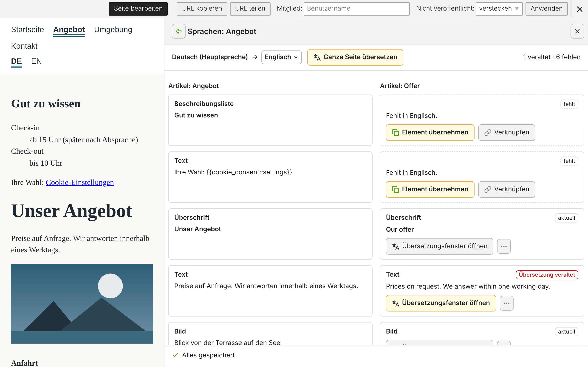

# Sprachen

**Stufe:** Plus. **Braucht:** den Schalter **Sprachversionen bearbeiten
(Plus)**; für Vorschläge außerdem **Übersetzung anfordern (Plus)**. Die Seiten
der Sprachen müssen verknüpft sein (Erweiterung changelanguage; siehe
[Mehrere Websites und Sprachen](../websites-and-languages.md)).

## Die Seite nebeneinander

**Am Element:** Der Reiter eines gewählten Elements zeigt seine Sprachversionen.
Ein Übersetzungssymbol heißt: In jeder Sprache gibt es eine aktuelle Fassung
(auf einer Sprachversion: diese Fassung ist aktuell). **Übersetzung veraltet**,
**nicht in allen Sprachen** oder **nicht verknüpft** nennen, was fehlt; das
Kontextmenü öffnet das Übersetzungsfenster.

1. Im Kopf der Seitenleiste auf **Sprachen** klicken.
2. Die Sprachversion wählen. Die Seitenleiste wird breiter und zeigt die Seite in
   der Hauptsprache neben der Sprachversion, Element für Element.

Jedes Paar hat einen Stand:

- **aktuell**: Die Übersetzung passt zur Hauptsprache, wie sie jetzt ist,
- **Übersetzung veraltet**: Das Element in der Hauptsprache wurde nach der
  Übersetzung geändert,
- **fehlt**: Das Element gibt es nur in der Hauptsprache,
- **nicht verknüpft**: Das Element gibt es nur in der Sprachversion, oder die
  Elemente sind noch nicht verbunden.

Jedes Element der Sprachversion zeigt, was es sagt und wie viele seiner Texte
noch nicht übersetzt sind. **Übersetzungsfenster öffnen** öffnet das Fenster
des Elements (unten).

Elemente in einem anderen Element (zum Beispiel die Abschnitte eines Akkordeons
oder die Elemente einer Elementgruppe) folgen diesem Element, je Ebene einen
Schritt eingerückt, und werden genauso verglichen: mit den Elementen in seinem
Gegenstück in der Sprachversion. Auf der Seite eines Beitrags (einer Nachricht,
eines Events und gleich gebauter Beiträge anderer Erweiterungen) folgen die
Elemente des Beitrags nach den Artikeln als eigene Gruppe, neben den Elementen
seines Beitrags in der Sprachversion (siehe „Beiträge“ unten).

Die Ansicht vergleicht immer die Hauptsprache mit einer Sprachversion, und
**Ganze Seite übersetzen** füllt immer eine Sprachversion aus der Hauptsprache:
Der Stand (*aktuell*, *veraltet*) bemisst sich an der Hauptsprache, und eine
ganze Seite aus einer Sprachversion würde die Texte der Hauptsprache
überschreiben. Für die umgekehrte Richtung oder zwischen zwei Sprachversionen
öffnen Sie das Übersetzungsfenster des Elements und wählen dort die Sprachen.

## Ein Element übersetzen

Ein Element auf der Seite mit der rechten Maustaste anklicken (oder **…** in der
Struktur, die Kontextmenü-Taste oder langes Drücken) und **Übersetzungsfenster
öffnen** wählen; im Formular **Alle Felder** des Elements tut der Knopf
**Übersetzungsfenster öffnen** dasselbe. Das geht auf der Seite der Hauptsprache
und auf der Seite einer Sprachversion, für die Elemente der Seite, die Elemente
in anderen Elementen und die Elemente von Beiträgen gleichermaßen.

Das Fenster zeigt jeden Text des Elements, egal wer das Feld angelegt hat
(Contao, die Website oder eine andere Erweiterung):

- Textfelder, Textbereiche und formatierten Text,
- jede Zeile einer Liste und jede Zelle einer Tabelle,
- die Einträge des Elements (zum Beispiel die Karten einer Kartenliste), je
  Eintrag eine Gruppe,
- die Texte seiner Bilder: Titel, Alternativtext und Bildunterschrift aus der
  Dateiverwaltung in der Sprache der Sprachversion (ein Bild mit eigenen Texten
  im Element behält sie im Element),
- Code-Felder: HTML wird übersetzt, seine Tags bleiben; anderer Code (CSS,
  JavaScript …) wird gezeigt und lässt sich ändern, bekommt aber keinen
  maschinellen Vorschlag.

Nicht im Fenster: Auswahlen, Ankreuzfelder, Links, Datumsangaben, CSS-ID und
Klassen.

Oben wählen Sie die Richtung: **Übersetzen aus** und **Übersetzen in**, zwei
beliebige Sprachen der Seite. Links steht die Sprache, aus der übersetzt wird,
rechts die, in die übersetzt wird. Zunächst übersetzt das Fenster aus der
Sprache der Seite, auf der Sie sind: auf einer Sprachversion in die
Hauptsprache, auf der Seite der Hauptsprache in die Sprachversion, in die Sie
zuletzt übersetzt haben (sonst in die erste).

- **Sprachen tauschen** (⇄, zwischen beiden) dreht die Richtung um. Dasselbe
  geschieht, wenn Sie unter **Übersetzen aus** die Sprache wählen, in die
  übersetzt wird.
- Unter **Übersetzen aus** stehen nur Sprachen, in denen es das Element gibt.
  Fehlt das Element in der Sprache, in die übersetzt wird, kopiert **Element
  übernehmen** es dorthin (unten).

Jeder Text lässt sich direkt ändern. Mit einem Übersetzungsdienst:

- **Alle Felder übersetzen** (oben): Vorschläge für jeden Text, den Sie ändern
  dürfen, in einem Zug,
- **Dieses Feld übersetzen** (der Knopf neben einem Text): ein Vorschlag nur für
  diesen Text.

Bis die Vorschläge da sind, liegt über den Texten des Fensters eine
Ladeanzeige mit Ladekreis und **Wird übersetzt …** (bei **Dieses Feld
übersetzen** nur über diesem Text), der Knopf zeigt einen Ladekreis, und im
Fenster lässt sich nichts eintippen oder auswählen. Dasselbe gilt, während das
Fenster lädt (**Wird geladen …**) oder speichert (**Wird gespeichert …**);
**Abbrechen** und der Knopf zum Schließen bleiben bedienbar und schließen das
Fenster ohne Rückfrage.

Vorschläge sind gekennzeichnet: „Vorschlag (Dienst) – bitte prüfen“.
**Speichern** speichert, was sich geändert hat, in die Sprache rechts und
setzt den Stand:

- aus der Hauptsprache in eine Sprachversion: Die Sprachversion ist
  **aktuell**,
- aus einer Sprachversion in die Hauptsprache: Die Hauptsprache hat sich
  geändert, ihre anderen Sprachversionen sind daher **veraltet**; die
  Sprachversion, aus der übersetzt wurde, ist **aktuell**,
- aus einer Sprachversion in eine andere: Die Sprachversion, in die übersetzt
  wurde, bekommt den Stand der Sprachversion, aus der übersetzt wurde
  (**aktuell**, wenn diese aktuell ist, **veraltet**, wenn sie veraltet ist).
  Bezugspunkt bleibt das Element der Hauptsprache.

Aktuell ist eine Übersetzung erst, wenn jeder Text gespeichert wurde.
**Abbrechen**, das Schließen-Symbol oder Esc schließt das Fenster.

Sind Texte geändert, aber nicht gespeichert, fragt das Fenster nach, bevor eine
andere Sprache gewählt oder das Fenster geschlossen wird: **Speichern** speichert
sie und macht weiter, **Verwerfen** verwirft sie, **Abbrechen** bleibt im
Fenster.

Ein Text, den Sie nicht ändern dürfen, erscheint grau mit dem Grund: kein Recht
für das Feld, oder den Eintrag gibt es in der Sprachversion noch nicht (zuerst im
Element anlegen). Fehlt das Element in der Sprachversion, kopiert **Element
übernehmen** es dorthin.

Bildtexte gehören zur Datei: Sie gelten überall, wo das Bild in dieser Sprache
gezeigt wird. Um sie zu ändern, braucht es das Recht, in der Dateiverwaltung
Dateien zu bearbeiten.

## Die ganze Seite übersetzen

In der Ansicht **Sprachen** macht **Ganze Seite übersetzen** Vorschläge für

- jedes veraltete Element: alle seine Texte,
- jedes Element mit noch nicht übersetzten Texten: nur diese Texte.

Gibt es nichts zu übersetzen, sagt das stattdessen ein Hinweis: „Nichts zu
übersetzen: alle Elemente in (Sprache) sind aktuell.“ Fehlen in der
Sprachversion Elemente, sagt der Hinweis, dass sie zuerst übernommen werden
müssen (**Element übernehmen**); Elemente, die es nur in der Sprachversion gibt,
nennt der Hinweis mit Namen. Fehlt Ihnen das Recht, die veralteten Elemente zu
ändern, sagt der Hinweis, dass die Berechtigung fehlt. Bekommt keines der
Elemente einen Vorschlag, sagt das ein Hinweis: Die Texte, die noch eine
Übersetzung brauchen, lassen sich nicht maschinell übersetzen (zum Beispiel
CSS- oder JavaScript-Code), oder Sie können sie hier nicht ändern;
**Übersetzungsfenster öffnen** zeigt bei jedem Text den Grund.

Solange es läuft, liegt über dem Vergleich eine Ladeanzeige mit Ladekreis, die
sagt, wie weit es ist (**Element 2 von 5 wird übersetzt …**, auch in der
Leiste); die Karte, die gerade übersetzt wird, ist markiert, und Karten und
Knöpfe sind gesperrt, bis es fertig ist. Die Vorschläge jedes Elements
erscheinen in seiner Karte.

Gespeichert ist noch nichts. Jedes Element zeigt, wie viele Vorschläge es hat:
**Übernehmen und speichern** speichert sie, wie sie sind, **Prüfen** öffnet sie
im Fenster, **Verwerfen** verwirft sie. **Alle Vorschläge übernehmen** speichert
alle. Nach noch nicht gespeicherten Vorschlägen fragt die Ansicht, bevor eine
andere Sprache gewählt, die Ansicht verlassen oder auf dieser Seite ein Element
übernommen wird (**Speichern**, **Verwerfen**, **Abbrechen**).

Links und andere Insert-Tags bleiben, wie sie sind. Welcher Dienst übersetzt,
wird in den Einstellungen des Editors gewählt (Azure Translator, DeepL oder ein
KI-Modell).

## Veraltete Übersetzungen

Ändert sich ein Text eines Elements in der Hauptsprache (ein Feld, ein Eintrag
oder die Texte seiner Bilder in der Hauptsprache; im Editor oder im Backend),
gelten seine Übersetzungen als veraltet. Das ist zu sehen:

- am Element und in der Seitenleiste der Sprachversion (*veraltet*),
- in Contaos Liste der Inhaltselemente (ein Symbol),
- in der Backend-Liste **Übersetzungen**, mit Filter.

Bei einer veralteten Übersetzung ist **Übersetzungsfenster öffnen** der
hervorgehobene Knopf. Stimmt die Übersetzung noch, bestätigt **…** › **Als
aktuell markieren** sie.

## Übernehmen und verknüpfen

- **Element übernehmen**: Ein Element, das in der Sprachversion fehlt, wird
  dorthin kopiert und verknüpft, gleich mit einem Übersetzungsvorschlag. Es
  kommt in den passenden Behälter der Sprachversion: den Artikel, das Element,
  in dem es steht (zum Beispiel das Akkordeon), oder den Beitrag. Ein Element,
  das Elemente enthält, nimmt sie mit; jedes davon wird verknüpft und ist noch
  zu übersetzen. Fehlt der Behälter selbst in der Sprachversion, sagt das
  Element das: Übernehmen Sie zuerst den Behälter.
- **In (Hauptsprache) übernehmen**: der umgekehrte Weg, für ein Element, das es
  nur in der Sprachversion gibt, etwa weil es dort zuerst geschrieben wurde. Es
  wird in die Seite der Hauptsprache kopiert, an die passende Stelle des
  Artikels, der zu seinem Artikel gehört (nach dem Gegenstück des nächsten
  Elements davor, sonst ganz oben), und verknüpft; das Element der
  Sprachversion gilt als **aktuell**. Das Übersetzungsfenster öffnet sich
  gleich, von der Sprachversion in die Hauptsprache (zum Beispiel „Englisch →
  Deutsch (Hauptsprache)“), mit Vorschlägen, wo ein Übersetzungsdienst
  eingerichtet ist. **Speichern** schreibt die Übersetzung in das Element der
  Hauptsprache; das Element der Sprachversion bleibt aktuell. Bis dahin zeigt
  die Kopie in der Hauptsprache die Texte der Sprachversion. Elemente in einem
  anderen Element und Elemente von Beiträgen kommen in das passende Element
  oder den passenden Beitrag der Hauptsprache, und die Elemente im übernommenen
  Element kommen mit, jedes verknüpft und aktuell. Wo die Übernahme nicht geht,
  sagt das Element stattdessen, warum: Der Artikel, das Element, in dem es
  steht, oder der Beitrag fehlt in der Hauptsprache, oder Ihnen fehlt die
  Berechtigung (siehe [Rechte](../permissions.md)).
- **Verknüpfen**: verbindet zwei vorhandene Elemente; **…** › **Verknüpfung
  lösen** trennt sie.

Sprachversionen von vor dem Editor: Beim ersten Vergleich einer Seite verknüpft
der Editor die Elemente jedes Artikels, die noch zu keinem gehören, wo sie in
derselben Reihenfolge mit demselben Typ stehen (ein Element, das nur eine Seite
hat, verschiebt den Rest nicht). Die Elemente in zwei verknüpften Elementen
(etwa einem Akkordeon und seinem Gegenstück) und die Elemente eines Beitrags und
seines Beitrags in der Sprachversion verknüpft er genauso, Ebene für Ebene. Eine
solche Verknüpfung gilt als aktuell; eine spätere Änderung in der Hauptsprache
macht sie veraltet. Das geschieht einmal je Artikel, Element oder Beitrag: Eine
Verknüpfung, die Sie lösen, entsteht nicht neu, und später hinzugekommene
Elemente werden übernommen oder von Hand verknüpft.

## Beiträge

Die Elemente einer Nachricht, eines Events oder eines gleich gebauten Beitrags
einer anderen Erweiterung haben Sprachversionen, wenn die Beiträge der Sprachen
mit changelanguage verknüpft sind: Das Archiv der Sprachversion nennt das Archiv
der Hauptsprache, und jeder Beitrag der Sprachversion nennt seinen Beitrag der
Hauptsprache (Feld **Hauptbeitrag** von changelanguage, siehe
[Mehrere Websites und Sprachen](../websites-and-languages.md)). Die Seiten, die
die Beiträge zeigen (die Leserseiten der Archive), sind verknüpft wie jede
Seite.

Auf einer solchen Seite zeigt die Ansicht **Sprachen** den Beitrag nach den
Artikeln, seine Elemente neben denen des verknüpften Beitrags; das
Übersetzungsfenster, **Element übernehmen**, **In (Hauptsprache) übernehmen**,
der Stand und **Ganze Seite übersetzen** funktionieren wie bei den Elementen der
Seite. Ein Beitrag ohne Verknüpfung zeigt den Hinweis, dass es ihn in der
anderen Sprache nicht gibt oder er nicht verknüpft ist.

## Beiträge, Archive, Seiteneinstellungen und Datensätze

Neben den Elementen übersetzt der Editor die Texte ganzer Datensätze: Titel,
Teaser und Meta-Felder eines Beitrags, die Einstellungen einer Seite (Titel,
Seitentitel, Beschreibung), den Titel eines Archivs, die Texte eines
Frontend-Moduls und die Datensätze anderer Backend-Module. Das Fenster ist
dasselbe wie bei einem Element, mit Typ und Titel des Datensatzes im Kopf.

| Was | Wo | Fassung |
| --- | --- | --- |
| Seiteneinstellungen (Titel, Seitentitel, Beschreibung) | Ansicht **Sprachen**: **Seite: Titel und Beschreibung** | Plus |
| Ein Beitrag (Nachricht, Event, FAQ) | Ansicht **Beiträge**: Menü des Beitrags → **Übersetzen**; auf der Seite eines Beitrags: **Übersetzen** in seinem Kopf | Plus |
| Ein Archiv (Nachrichtenarchiv, Kalender, FAQ-Kategorie) | Ansicht **Beiträge**: **Sprachversionen dieses Archivs** | Plus |
| Ein Frontend-Modul von Contao (Navigation, Nachrichtenliste …) | Sein Menü auf der Seite → **Übersetzen** | Plus |
| Ein Frontend-Modul einer Erweiterung oder der Website | Sein Menü auf der Seite → **Übersetzen** | Pro |
| Ein Datensatz eines Backend-Moduls einer Erweiterung oder der Website (ein Katalog, Angebote …) | Ansicht **Module**: Liste des Moduls → Icon **Übersetzen** beim Datensatz | Pro |

**Verknüpfen.** Hat ein Datensatz noch keine Fassung in der anderen Sprache,
sagt das Fenster das und bietet zwei Wege:

- **Vorhandenen Eintrag in (Sprache) verknüpfen**, dann **Verknüpfen**: Die
  Liste zeigt die Datensätze dieser Sprache; der an derselben Stelle seiner
  Liste ist mit **(Vorschlag)** markiert. Beiträge werden mit dem Feld
  **Hauptbeitrag** von changelanguage verknüpft, Archive mit dessen Feld
  **Hauptarchiv**; Datensätze, die Contao nicht verknüpft (Frontend-Module,
  Datensätze von Erweiterungen), verknüpft der Editor selbst. Werden zwei
  Archive verknüpft, verknüpft er auch ihre Beiträge der Reihe nach, wenn beide
  gleich viele haben und in der Fassung noch keiner verknüpft ist.
- **Als Kopie in (Sprache) anlegen**: eine Kopie, die Contao anlegt, sofort
  verknüpft. Ein Beitrag kommt in das verknüpfte Archiv dieser Sprache, nicht
  veröffentlicht, mit denselben Daten und demselben Autor; seine Adresse
  entsteht aus dem übersetzten Titel, wenn Sie die Übersetzung speichern. Dafür
  muss zuerst sein Archiv verknüpft sein (**Archiv verknüpfen** im Fenster).

Wird das Fenster auf einem Datensatz einer Sprachversion geöffnet, der noch
keinen Datensatz in der Hauptsprache hat (zuerst auf der englischen Seite
geschrieben, zum Beispiel), übersetzt es aus dieser Sprache in die Hauptsprache:
Es bietet die Datensätze der Hauptsprache an, die noch keine Fassung haben, und
der gewählte wird zum Hauptdatensatz; **Als Kopie anlegen** legt den Datensatz
der Hauptsprache an. Der Datensatz der Hauptsprache bleibt immer der
Hauptdatensatz.

Die Sprache eines Datensatzes kommt von seiner Seite (eine Seite; ein Beitrag
von der Leserseite seines Archivs), von den Seiten, deren Elemente ihn zeigen
(ein Archiv), aus seinem eigenen Feld **Sprache** oder aus seiner Verknüpfung.

**Neue Beiträge in allen Sprachen.** Schreiben Sie in **Beiträge** einen neuen
Beitrag und speichern ihn zum ersten Mal, legt der Editor seine Fassungen in
jeder Sprache an, deren Archiv mit dem Archiv des Beitrags verknüpft ist:
Kopien, nicht veröffentlicht, verknüpft; eine Meldung nennt sie. Ein Beitrag,
der zuerst in einer Sprachversion entsteht (etwa auf der englischen Seite),
bekommt auch seinen Datensatz in der Hauptsprache. Übersetzen Sie sie mit
**Übersetzen** und veröffentlichen Sie sie, wenn sie fertig sind.

**Module der Website (Pro).** Mit Pro zeigt die Ansicht **Module** auch die
Backend-Module der Website und anderer Erweiterungen (nicht die von Contao
selbst). In ihren Listen steht vor **Bearbeiten** bei jedem Datensatz, der für
sich übersetzt wird, das Icon **Übersetzen**.

## Häufige Probleme

| Anzeichen | Ursache | Lösung |
| --- | --- | --- |
| Kein Knopf **Sprachen** | Die Seite hat keine verknüpften Sprachversionen, oder Ihnen fehlt der Schalter | Die Seiten verknüpfen (Administrator); siehe [Rechte](../permissions.md). |
| „Für Übersetzungen fehlt ein Übersetzungsdienst …“ | Kein Übersetzungsdienst eingerichtet oder gewählt | Administrator: unter *Zugänge und Lizenzen* einen einrichten und in den Einstellungen des Editors wählen. |
| „… hat die Übersetzung abgelehnt“ (mit dem Namen des Dienstes) | Schlüssel, Region oder Modell falsch, oder die Zeichen des Tarifs sind aufgebraucht | Administrator: **Verbindung prüfen** im Abschnitt des Dienstes. |
| Alle Elemente der Version stehen als **fehlt** da, obwohl es sie gibt | Die Elemente stehen in anderer Reihenfolge oder haben andere Typen und wurden deshalb nicht von selbst verknüpft | Mit **Verknüpfen** verbinden; ein Element der Version ohne Gegenstück steht am Ende seines Artikels. |
| Eine Sprachversion wird nicht angeboten | Sie haben keinen Zugriff auf die Seiten dieser Sprache | Beim Administrator nachfragen. |
| Ein Text im Übersetzungsfenster ist grau | Sie dürfen das Feld nicht ändern, oder den Eintrag gibt es nur in der Hauptsprache | Beim Administrator nach dem Feld fragen; den Eintrag in der Sprachversion im Element anlegen. |
| Bildtexte sind grau | Sie dürfen in der Dateiverwaltung keine Dateien bearbeiten, oder die Datei liegt außerhalb Ihrer Dateifreigaben | Beim Administrator nachfragen. |
| „Zu diesem Element gibt es kein Gegenstück in der Hauptsprache“ | Das Element der Sprachversion ist nicht verknüpft | In der Ansicht **Sprachen** **verknüpfen** oder mit **In (Hauptsprache) übernehmen** übernehmen. |
| „Der Artikel fehlt in (Hauptsprache).“ an einem Element der Sprachversion | Sein Artikel gehört zu keinem Artikel der Seite in der Hauptsprache | Den Artikel auf der Seite der Hauptsprache anlegen (oder die Artikel mit changelanguage verknüpfen), dann das Element übernehmen. |
| „Das Element, in dem es steht, fehlt in (Sprache).“ | Das Element steht in einem Element (einem Akkordeon, einer Elementgruppe …), das in dieser Sprache kein Gegenstück hat | Zuerst dieses Element übernehmen oder verknüpfen. |
| „Den Beitrag gibt es in (Sprache) nicht, oder er ist nicht …“ | Der Beitrag hat in dieser Sprache keinen Beitrag, oder die Beiträge sind nicht mit changelanguage verknüpft | Den Beitrag in dieser Sprache anlegen und seinen **Hauptbeitrag** setzen (Archiv und Beitrag, siehe [Mehrere Websites und Sprachen](../websites-and-languages.md)). |
| „Ihnen fehlt die Berechtigung, dieses Element in (Hauptsprache) zu übernehmen.“ | Der Schalter **Elemente anlegen, verschieben und löschen** fehlt, oder Contaos Recht, das Element im Artikel der Hauptsprache anzulegen | Beim Administrator nachfragen; siehe [Rechte](../permissions.md). |
| „Das Archiv dieses Beitrags hat noch keine Sprachversion in (Sprache) …“ | Das Archiv des Beitrags hat in dieser Sprache kein verknüpftes Archiv | **Archiv verknüpfen** und die Archive verknüpfen (oder im Archiv der Fassung das **Hauptarchiv** setzen). |
| Ein Modul der Website fehlt in der Ansicht **Module** | Dafür braucht es Pro, oder Ihre Benutzergruppe darf das Modul nicht öffnen | Pro-Lizenz eintragen; das Modul bei Ihrer Administration erfragen (**Backend-Module**). |
| „Einträge von Erweiterungen und eigenen Modulen übersetzen Sie mit Pro.“ | Der Datensatz gehört zu einer Erweiterung oder zur Website | Pro-Lizenz eintragen. |
