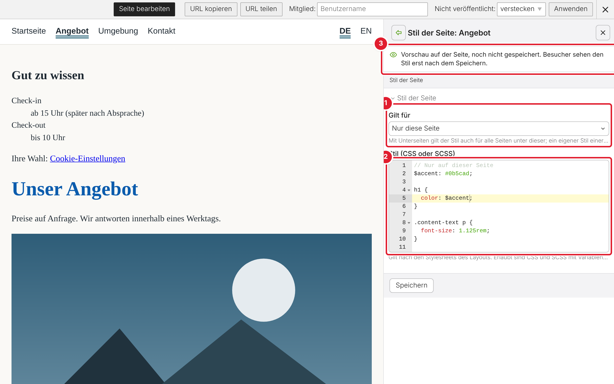

# Stil der Seite

**Stufe:** Pro. **Braucht:** den Schalter **Stil der Seiten bearbeiten (Pro)**,
das Backend-Modul **Stile der Seiten** und *Seite bearbeiten* für die Seite.
Gedacht für Webdesigner: Ein Fehler im Stil kann die Seite für Besucher
verstellen.

## Einen Stil schreiben

1. **Mehr zur Seite** (…) → **Stil der Seite (CSS)**.
2. Contaos Formular öffnet sich in der breiten Seitenleiste. Wählen, wofür der
   Stil gilt: **Nur diese Seite** oder **Diese Seite und ihre Unterseiten**.
3. CSS oder SCSS (Variablen, Verschachtelung, `@media`) im Code-Editor
   schreiben.
4. Eine halbe Sekunde nach dem letzten Tastendruck zeigt die Seite den Stil, nur
   Ihnen. Die Zeile über dem Formular sagt, ob der Stil eine Vorschau,
   gespeichert oder fehlerhaft ist.
5. Auf **Speichern** klicken. Besucher sehen den neuen Stil.

Die Leiste der Seite zeigt **Eigener Stil** oder **Stil von „{Seite}“**, wenn der
Stil von einer übergeordneten Seite kommt.

## Fehler

Ein Fehler nennt die Zeile in Worten, zum Beispiel *Hier fehlt ein Strichpunkt
„;“.* Die Seite behält den zuletzt gültigen Stil; gespeichert wird nur ohne
Fehler.

Nicht erlaubt:

- andere Dateien (`@import`, `@use`),
- Adressen anderer Websites (sie würden Daten der Besucher an fremde Server
  schicken); Schriften und Bilder von der Website selbst laden,
- mehr als 32 KB CSS je Seite.

## Wohin der Stil kommt

Besucher bekommen das fertige CSS am Ende des Seitenkopfs, nach allen
Stylesheets des Layouts. Gleiche Selektoren gewinnen deshalb; ein genauerer
Selektor im Layout gewinnt trotzdem, wie in jedem CSS. Seiten ohne Stil bleiben
unverändert.

Im Backend listet **Stile der Seiten** alle Stile, die Sie bearbeiten dürfen.

**Ohne Pro:** Endet die Pro-Lizenz, bleiben die gespeicherten Stile wirksam,
die Seiten sehen gleich aus. Nur das Werkzeug fällt weg: Ändern oder löschen
lassen sich die Stile erst wieder mit Pro.

## Häufige Probleme

| Anzeichen | Ursache | Lösung |
| --- | --- | --- |
| Kein **Stil der Seite (CSS)** im Menü | Schalter, Backend-Modul oder *Seite bearbeiten* fehlen; mit Plus trägt der Eintrag „Pro“ | Beim Administrator nachfragen. |
| Der Stil wirkt nicht | Ein genauerer Selektor des Layouts gewinnt | Einen genaueren Selektor verwenden. |
| „Adressen anderer Websites sind nicht erlaubt“ | Der Stil lädt etwas von einem anderen Server | Die Datei auf die Website hochladen und ihre Adresse verwenden. |
