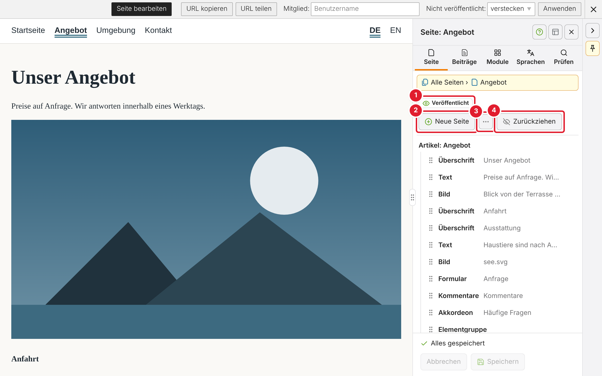
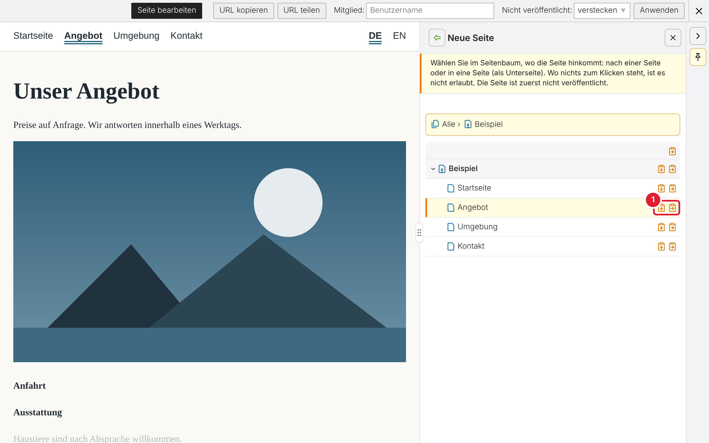
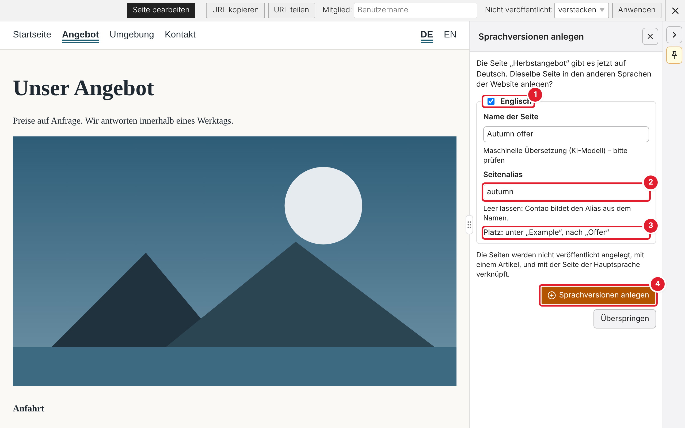

# Seiten

**Stufe:** Plus. **Braucht:** den Schalter **Seiten anlegen und veröffentlichen
(Plus)**.

Über der Struktur in der Seitenleiste (Ansicht **Seite**) stehen der Zustand der
Seite und ihre Aktionen.

## Zustand, veröffentlichen, zurückziehen

Der Zustand ist einer von **Veröffentlicht**, **Nicht veröffentlicht**, **Ab
{Datum}** (ab einem späteren Datum veröffentlicht) oder **Abgelaufen**.

- **Veröffentlichen** stellt die Seite online. Sie erscheint in der Navigation an
  der Stelle, die ihr Platz im Seitenbaum ergibt.
- **Zurückziehen** nimmt sie nach einer Rückfrage offline; Besucher können sie
  nicht mehr erreichen. Hat die Seite Unterseiten, sagt die Rückfrage, dass auch
  diese nicht mehr erreichbar sind.

## Seiteneinstellungen

**Mehr zur Seite** (…) → **Seiteneinstellungen** öffnet Contaos Formular der
Seite, beschränkt auf: Seitenname, Alias (die Adresse), Seitentitel,
Beschreibung und den Anzeigezeitraum. Mit Pro außerdem **Robots-Tag** und
Contaos **Google Suchergebnis-Vorschau**. Navigation, Layout, Cache und
Zugriffsschutz bleiben im Backend.

## Eine neue Seite anlegen

1. Auf **Neue Seite** klicken.
2. Contaos Seitenbaum öffnet sich in der Seitenleiste, bei der aktuellen Seite.
   Er zeigt nur diese Website und Sprache. Neben jeder Seite stehen die Knöpfe
   „Nach der Seite einfügen“ und „In die Seite einfügen“, wo Sie eine Seite
   anlegen dürfen.
3. Auf „Nach der Seite einfügen“ klicken (die neue Seite kommt nach dieser Seite)
   oder auf „In die Seite einfügen“ (die neue Seite wird eine Unterseite).
4. Den Namen der Seite eintragen und nach Wunsch den **Seitenalias**: die
   Adresse, zum Beispiel `index` für eine Seite „Startseite“. Bleibt er leer,
   bildet Contao ihn aus dem Namen. Wenn Sie wählen dürfen, auch den Seitentyp.
5. Auf **Speichern** klicken.

**Ergebnis:** Die neue Seite wird **nicht veröffentlicht** angelegt, mit einem
Artikel, und öffnet sich in der Vorschau. Inhalte hinzufügen, dann
**Veröffentlichen**. Auf einer Website mit mehreren Sprachen kommt vorher der
Schritt **Sprachversionen anlegen** (nächster Abschnitt).

Werden der Baum oder das Formular ohne Speichern geschlossen, wird nichts
angelegt.

## Sprachversionen gleich mit anlegen

Jede Sprachversion ist eine eigene Seite im Seitenbaum ihrer Sprache;
changelanguage verknüpft sie mit der Seite in der **Hauptsprache** (der Sprache
des Startpunkts mit **Sprachen-Fallback**).

**Die Hauptsprache wird automatisch angelegt.** Die Seite in der Hauptsprache
wird immer gebraucht. Wird eine neue Seite in einer anderen Sprache
gespeichert, legt der Editor ihre Sprachversion in der Hauptsprache sofort an,
ohne Klick: am selben Platz in deren Seitenbaum, mit dem vom Übersetzungsdienst
der Einstellungen übersetzten Namen (wenn einer eingerichtet ist und Sie
Übersetzungen anfordern dürfen; sonst mit demselben Namen), mit einem Alias, den Contao aus dem Namen bildet,
nicht veröffentlicht, mit Artikel und verknüpft. Ein Hinweis nennt die Seite,
zum Beispiel *Die Seite in der Hauptsprache (Deutsch) wurde gleich mit angelegt
und verknüpft: Herbstangebot (herbstangebot).* Name und Alias lassen sich danach
in den Seiteneinstellungen dieser Seite ändern.

**Die übrigen Sprachen sind Ihre Wahl.** Hat die Website weitere Sprachen,
zeigt die Seitenleiste danach den Schritt **Sprachversionen anlegen**, mit einer
Zeile für jede Sprache, in der es die Seite noch nicht gibt; gibt es keine,
öffnet sich gleich die neue Seite. Eine Zeile hat:

- das Häkchen: diese Sprachversion anlegen oder nicht,
- **Name der Seite**: eine maschinelle Übersetzung, wenn ein Übersetzungsdienst
  eingerichtet ist und Sie Übersetzungen anfordern dürfen, markiert z. B. mit
  „Maschinelle Übersetzung (DeepL) – bitte prüfen“; sonst der Name der neuen Seite, markiert mit
  „Noch nicht übersetzt.“,
- **Seitenalias**: die Adresse in dieser Sprache. Bleibt er leer, bildet Contao
  ihn aus dem Namen,
- **Platz**: wo die Seite in dieser Sprache hinkommt, zum Beispiel *unter
  „Testseite“, nach „Angebot“*.

1. Namen und Aliase prüfen.
2. Auf **Sprachversionen anlegen** klicken, oder auf **Überspringen**, um keine
   davon anzulegen.

Lässt sich die Sprachversion in der Hauptsprache nicht automatisch anlegen
(kein Platz in ihrem Seitenbaum gefunden, oder dort fehlt ein Recht), zeigt der
Schritt sie als Zeile mit **Hauptsprache**, die sich nicht weglassen lässt, mit
dem Grund.

**Platz:** Der Editor sucht in jeder Sprache denselben Platz. Kommt die neue
Seite nach einer Seite, kommt sie in der anderen Sprache nach deren
Sprachversion; ist sie eine Unterseite, wird sie die erste Unterseite der
Sprachversion der Elternseite. Hat eine Seite davor keine Sprachversion in
dieser Sprache, nimmt der Editor die nächste davor, die eine hat; hat keine
eine, wird die neue Seite die erste Unterseite der Sprachversion der
Elternseite.

**Keine Entsprechung:** Gibt es auch die Elternseite in einer Sprache nicht,
sagt die Zeile *Keine Entsprechung für „…“ in …* und bietet unter **Elternseite
in dieser Sprache** die Seiten dieser Sprache an. Die neue Seite wird deren
erste Unterseite.

**Ergebnis:** Die Seiten werden **nicht veröffentlicht** angelegt, jede mit
einem Artikel, und verknüpft. Eine Liste zeigt sie, jede mit **In der Vorschau
öffnen**. **Fertig** öffnet die neue Seite.

**Scheitert eine Sprache** (zum Beispiel, weil es den Alias in dieser Sprache
schon gibt), nennt das Ergebnis den Grund. **Erneut versuchen** bringt den
Schritt mit Ihren Eingaben für die noch fehlenden Sprachen zurück.

Wird der Schritt (×) ohne Anlegen geschlossen, fehlen nur die freiwilligen
Sprachen; sie lassen sich später im Backend anlegen. Für andere Seitentypen als *Reguläre Seite* (zum
Beispiel *Weiterleitung*) gibt es den Schritt nicht, weil sie je Sprache
weitere Pflichtfelder brauchen; diese im Backend anlegen. Ohne changelanguage
oder mit nur einer Sprache gibt es keinen Schritt.

## Eine Seite duplizieren oder löschen

**Mehr zur Seite** (…):

- **Seite duplizieren** kopiert die Seite mit ihren Artikeln und Elementen,
  direkt nach ihr, nicht veröffentlicht.
- **Seite löschen** fragt vorher nach; es wird nur bei Seiten ohne Unterseiten
  angeboten. Eine gelöschte Seite lässt sich im Backend unter
  **Wiederherstellen** zurückholen.

Seiten werden im Editor nicht verschoben; dafür den Seitenbaum im Backend
nutzen.

## Häufige Probleme

| Anzeichen | Ursache | Lösung |
| --- | --- | --- |
| Kein **Neue Seite** oder keine Knöpfe im Baum | Ihnen fehlen *Seite bearbeiten* und *Hierarchie der Seiten ändern* an der übergeordneten Seite, oder der Schalter | Beim Administrator nachfragen; siehe [Rechte](../permissions.md). |
| Der Baum zeigt nur eine Website | So vorgesehen: Eine neue Seite wird in der Website und Sprache der offenen Seite angelegt | Zuerst eine Seite der anderen Website oder Sprache öffnen. |
| **Seite löschen** fehlt | Die Seite hat Unterseiten, oder Ihnen fehlt *Seite löschen* | Zuerst die Unterseiten löschen oder beim Administrator nachfragen. |
| Kein Schritt **Sprachversionen anlegen** nach dem Speichern | Die Website hat eine Sprache, ihre Sprachen sind nicht mit changelanguage verknüpft, die Seite ist keine *Reguläre Seite*, oder es gibt die Seite schon in jeder Sprache | Siehe [Mehrere Websites und Sprachen](../websites-and-languages.md). |
| „Zum Verknüpfen der Sprachversionen fehlt das Feldrecht „Seite in Hauptsprache“.“ | Das Feldrecht `languageMain` fehlt | Beim Administrator nachfragen; siehe [Rechte](../permissions.md). |
| „Für … fehlt das Recht, an dieser Stelle eine Seite anzulegen.“ | In dieser Sprache fehlen *Seite bearbeiten* oder *Hierarchie der Seiten ändern* an der übergeordneten Seite, ihr Startpunkt in den Pagemounts oder das Feldrecht Seitenname | Beim Administrator nachfragen. |
| „… Die Seite konnte nicht angelegt werden (Dieser Alias führt zu einem Konflikt …)“ | Den Alias gibt es in dieser Sprache schon | **Erneut versuchen** mit einem anderen Alias. |
| Eine Sprachversion hat keinen Artikel | Sie dürfen keine Artikel anlegen: kein Feld von `tl_article` unter **Erlaubte Felder** | Beim Administrator nachfragen; dann **Artikel anlegen** auf der Seite. |
| Die neue Seite erscheint nicht in der Navigation | Sie ist nicht veröffentlicht, oder das Navigationsmodul lässt sie aus (z. B. „Im Menü verstecken“) | **Veröffentlichen**; die Seiteneinstellungen im Backend prüfen. |
