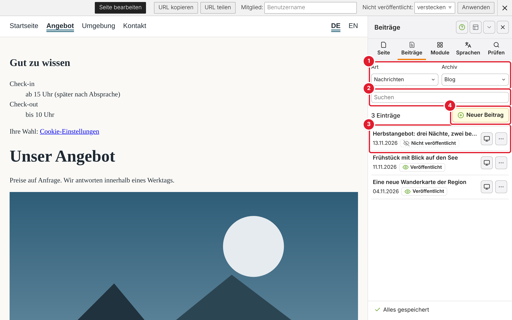

# Beiträge

**Stufe:** Plus. **Braucht:** den Schalter **Beiträge bearbeiten (Plus)** und
Zugriff auf die Archive in Contao.

Beiträge sind Nachrichten, Events, FAQ und Einträge von Erweiterungen, die gleich
gebaut sind. Die Ansicht **Beiträge** im Kopf der Seitenleiste listet sie.

## Einen Beitrag finden

1. Im Kopf der Seitenleiste auf **Beiträge** klicken.
2. Die **Art** und das Archiv wählen. Archive, die auf der offenen Seite gezeigt
   werden, stehen zuerst; gelistet werden nur Archive dieser Website.
3. Ist die Liste lang, nach dem Titel suchen.

Jeder Beitrag zeigt seinen Zustand (**Veröffentlicht**, **Nicht
veröffentlicht**, **Ab {Datum}**, **Abgelaufen**) und seine Aktionen: **Auf der
Seite öffnen**, **Veröffentlichen**/**Zurückziehen**, **Eigenschaften** (Contaos
Formular des Beitrags), **Duplizieren**, **Löschen**. FAQ lassen sich hier
ordnen; die Reihenfolge ist die Reihenfolge auf der Seite.

## Einen neuen Beitrag schreiben

1. Unter **Beiträge** Art und Archiv wählen und auf **Neuer Beitrag** klicken
   (**Neue Veranstaltung**, **Neue Frage**).
2. Contaos Formular öffnet sich in der Seitenleiste. Mindestens den Titel
   ausfüllen, dann **Speichern**.
3. Der Beitrag öffnet sich auf seiner Seite. Seinen Inhalt wie den Inhalt einer
   Seite hinzufügen: in den Text schreiben, **Element einfügen** und so weiter
   (siehe [Struktur ändern](structure.md)).
4. **Veröffentlichen**, wenn er fertig ist.

Auf einer Website mit Sprachversionen (Plus) legt das erste Speichern den
Beitrag auch in jeder anderen Sprache an, deren Archiv verknüpft ist: Kopien,
nicht veröffentlicht, mit dem neuen Beitrag verknüpft. Übersetzen und
veröffentlichen Sie sie dort (siehe
[Sprachen](languages.md#beiträge-archive-seiteneinstellungen-und-datensätze)).

Ein nicht veröffentlichter Beitrag wird in der Vorschau nur gezeigt, wenn in
Contaos Vorschauleiste „Nicht veröffentlicht: anzeigen“ eingestellt ist; der
Editor stellt das um, wenn er einen Entwurf öffnet.

## Die Seite eines Beitrags

Auf der Seite eines Beitrags zeigt die Seitenleiste **Beitrag: {Titel}** mit
seinem Zustand, **Eigenschaften** und **Veröffentlichen**/**Zurückziehen**,
darunter **Inhalt des Beitrags** mit seinen Elementen. Überschrift und Teaser
werden, wo die Seite sie zeigt, direkt auf der Seite bearbeitet: den Beitrag
einmal anklicken, um ihn zu wählen, den Text erneut anklicken, um zu schreiben;
**Speichern** speichert in den Beitrag.

## Einen Beitrag in einer Liste bearbeiten

Auf einer Seite mit einer Nachrichten- oder Eventliste bekommt jeder Eintrag der
Liste einen Rahmen, wenn man ihn anklickt, mit **Beitrag bearbeiten**. Das
öffnet die Eigenschaften des Beitrags (Contaos Formular) in der Seitenleiste.
Überschrift und Teaser des Eintrags werden direkt in der Liste bearbeitet wie
jeder Text der Seite (ein zweiter Klick auf den Text); sie werden in den Beitrag
gespeichert.

## Häufige Probleme

| Anzeichen | Ursache | Lösung |
| --- | --- | --- |
| Eine Beitragsart oder ein Archiv fehlt | Ihnen fehlen das Backend-Modul, das Archiv oder **Beiträge bearbeiten (Plus)**; oder das Archiv gehört zu einer anderen Website | Beim Administrator nachfragen. |
| Ein Beitrag öffnet sich als „Nicht gefunden“ | Er ist nicht veröffentlicht, und die Vorschauleiste steht auf „Nicht veröffentlicht: verstecken“ | In der Vorschauleiste auf „anzeigen“ stellen. |
| Ein neuer Beitrag hat keine Adresse | Er braucht einen Titel; der Alias entsteht daraus | Einen Titel eintragen und speichern. |
