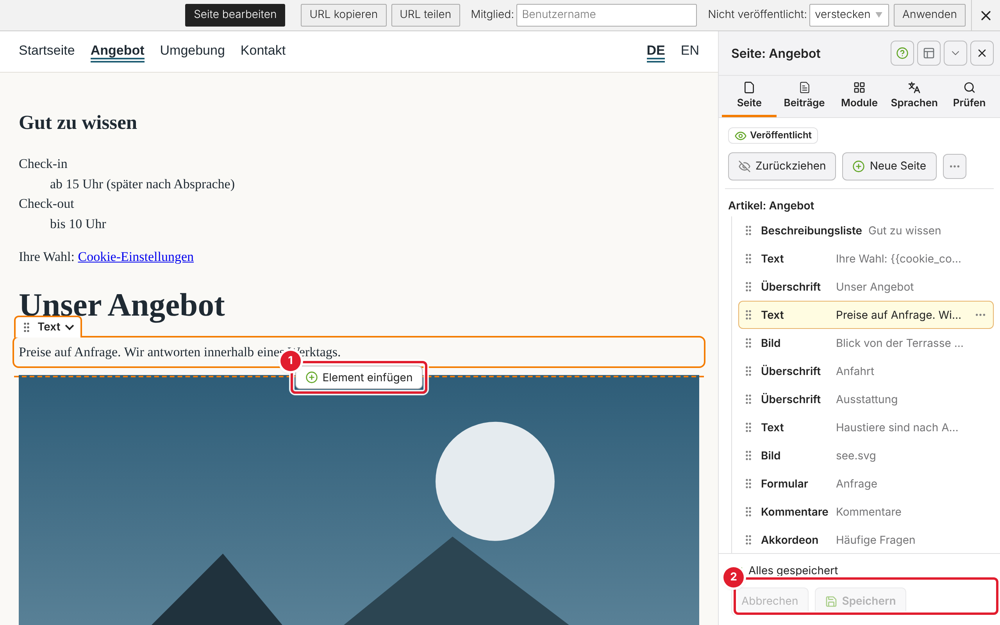
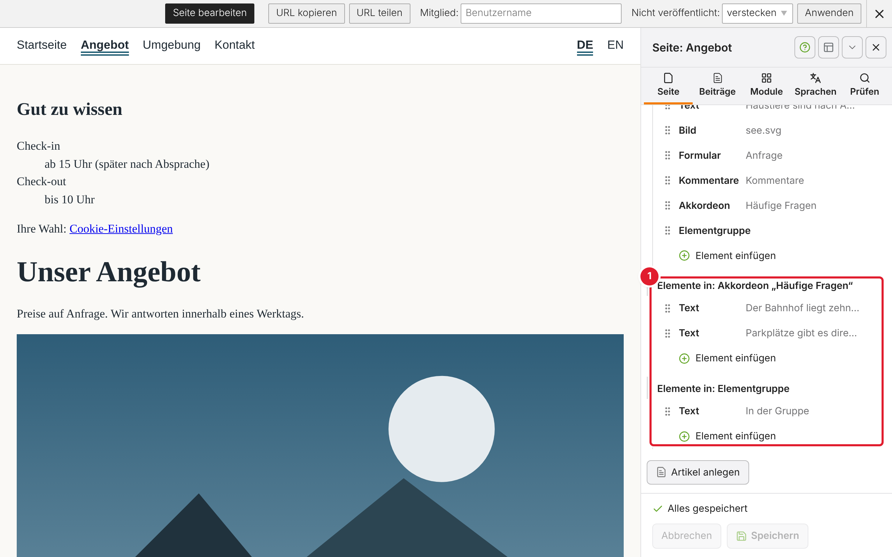

# Struktur ändern

**Stufe:** Basic. **Braucht:** den Schalter **Elemente anlegen, verschieben und
löschen**; für Artikel **Artikel anlegen**.

Alle Änderungen führen Contaos eigene Abläufe aus, mit Versionen und mit Contaos
Liste zum Wiederherstellen (**Wiederherstellen** im Backend). Nach einer Änderung
lädt die Seite neu, mit demselben Element gewählt.

## Ein Element einfügen

1. Die Stelle wählen:
   - auf der Seite: das Element anklicken, nach dem das neue kommen soll, und
     darunter auf **Element einfügen** klicken (über dem ersten Element eines
     Artikels gibt es den Knopf auch),
   - oder in der Seitenleiste: **Element einfügen** am Ende eines Artikels.
2. Contaos Formular öffnet sich in der Seitenleiste. Den **Elementtyp** wählen
   (angeboten werden nur die Typen, die Sie anlegen dürfen) und die Felder
   ausfüllen.
3. Auf **Speichern** klicken.

**Ergebnis:** Das neue Element steht auf der Seite. Wird das Formular ohne
Speichern geschlossen, wird das neue Element wieder entfernt.

## Ein Element verschieben

- Auf der Seite: das Element am Griff in seinem Reiter an seine neue Stelle
  ziehen, oder in seinem Menü **Nach oben** oder **Nach unten** wählen, oder auf
  dem Element oder seinem Reiter Alt+Pfeil nach oben / Alt+Pfeil nach unten
  drücken.
- In der Seitenleiste: die Zeile an ihrem Griff ziehen, oder die Zeile wählen und
  Alt+Pfeil nach oben / Alt+Pfeil nach unten drücken.

Elemente lassen sich innerhalb der Artikel der Seite verschieben. Elemente in
einem Akkordeon, einem Slider oder einer Elementgruppe bewegen sich innerhalb
dieses Elements.

## Duplizieren, ausblenden, löschen

- **Duplizieren** legt direkt nach dem Element eine Kopie an.
- **Ausblenden** verbirgt das Element vor Besuchern (es bleibt in der
  Seitenleiste, markiert mit *ausgeblendet*); ein erneuter Klick zeigt es
  wieder.
- **Löschen** fragt vorher nach. Ein gelöschtes Element lässt sich im Backend
  unter **Wiederherstellen** zurückholen.

Auf der Seite sind das Einträge im Menü des Reiters des Elements.

In der Seitenleiste öffnet Umschalt+F10 (oder der Knopf **Mehr** einer Zeile)
ein Menü mit allen Aktionen des Elements; Entf löscht das gewählte Element.

## Einen Artikel anlegen

1. In der Seitenleiste unter der Struktur auf **Artikel anlegen** klicken.
2. Hat das Layout mehrere Spalten, die Spalte wählen.
3. Contaos Formular öffnet sich; den Titel eintragen und auf **Speichern**
   klicken.

## Elemente in einem Akkordeon, einem Slider oder einer Elementgruppe

Manche Elementtypen enthalten Elemente (Contaos Akkordeon, Slider und
Elementgruppe sowie ähnliche Elemente von Erweiterungen). Ihre Elemente stehen in
der Seitenleiste als eigene Gruppe, direkt nach dem Artikel: **Elemente in:
Akkordeon „…“**.

- Sie werden wie jedes andere Element bearbeitet, eingefügt, verschoben,
  dupliziert, ausgeblendet und gelöscht.
- **Element einfügen** in der Gruppe fügt ein Element in dieses Akkordeon, diesen
  Slider oder diese Gruppe ein.
- Abschnitte eines geschlossenen Akkordeons sind auf der Seite nicht sichtbar;
  sie sind über die Seitenleiste erreichbar.

## Häufige Probleme

| Anzeichen | Ursache | Lösung |
| --- | --- | --- |
| Kein **Element einfügen**, **Duplizieren** oder **Löschen** | Ihrer Gruppe fehlt **Elemente anlegen, verschieben und löschen** oder Contaos Recht, Elemente anzulegen oder zu löschen | Beim Administrator nachfragen; siehe [Rechte](../permissions.md). |
| Der gebrauchte Elementtyp wird nicht angeboten | Er gehört nicht zu den Elementtypen, die Ihre Gruppe nutzen darf, oder er darf nicht in dieses Element gesetzt werden | Beim Administrator nachfragen. |
| Ein Element lässt sich nicht an eine andere Stelle verschieben | Elemente bewegen sich nur innerhalb der Artikel der Seite oder innerhalb ihres eigenen Akkordeons, Sliders oder ihrer Gruppe | An der neuen Stelle duplizieren und das alte löschen. |
| Ein gelöschtes Element soll zurück | – | Backend → **Wiederherstellen**. |
