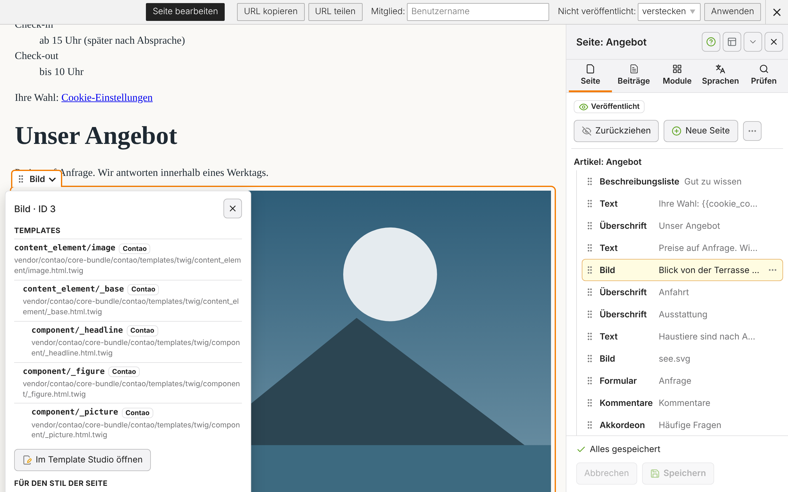
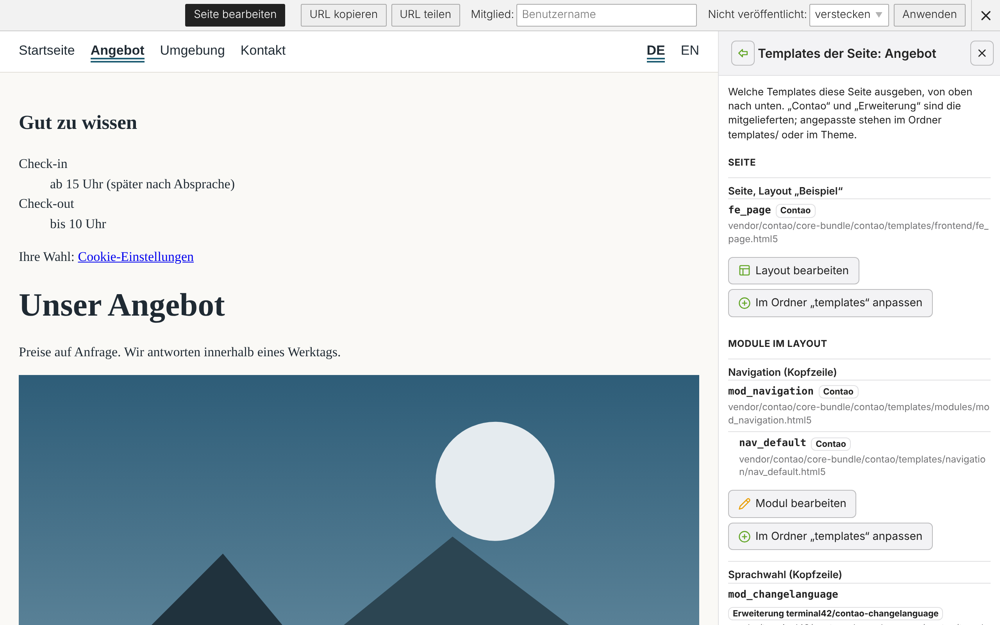
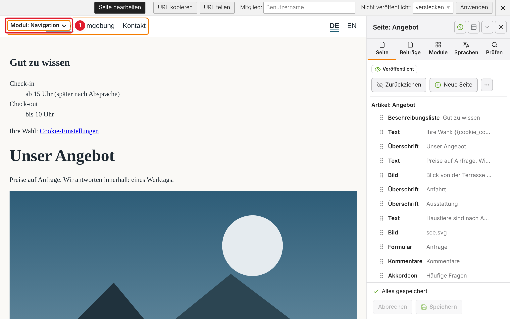
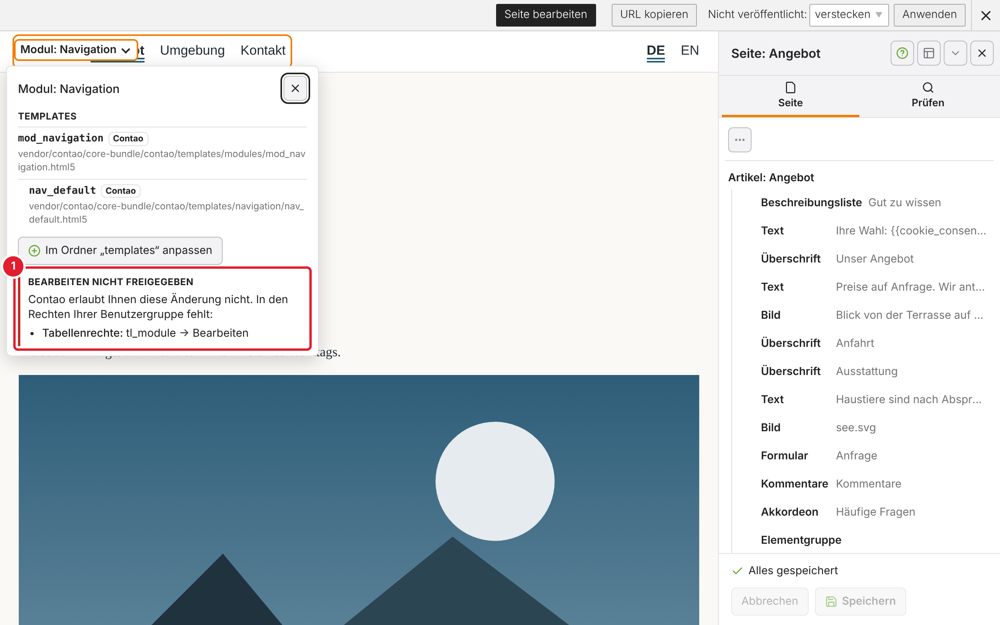

# Templates und Module

**Stufe:** Basic. **Braucht:** den Schalter **Templates und Module (für
Webdesigner)** und Contaos Rechte für die Teile (siehe
[Rechte](../permissions.md)).

## Welche Templates ein Element ausgeben

1. Ein Element auf der Seite anklicken, dann seinen Reiter und **Info**.
2. Die Karte listet die Templates, die das Element ausgeben, und die Templates,
   die diese verwenden (zum Beispiel `component/_figure` in einem Bild), jeweils
   mit ihrer Herkunft: **Contao**, **Erweiterung …**, **Angepasst** oder
   **Angepasst im Theme**, und ihrem Pfad.
3. Ein Template ändern:
   - Twig-Templates: **Im Template Studio öffnen**. Contaos Template Studio
     öffnet sich in der breiten Seitenleiste, mit dem Template schon gewählt.
   - Ältere `.html5`-Templates: **Im Ordner „templates“ anpassen** oder
     **Angepasstes Template bearbeiten**.
4. **Für den Stil der Seite**: die CSS-Klasse des Elements und wo es eine eigene
   Klasse bekommt (**Alle Felder** › CSS-ID/Klasse).

Die Karte bleibt offen, bis sie geschlossen wird (× oder Esc). Auf Bildschirmen
bis 768 px Breite wird sie nicht gezeigt; dort **Templates der Seite** nutzen.

## Templates der Seite

**Mehr zur Seite** (…) → **Templates der Seite** listet von oben nach unten: die
Seite und ihr Layout, die Module des Layouts, die Inhaltselemente (gleiche
zusammengefasst) und die weiteren Teile der Seite, jeweils mit ihren Templates
und ihrem Formular. Hier ist jeder Teil mit der Tastatur erreichbar.

## Frontend-Module, Layout, Formularfelder, Kommentare

Auf der Seite bekommen diese Teile einen Rahmen mit einem Reiter mit ihrem
Namen, wenn man sie anklickt (fährt die Maus darüber, werden sie nur umrandet);
der Reiter öffnet ihr Menü:

- **Modul: {Name}** (Navigation, Listen …) → **Modul bearbeiten**,
- **Formularfeld: {Name}** → **Feld bearbeiten**, **Feld danach einfügen**,
  **Feld löschen**,
- **Kommentar: {Name}** → **Kommentar bearbeiten**.

Jeder Eintrag öffnet Contaos Formular in der Seitenleiste. Nach dem Schließen des
Formulars lädt die Seite mit der Änderung neu. **Mehr zur Seite** (…) →
**Layout bearbeiten** öffnet das Formular des Layouts der Seite.

**Feld danach einfügen** öffnet das Formular eines neuen Felds direkt nach
diesem; ohne Speichern geschlossen, wird es wieder entfernt. **Feld löschen**
fragt vorher nach; das Feld lässt sich im Backend unter **Wiederherstellen**
zurückholen.

## Wenn ein Eintrag fehlt

Erlaubt Contao nicht, einen Teil zu ändern, hat sein Menü keinen Eintrag zum Bearbeiten, oder er steht ausgegraut da.
**Info** am Teil (beim Layout: **Templates der Seite**) zeigt **Bearbeiten nicht
freigegeben** und nennt, was in den Rechten Ihrer Benutzergruppe fehlt, mit
Contaos eigener Bezeichnung, zum Beispiel „Tabellenrechte: tl_module →
Bearbeiten“.

Das an den Administrator weitergeben; unter [Rechte](../permissions.md) steht die
vollständige Liste.
