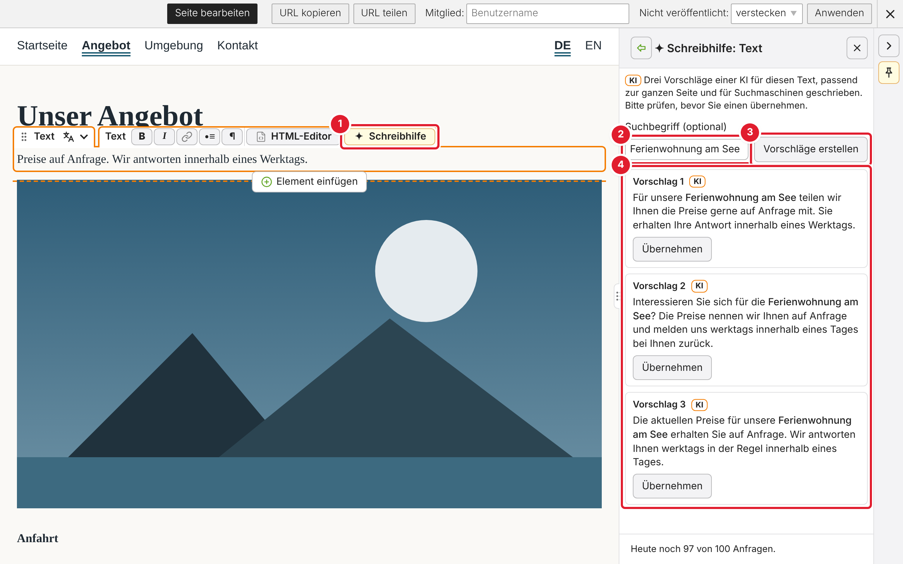

# Schreibhilfe

**Stufe:** Pro. **Braucht:** **Texte und Bilder ändern**; die KI-Verbindung und
ein Modell müssen eingerichtet sein (Administrator, siehe
[Einrichtung](../setup.md)).

1. Eine Überschrift oder einen Text bearbeiten (**Bearbeiten**).
2. In die Überschrift oder den Text klicken, dann in den Textwerkzeugen neben
   dem Reiter des Elements auf **Schreibhilfe** (1 im Bild).
3. Wahlweise unter **Suchbegriff (optional)** einen Begriff eintragen, unter dem
   der Text gefunden werden soll (2).
4. Auf **Vorschläge erstellen** klicken (3). Solange die KI schreibt, liegt über
   der Schreibhilfe eine Ladeanzeige mit **Vorschläge werden geschrieben …**.
   Drei Vorschläge erscheinen (4), gekennzeichnet als Vorschläge einer KI.
5. Beim gewünschten Vorschlag auf **Übernehmen** klicken. Er ersetzt den Text im
   Element.
6. Den Text prüfen und ändern, dann **Speichern**.

Vor dem Klick auf **Speichern** wird nichts gespeichert. Die Vorschläge nutzen
die ganze Seite als Kontext (Seitentitel, Beschreibung, die Texte der Elemente).

Die Zahl der Anfragen pro Tag ist für alle Redakteure zusammen begrenzt; die
Schreibhilfe zeigt, wie viele heute noch übrig sind.

## Beispiel

Das Bild oben zeigt diesen Fall:

- **Text des Elements:** „Preise auf Anfrage. Wir antworten innerhalb eines
  Werktags.“
- **Suchbegriff:** Ferienwohnung am See
- **Vorschläge:**
  1. „Für unsere Ferienwohnung am See teilen wir Ihnen die Preise gerne auf
     Anfrage mit. Sie erhalten Ihre Antwort innerhalb eines Werktags.“
  2. „Interessieren Sie sich für die Ferienwohnung am See? Die Preise nennen
     wir Ihnen auf Anfrage und melden uns werktags innerhalb eines Tages bei
     Ihnen zurück.“
  3. „Die aktuellen Preise für unsere Ferienwohnung am See erhalten Sie auf
     Anfrage. Wir antworten Ihnen werktags in der Regel innerhalb eines Tages.“

Jeder Vorschlag behält die Aussage des Textes und baut den Suchbegriff ein. Die
Vorschläge sind bei jeder Anfrage neu. Prüfen Sie Angaben, bevor Sie einen
übernehmen: Der dritte Vorschlag schwächt die Zusage ab („in der Regel“), die
der ursprüngliche Text so nicht macht.

## Häufige Probleme

| Anzeichen | Lösung |
| --- | --- |
| „Für die Schreibhilfe fehlen die KI-Verbindung oder das Modell.“ | Administrator: die KI-Verbindung und das Modell einrichten. |
| „Die Schreibhilfe hat für heute ihre Grenze erreicht.“ | Morgen erneut versuchen, oder der Administrator erhöht **Anfragen pro Tag**. |
| „Die Schreibhilfe ist gerade nicht erreichbar.“ | Später erneut versuchen. |
| Keine **Schreibhilfe** in den Textwerkzeugen | Der Cursor steht in einem anderen Feld als Überschrift oder Text, oder die Website hat keine Pro-Lizenz. |
