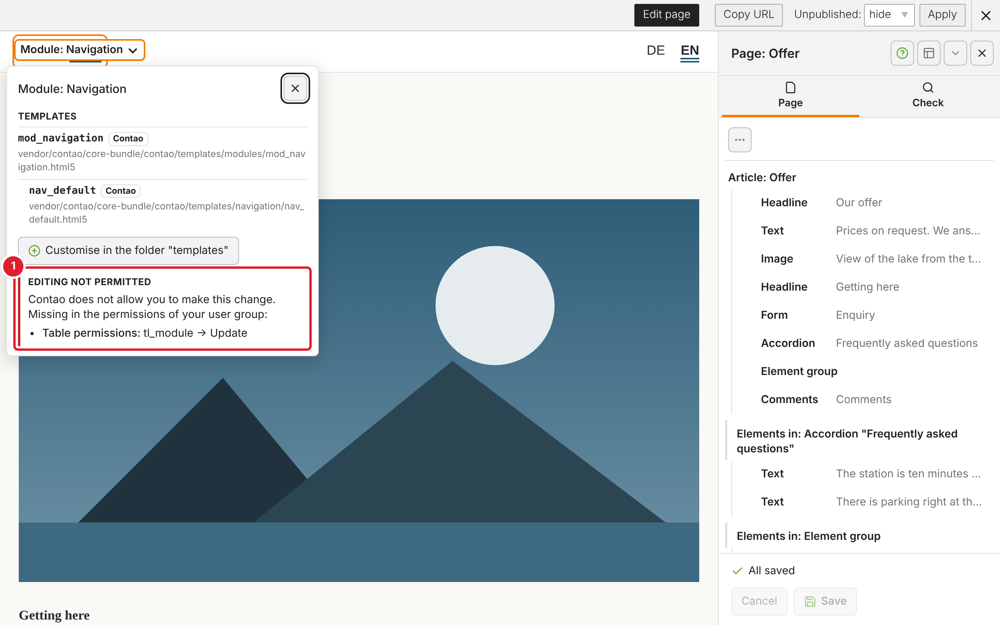

# Permissions

## How permissions work in the editor

- The editor has **no permission system of its own**. What a user may do on the
  page is exactly what Contao lets them do in the back end, checked record by
  record and field by field.
- The switches of the extension (section **Frontend Editor** of a user group or
  user, field **Allowed functions**) only **narrow** that. They never allow
  something Contao forbids.
- A function therefore needs **both**: its switch, and Contao's permissions.
- When a permission is missing, the button is not shown. For modules, the
  layout, form fields and comments, the card **Info** names the missing
  permission with Contao's own label (switch **Templates and modules** needed).

Administrators have every function.

All Contao permissions below are set in the back end under **User groups**
(or **Users**). The names are those Contao shows there.

## The switches of the extension

| Switch | What it allows | Edition |
| --- | --- | --- |
| **Front end editing allowed** | **Frontend Editor** at the top of the back end and the button **Edit page** in the preview; without it the user does not see the editor | Basic |
| **Change texts and images** | Write in headlines and texts, change images, **All fields** | Basic |
| **Create, move and delete elements** | Insert, move, duplicate, hide and delete elements, also elements inside an accordion, slider or element group | Basic |
| **Create articles** | **Create article** | Basic |
| **Templates and modules (for web designers)** | **Info** with the templates, frames around modules, form fields and comments with their forms, **Edit layout**, **Templates of the page** | Basic |
| **Edit language versions (Plus)** | The view **Languages** and the translation window: side by side, translate and save texts, link, take over, mark as current | Plus |
| **Request translations (Plus)** | **Translate all fields**, **Translate this field** and **Translate whole page** (with the translation service of the settings) | Plus |
| **Create and publish pages (Plus)** | **New page**, **Publish**, **Withdraw**, **Page settings**, **Duplicate page**, **Delete page** | Plus |
| **Edit posts (Plus)** | The view **Posts** and **Edit post** in lists | Plus |
| **Open modules (Plus)** | The view **Modules** | Plus |
| **Edit page styles (Pro)** | **Page style (CSS)** | Pro |

The switches of Plus and Pro are shown with a licence for that edition (on a
development address always). Without it they are hidden; a switch that is
ticked keeps its state when the form is saved and applies again with the
licence.

The checks for search engines and accessibility, the screen sizes and the
writing aid (Pro) need no switch of their own: everyone who may use the editor
may use them. Changes they lead to go through the permissions below.

## Contao's permissions per function

### Texts and images (Basic)

| Contao permission | Setting |
| --- | --- |
| **Back end modules** | Articles |
| **Pagemounts** | the pages (or the root page) of the website the group works on |
| **Access rights** of the pages | *Edit articles* for the group (on the pages, or by default) |
| **Content elements** | the element types the group may edit |
| **Allowed fields**, table `tl_content` | at least: Headline (`headline`), Text (`text`); for images also Source file (`singleSRC`), Alternate text (`alt`), Image caption (`caption`), Overwrite metadata (`overwriteMeta`); for other text fields of an element on the page (lead texts, labels, lists, tables, also of other extensions) those fields; for the records of an element's child table, and for records it shows from another table through a relation (a FAQ category and its questions), that table's permissions (back-end module, table permissions, allowed fields of that table); for the texts of front-end modules the permissions of a front-end module as under *Front-end modules, layout, form fields, comments* below, with the allowed fields of `tl_module` that hold the texts |
| **Table permissions** (Contao 5.7 and later) | `tl_content` → Update |

### Structure: insert, move, duplicate, hide, delete (Basic)

Everything from *Texts and images*, plus:

| Contao permission | Setting |
| --- | --- |
| **Table permissions** | `tl_content` → Create and → Delete (moving is an update) |
| **Allowed fields**, `tl_content` | Element type (`type`) to choose the type of a new element; Invisible (`invisible`) for hiding |

Inserting, duplicating and deleting elements inside an accordion, slider or
element group need the same permissions; Contao also checks that the element
type may be placed inside that element.

### Create articles (Basic)

| Contao permission | Setting |
| --- | --- |
| **Access rights** of the page | *Edit articles* and *Edit article hierarchy* |
| **Allowed fields**, `tl_article` | at least Title (`title`); Display in (`inColumn`) if the layout has several columns |

Pages and articles have no **Table permissions** in Contao; the access rights
of the pages decide.

### Pages (Plus)

| Contao permission | Setting |
| --- | --- |
| **Back end modules** | Pages |
| **Pagemounts** | the website or the part of it the group works on |
| **Allowed page types** | at least *Regular page* |
| **Access rights** of the pages | *Edit page*; for **New page** also *Edit page hierarchy* of the parent page; for **Delete page** *Delete page* |
| **Allowed fields**, `tl_page` | Page name (`title`), Page alias (`alias`), Page title (`pageTitle`), Page description (`description`), Publish page (`published`), Show from / Show until (`start`, `stop`); for Pro also Robots tag (`robots`) and the search result preview (`serpPreview`) |
| **Allowed fields**, `tl_article` | at least Title (`title`): Contao creates the article of a new page only for users who may create articles |

### Posts: news, events, FAQ (Plus)

Shown for news; events and FAQ work the same way with their own module,
archive field and tables.

| Contao permission | Setting |
| --- | --- |
| **Back end modules** | News |
| **Allowed archives** | the archives the group writes in |
| **Table permissions** | `tl_news` → Create, Update, Delete |
| **Allowed fields**, `tl_news` | at least Title (`headline`), News alias (`alias`), Publish item (`published`) and the fields the group fills in |
| For the content of a post | the same as *Texts and images* and *Structure* |

### Modules (Plus)

The view **Modules** shows the back-end modules of the extensions' menu group
the user may open (**Back end modules**), except the settings of the editor
itself and the page "Access keys and licences". With Pro it also lists the
back-end modules of the website and of other extensions (any module that is
not one of Contao's own); their records are translated there with the switch
**Edit language versions (Plus)** and Contao's permissions of the module's table
(**Table permissions** → Update, **Allowed fields**).

### Front-end modules, layout, form fields, comments (Basic, for web designers)

Switch **Templates and modules (for web designers)**, plus:

| Part | Contao's permissions |
| --- | --- |
| Front-end module | **Back end modules**: Themes; **Theme modules**: Front end modules; **Front end modules**: the module type (e.g. Navigation menu); **Allowed fields**: at least one field of `tl_module` (e.g. `name`); **Table permissions**: `tl_module` → Update |
| Layout | **Back end modules**: Themes; **Theme modules**: Page layouts; **Allowed fields**: at least one field of `tl_layout`; **Table permissions**: `tl_layout` → Update |
| Form field | **Back end modules**: Forms; **Allowed forms**: the form; **Form fields**: the field type (e.g. Text field); **Allowed fields**: at least one field of `tl_form_field` (e.g. `label`); **Table permissions**: `tl_form_field` → Update; for **Insert field after** and **Delete field** also → Create and → Delete |
| Comment | **Back end modules**: Comments; for comments of a content element *Edit articles* on its page; **Allowed fields**: at least one field of `tl_comments`; **Table permissions**: `tl_comments` → Update |
| Template Studio | **Back end modules**: Templates |

Contao's form in the sidebar shows only the allowed fields.

### Language versions (Plus)

Switch **Edit language versions (Plus)**, plus *Texts and images* for the pages
of every language the group edits (**Pagemounts** of all language root pages).
**Take over element** also needs *Structure* in the target language,
**Take over into (main language)** *Structure* in the main language.
**Request translations (Plus)** additionally needs a translation service that
is set up (Azure Translator, DeepL or the AI connection, see
[Setup](setup.md)).

**Create language versions** of a new page (see
[Pages](usage/pages.md#create-the-language-versions-right-away)) needs:

| Contao permission | Setting |
| --- | --- |
| Switch | **Create and publish pages (Plus)**; for the name proposals also **Request translations (Plus)** |
| **Pagemounts** | the root pages of all languages the group creates pages in |
| **Access rights** of the pages | in every language *Edit page* and *Edit page hierarchy* of the parent page of the new version |
| **Allowed fields**, `tl_page` | Page name (`title`); Main language page (`languageMain`) to link the versions; Page alias (`alias`) to enter the alias yourself (without it Contao makes it from the name) |
| **Allowed fields**, `tl_article` | at least Title (`title`), for the article of each version |

### Checks and writing aid (Pro)

- Focus keyword: *Edit page* on the page.
- Fixes offered by the accessibility check (for example **Set level 2**,
  **Enter alternative text**): the permissions of the element.
- Writing aid: *Texts and images*; the AI connection must be set up.

### Page style (Pro)

| Contao permission | Setting |
| --- | --- |
| Switch | **Edit page styles (Pro)** |
| **Back end modules** | Page styles |
| **Access rights** of the page | *Edit page* |

The back-end list **Page styles** shows only the styles of pages the user may
edit. Give this only to web designers: an error in a style can disarrange the
page for visitors.

### Settings and translations list

- **Frontend Editor** (settings: back-end address, model and limit of the
  writing aid): only for administrators or the person who sets up the website.
- **Translations** (list of linked elements, Plus): for those who check
  outdated translations. Deleting a row removes the link, not the elements.

## Example groups

### "Editors – texts only"

For people who correct texts and exchange images.

1. Switches: **Front end editing allowed**, **Change texts and images**.
2. **Back end modules**: Articles.
3. **Pagemounts**: the root page of the website.
4. **Content elements**: the types used on the website.
5. **Allowed fields** (`tl_content`): `headline`, `text`, `singleSRC`, `alt`,
   `caption`, `overwriteMeta`.
6. **Table permissions**: `tl_content` → Update.
7. **Access rights** of the pages (or default access rights of new pages):
   *Edit articles* for the group.

### "Editors – content and structure"

As above, plus:

1. Switches: **Create, move and delete elements**, **Create articles**.
2. **Allowed fields** (`tl_content`): also `type`, `invisible`; (`tl_article`):
   `title`.
3. **Table permissions**: `tl_content` → Create, Delete.
4. **Access rights**: also *Edit article hierarchy*.

### "Editors – Plus"

As above, plus the switches and permissions of *Pages*, *Posts* and *Language
versions* you want the group to have.

### "Web design"

1. Switches: as needed, plus **Templates and modules (for web designers)** and,
   with Pro, **Edit page styles (Pro)**.
2. The permissions of *Front-end modules, layout, form fields, comments* and
   *Page style* above.

After setting up a group, log in with a test user of that group and go through
the [user manual](usage/README.md): every button the group should have must be
there. If one is missing, see [Troubleshooting](troubleshooting.md).

