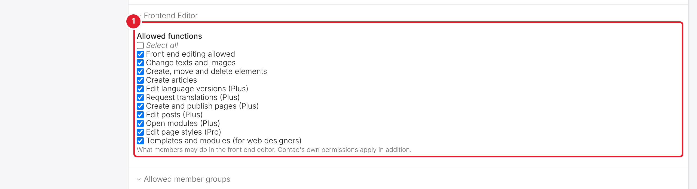
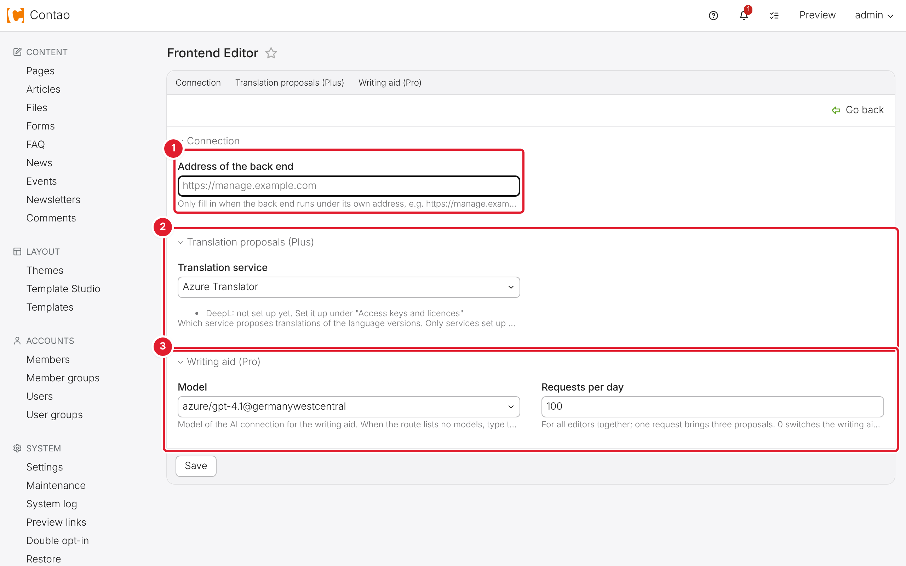

# Setup

Do the steps in this order. Steps 1 and 2 are enough for the free edition
(Basic).

## 1. Allow the editor for a user group

1. In the back end, open **User groups** and edit the group of your editors.
2. In the section **Frontend Editor**, tick in **Allowed functions** what the
   group may do (the full list with the Contao permissions each function needs
   is on [Permissions](permissions.md)):
   - **Front end editing allowed** shows the button **Edit page** in the
     preview. Without it the user does not see the editor at all.
   - **Change texts and images**: write in headlines and texts, change images,
     open **All fields**.
   - **Create, move and delete elements**: insert, move, duplicate, hide and
     delete elements.
   - **Create articles**.
   - The other switches belong to Plus and Pro and to web designers; see
     [Permissions](permissions.md). The switches of Plus and Pro appear with
     a licence for that edition.
3. Save.

The same switches exist on a single user. As with Contao's own permissions, a
user gets those of the user, those of the groups, or both, depending on
**Permission inheritance**.

Administrators have every function; they need no switch.

The switches only **narrow** what Contao allows. Each function also needs
Contao's own permissions, exactly as in the back end. If a button is missing,
[Permissions](permissions.md) and [Troubleshooting](troubleshooting.md) say
which permission it is.

## 2. Try it

1. Log in to the back end with a user of the group.
2. Open the preview of a page (**Preview** in the back end, or the preview icon
   of a page in the page tree).
3. Click **Edit page** in Contao's preview bar at the top.

The editor opens; continue in the [user manual](usage/README.md).

## 3. Licence (Plus and Pro)

**Licence keys for Plus and Pro:** <https://store.neo-digital.at/extensions/frontend-editor>

1. Open **Access keys and licences** in the menu group of the extensions.
2. Under **Licences**, enter the licence key of the Frontend Editor and save.

The licence covers the domains of the website. On development addresses
(`localhost`, loopback addresses, `*.localhost`, `*.test`, `*.local`) every
function works without a key, so you can try Plus and Pro before buying.

Switches and settings of an edition the licence does not include are not
shown in the back end. What they were set to stays stored and applies again
with a licence for that edition. In the back end the licence counts without
the domain check, since the back end may run under another address; on a
development address everything is shown. The same goes for the menu and for
**Access keys and licences**: **Translations** appears with Plus, **Page
styles** with Pro; the translation services (Azure Translator, DeepL) and the
AI connection appear with Plus, unless another extension uses them. In the
editor itself, functions of an edition the licence does not include stay
visible with their edition and are locked. What each edition adds is listed
in the licence row on **Access keys and licences**.

## 4. Translation proposals (Plus)

Translation proposals come from one of three services: Microsoft Azure
Translator, DeepL or a language model of the AI connection. Set up the one you
want to use, then choose it in the settings of the editor.

1. Set up the access under **Access keys and licences**:
   - **Azure Translator**: create a *Translator* resource in the Azure portal,
     enter its key, choose **Processing** (default *Europe*) and enter the
     region of the resource.
   - **DeepL**: enter the key of your DeepL API account (Free or Pro; keys of
     the free plan end in `:fx`).
   - **AI model**: the section **AI connection** (route and key), the same
     connection as for the writing aid.
2. Click **Test connection** in that section. It must report that the
   connection works.
3. Open **Frontend Editor** in the menu group of the extensions → section
   **Translation proposals (Plus)** → **Translation service** and choose the
   service. A service whose access is not set up is shown but cannot be
   chosen; the line below the field says what is missing and links to its
   section. Without a choice, the first service that is set up is used, in
   the order Azure Translator, DeepL, AI model.
4. For **AI model (AI connection)**: choose the **Model for translations**
   (from the models of the route). Without the AI connection the field is
   disabled and says why.
5. Click **Save**.

The accesses are shared by all extensions of the family.

## 5. Writing aid (Pro)

1. Open **Access keys and licences** → section **AI** and enter the route and
   the key of your AI connection.
2. Open **Frontend Editor** in the menu group of the extensions → section
   **Writing aid (Pro)** (shown with a licence for Pro).
3. Choose the **Model**. The list comes from the AI connection; when the route
   lists no models, type the name of the model. Without the AI connection the
   settings of the writing aid are disabled and say why.
4. Set **Requests per day** (for all editors together; one request brings three
   proposals; 0 switches the writing aid off). Default: 100.

## 6. Only with a separate back-end address

If the back end runs under its own address (for example
`https://manage.example.com` for the website `https://example.com`):

1. Open **Frontend Editor** in the menu group of the extensions.
2. Enter the address in **Address of the back end**.
3. Check that every root page of the website has its **Domain name** filled in.

The editor then loads Contao's forms from that address. Only the domains of the
root pages may embed them; any other site is refused. Leave the field empty
when back end and website share one address.

## 7. For several websites or languages

If the installation holds several websites, or a website in several languages,
read [Several websites and languages](websites-and-languages.md) before you set
up the groups.
