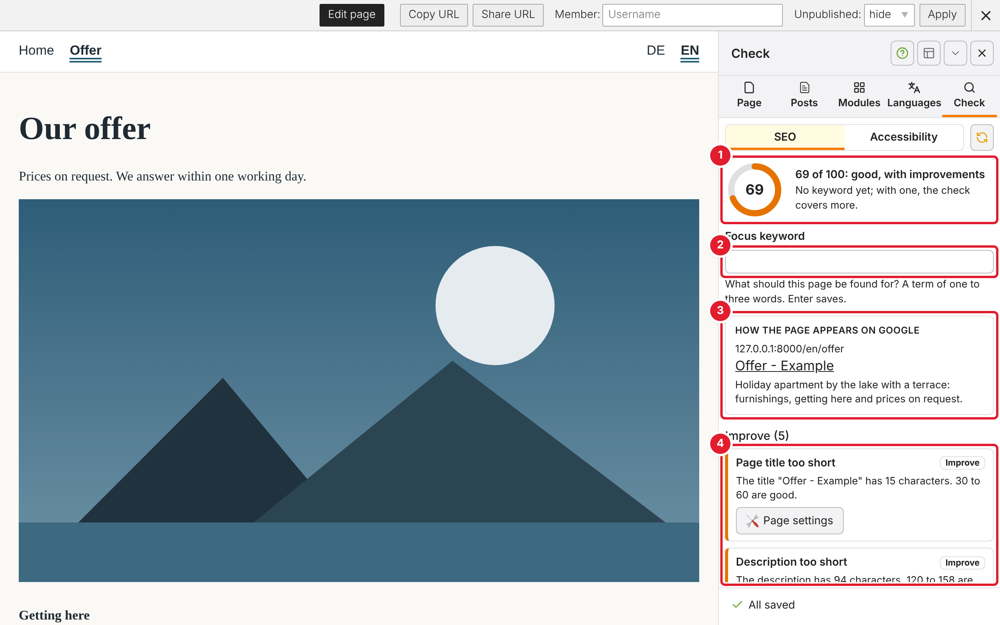
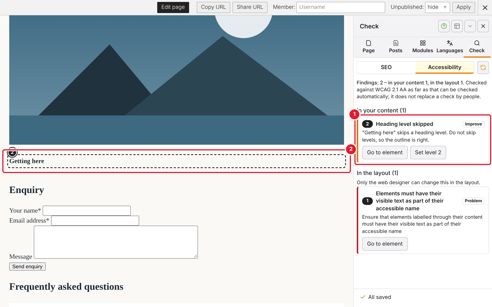
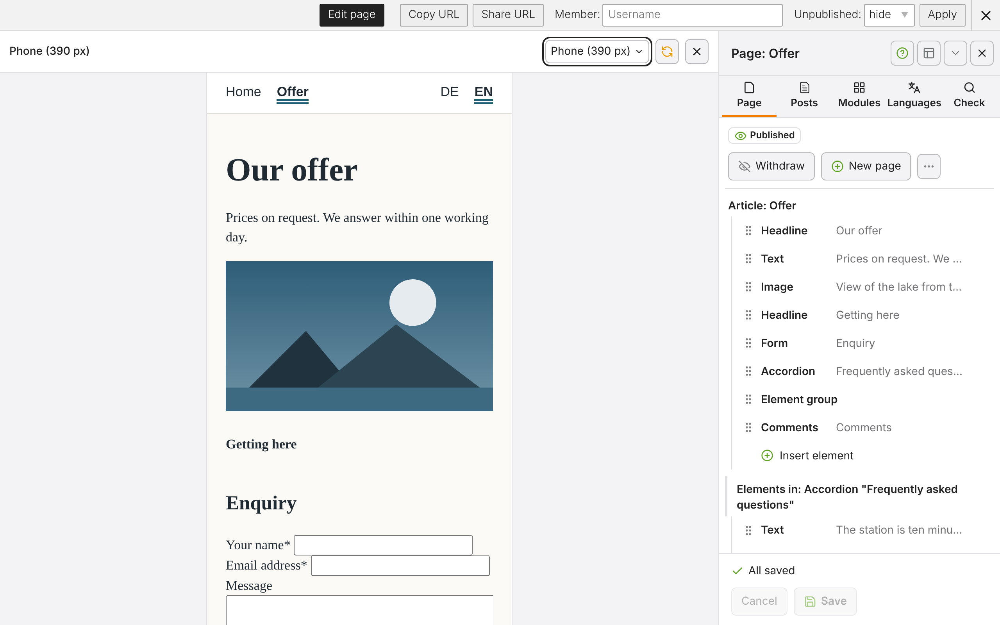

# Checks and screen sizes

**Edition:** Pro. No switch needed: everyone who may use the editor may check.

The view **Check** in the head of the sidebar has two tabs, **SEO** and
**Accessibility**. The page is checked in your browser as the preview shows it:
when the view opens, after every save and with **Check again**.

Every finding is marked **Problem**, **Improve** or **Fine** (in words, not only
by colour), with a sentence of explanation and, where possible, the way to the
solution: **Page settings**, **Go to element** (selects the element on the page)
or a fix right there.

## SEO

1. **Score** from 0 to 100 (see the table below).
2. **Focus keyword**: what should this page be found for? Enter a term of one to
   three words and press Enter. It is saved with the page (needs *Edit page*).
3. **How the page appears on Google**: address, page title and description.
4. **Findings**: problems first, then improvements, then what is fine.

How the score is made: every check has a weight; **Fine** counts fully,
**Improve** half, **Problem** not at all. The score is the share of the
reachable points. Checks for the keyword only count when a keyword is set.
The main heading counts as search engines read it: every `h1` in the page's
source, also one the layout shows only at some widths (a variant for phones);
not one hidden from everybody (`hidden`, `aria-hidden="true"`).

| Check | Weight | Problem | Improve | Fine |
| --- | --- | --- | --- | --- |
| Page title | 10 | missing | under 30 or over 60 characters | 30 to 60 characters |
| Description | 10 | missing | under 120 or over 158 characters | 120 to 158 characters |
| Main heading (h1) | 10 | none or several | – | exactly one |
| Heading levels | 5 | – | a level skipped | no level skipped |
| Amount of text | 10 | – | under 300 words | 300 words or more |
| Alternative texts | 5 | – | an image in the content without one | all images |
| Links to other pages | 5 | – | none | at least one |
| Indexing | 10 | "noindex" | – | indexed |
| Keyword in page title | 10 | – | missing | present |
| Keyword in description | 5 | – | missing | present |
| Keyword in main heading | 5 | – | missing | present |
| Keyword in address | 5 | – | missing | present |
| Keyword in first paragraph | 5 | – | missing | present |
| Keyword only on this page | 5 | – | also on another page of the website | only here |

A keyword counts as present when all its words appear, also inside longer
words, ignoring upper and lower case and accents.

Headings and images count only where a visitor or a screen reader gets them:
shown on the page (not hidden, with a size) and not hidden from screen readers
(`aria-hidden="true"` on the element or around it). An image needs an
alternative text unless it is marked as decorative (`role="presentation"` or
`none`); an empty `alt=""` on a shown image counts as missing, as Contao writes
it when no text was entered. With several findings, **Go to element (1 of 3)**
goes to one after the other. If a place is hidden by the time you click, the
line at the foot of the sidebar says so.

## Accessibility

The page is checked against WCAG 2.1 AA as far as that can be done
automatically: contrasts, alternative texts, texts of links and buttons, order
of headings, language, labels of form fields, titles of embedded content.

- **In your content**: elements you may edit. Simple cases are fixed right there:
  **Set level n** for a skipped heading, **Enter alternative text** for an
  image.
- **In the layout**: only the web designer can change these.
- Each finding has a number; the same number marks the place on the page.
- Contrasts show the ratio, the required value and both colours.

The check does not replace a check by people; the view says so.

## Screen sizes

1. Click **Screen size** in the head of the sidebar.
2. Choose **Phone** (390 px) or **Tablet** (820 px). The page next to the
   sidebar becomes as wide as the device; the page's layout for that width
   applies. **Rotate** sets the width of the device held across (844 px or
   1180 px); where the window is narrower, the page can be scrolled sideways.
3. **Computer**, **Close** (×) or Esc in the bar above the page goes back to the
   normal width.

Everything works in this width as in the normal one: selecting, editing,
saving, the checks. Screen sizes are offered on screens wider than 768 px.

## Common problems

| What you see | Why | What to do |
| --- | --- | --- |
| "The check could not run." | The checker file cannot be loaded (public files missing, or a content security policy blocks it) | Administrator: see [Troubleshooting](../troubleshooting.md). |
| The focus keyword cannot be saved | You lack *Edit page* for this page | Ask your administrator. |
| No **Screen size** | The window is 768 px wide or narrower, or no Pro licence | Use a wider window. |
| A finding "In the layout" | It comes from the layout, not from the content | Tell your web designer. |
