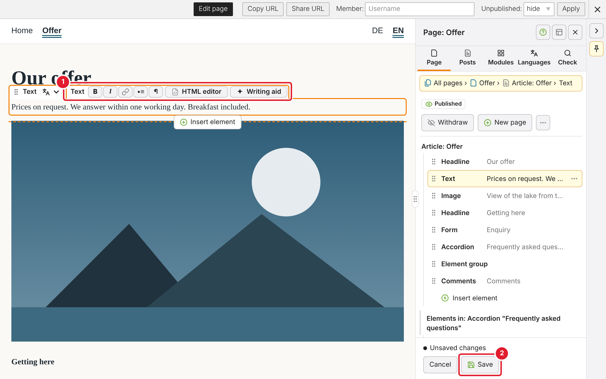
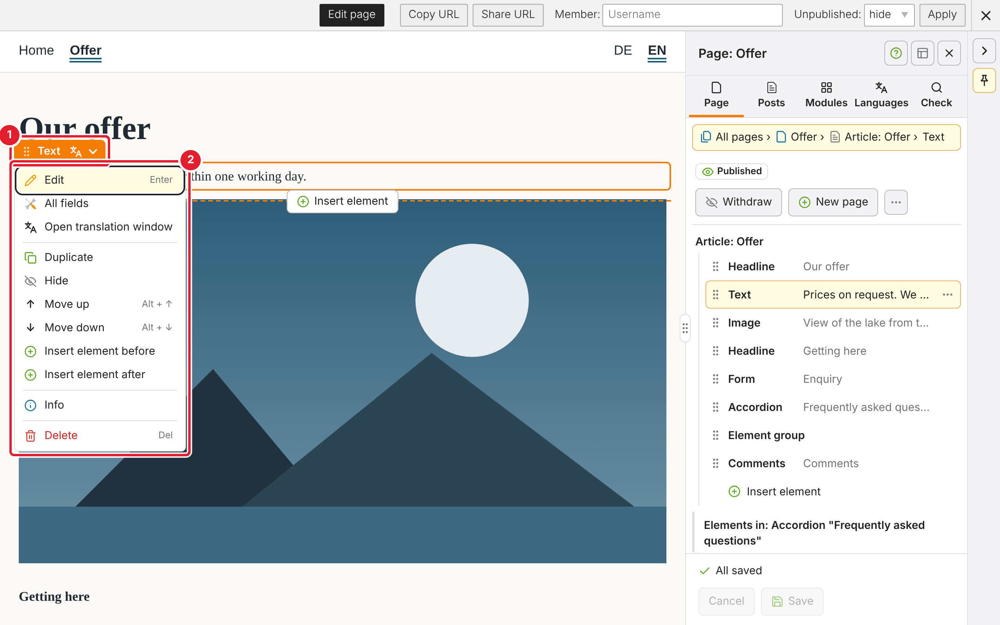
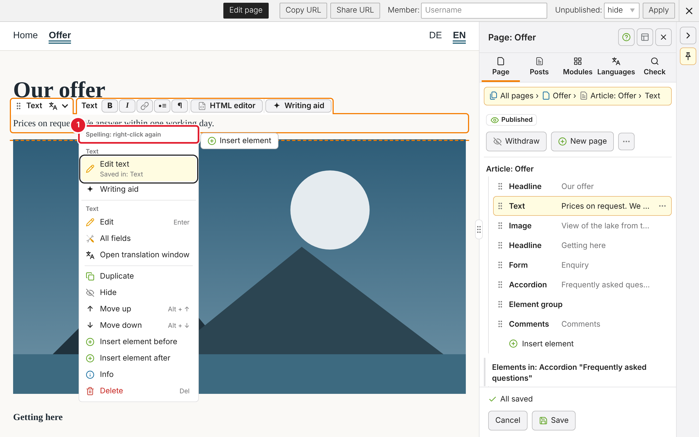
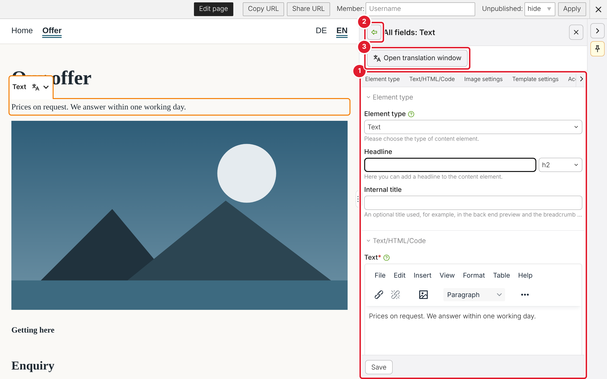

# Editing text, images and links

**Edition:** Basic. **Needs:** the switch **Change texts and images**.

## Change a headline or a text

1. Click the element on the page, then its tab (the type on the line of its
   frame) and **Edit**. Or press Enter on the selected element, on the page or
   in the sidebar.
2. Click into the text and write. Next to the tab, on the line of the frame,
   the text tools of the field you are writing in appear; they start with the
   name of the field.
3. Click **Save**, or press Ctrl+S (Cmd+S on a Mac).

The text tools depend on the field:

- in the headline: the **Headline level** (h1 to h6);
- in a formatted text: **Bold**, **Italic**, **Link** (opens Contao's link
  picker; choose a page of the website or enter an address), **List**,
  **Paragraph**.

A field without formatting gets no text tools; what you write there is saved as
plain text. Text you paste arrives as plain text, without the formatting of the source.

**Result:** the change is saved as a version in Contao, like a change in the
back end. Where the page already shows exactly what Contao renders for the saved
text, it stays as it is. Otherwise (the template or an insert tag changes the
value, the element is animated by the website's scripts, **All fields**, a new
image) the page in the frame loads again, at the same place, with the same
element selected and the sidebar as it was: it then looks exactly like after
opening it anew. While it loads, it is dimmed with the note **Updating the
page …**.

Whatever runs in the background shows that it runs: the button you clicked
turns its symbol into a spinner until the answer is there; an action started
from a menu shows it at the menu's button, or in a note at the bottom edge
(**Working …**).

**Leave a text:** press Esc. Your change waits until you save; a second Esc
ends the selection of the element. **Cancel** drops every change that waits, and
the page shows what was saved before.

**Contao's editor for a text:** a rich text (a field with Contao's TinyMCE in
the back end, such as the text of a text element or the teaser of a post; not
the HTML element, which has no TinyMCE) has bold, italic, link, list and
paragraph in the toolbar of the text. **HTML editor** there switches to
Contao's own TinyMCE on the page, with the toolbar and menus Contao's form has
for this field: images and links through Contao's picker (with upload), tables
and the source code. Its toolbar stands in a bar above the tabs of the element,
flush with the frame and always on top of the page; drag the grip at its left to put it anywhere in the
window (also with the arrow keys), a double click on the grip puts it back.
**HTML editor** again switches back; the text stays as it is. The browser
remembers the choice and the place of the bar. Where Contao's rich text editor
is switched off (**System › Settings**), the button is missing. A value of
another field that contains HTML tags offers **HTML source**: Contao's form of
the element opens in the sidebar at this field. Changes that wait for Save are
saved or dropped first.

**On a phone** the tools of a text are behind one button with the name of the
field next to the element's tab; it opens them as a dropdown below it (bold,
italic, link, list, paragraph, the level of a headline, the writing aid), and a
tool closes the dropdown again. Contao's TinyMCE is not offered on a phone: its toolbar does
not fit there.

## Moving on while you edit

Editing never locks the editor. While you write in a text:

- a click on another element on the page or in the structure selects it; the
  text you were writing in is left and your change waits (the status says
  **Unsaved changes**);
- the menu in the element's tab, the structure with its handles and "…", the
  tabs (**Page**, **Posts**, **Modules**, **Check**) and the screen size stay
  usable; using one leaves the text first;
- **Save** and **Cancel** stay at the bottom of the sidebar and save or drop
  every waiting change at once.

Actions that load the page again or open Contao's form (insert, move,
duplicate, hide or delete an element, **All fields**, the page settings, a
new language version) ask once when changes wait: **Save**, **Discard** or
**Cancel** (the action is not done, your changes stay).

## Every other text of a part

Besides the headline and the text, a part of the page shows further texts:
a lead text, a label, a caption, the rows of a list, the cells of a table, the
entries of an element that keeps them in a table of its own (the cards of a
card list), the texts of a front-end module (a header or footer), also of other
extensions. Click the part to select it, then click the text again: it becomes
editable in place, and saving stores it in the field it comes from.

- The editor knows where each text comes from: in the edit mode Contao renders
  the part a second time with invisible marks around the values of its text
  fields and keeps where they end up. So a value is found also when the template
  changes it (special characters, capitals, line breaks, quotation marks,
  insert tags), and the same text in two fields goes to the right one. Where
  the marks would change what the template does with a value, that value is
  found by its text as before. Visitors never get the marks.
- The text is edited where it stands. The template's markup, classes and
  effects stay as they are: an accent word keeps its marker, a bold word stays
  bold, a link keeps its look. Texts inside other texts are edited in place as
  well and each goes into its own field: the accent word in its span into the
  field of the accent word, the rest of the headline into the headline.
  Leaving a text without a change leaves the page exactly as it was.
- What the template or an insert tag (`{{…}}`) fills in itself is shown as on
  the page and kept. A change inside such a place cannot be put into the field;
  **Save** then names the field, and you change it under **All fields**.
- A headline that the template reads as plain text (some elements of other
  extensions store it that way) is saved as plain text again.
- Contao decides what you may change, as in the back end: the record (element,
  entry, module) and the field (**Allowed fields** of your user group). Modules
  are changed only with the permissions for themes and modules.
- A module appears on every page that shows it; the editor says so before you
  save. A content element that shows a module's value (the opening hours of
  the footer, for example) changes that module.
- Saving works as for the text: Contao checks the input with the field's own
  rules, keeps a version and the page shows the result.

A click on a text that cannot be edited there says why, for example: the text
comes from the template or a language file of the website; you may not change
the field; the text is the title of a page (the navigation is changed in the
page settings); the text belongs to a post (**Posts**). Such texts, and fields
for code, links, dates or colours, are changed under **All fields** or where the
note says.

## The menu of an element

The tab with the element's type, on the line of its frame, is the button of
its menu: click it, or focus it and press Enter, Space or an arrow key. The
menu has every action for the element: **Edit**, **All fields**, **Change
image** for each image field, **Open translation window** (Plus); then
**Duplicate**, **Hide**, **Move up**, **Move down**, **Insert element before**,
**Insert element after**; **Info** (web designers); **Delete** last. At the
right of an entry are the keys that do the same on the selected element: Enter
edits it, Alt+Arrow up or Alt+Arrow down moves it, Delete deletes it after a
question. An entry your permissions do not allow is greyed out with the reason.
The same entries are the lower part of the context menu (right click).

The grip at the left of the tab drags the element to another place. While you
write, the tools of the text (or of the image) stand as a second tab next to it.
The tabs never cover the text you are writing. Where there is no room above the
element (the top of the window, or a header that stays at the top), the page
scrolls by just enough when you select the element or start writing. Where it
cannot (the element is at the very top of the page), the tabs hang from the
bottom line of the frame while you write; an element that is only selected
then has its tab inside its top edge.

## The context menu

A right click on the page opens the editor's menu for what is under the
pointer, the nearest first:

| Under the pointer | Entries |
| --- | --- |
| A text | **Edit text** (with the field it is saved into), **Writing aid** (Pro) |
| An image, also one the template shows as a background or a mask | **Change image** (with the field), **Alternative text**, **Caption**, **Remove image** where the field may be empty |
| A link | **Edit link** (Contao's link picker; the field it is saved into), **Edit link text**, **Open link** |
| Always, below, with the element's type as heading: the menu of the element's tab | **Edit**, **All fields**, **Change image** for each image field, **Open translation window** (Plus); **Duplicate**, **Hide**, **Move up** / **Move down**, **Insert element before** / **after**; **Info** (web designers); **Delete** |
| A module (header, footer …) | **Edit texts**, **Edit module**; the note says that it changes on every page that shows the module; **Info** (web designers) |
| An empty place of an article | **Article settings**, **Insert element** |

An entry your permissions or your edition do not allow is shown greyed out
with the reason (for example "With the Pro licence"); an entry that does not
apply (**Move up** at the first element) is left out.

- Keyboard: the context-menu key or Shift+F10 opens the menu of what has the
  focus (or of the text you are writing in); arrow keys, Enter and Esc work in
  the menu, and the focus goes back where it was.
- Touch: hold your finger on the place.
- Everywhere on the page, also in the text you are writing in, in a table cell,
  on the tabs of the element and with Shift, the editor's menu opens. Where the
  editor has nothing for that place (a text of the template), a short note says
  why it is not edited there.
- Spelling: in the text you are writing in, the editor's menu starts with the
  hint "Spelling: right-click again". A second right click on the text, while
  that menu is open, closes it and opens the browser's own menu with its
  spelling suggestions. Elsewhere the browser's menu does not appear in the
  editor.

Images, alternative texts, captions and links chosen from the menu are saved
at once (as a version in Contao); a text started from the menu is saved with
**Save**.

## Change an image

Right click the image (or the place where the template shows it as a
background) and choose **Change image**: Contao's file manager opens, where you
choose an image or upload a new one. Or:

1. Choose **Edit** in the tab of an image element.
2. Next to the tab, click **Choose image**. Contao's file manager opens; choose an image or
   upload a new one in the dialog.
3. Enter the **Alternative text**: what can be seen in the image, for people
   who cannot see it and for search engines.
4. A caption shown below the image is edited directly in place.
5. Click **Save**.

Saving an alternative text or a caption switches on **Overwrite metadata** of
the element, as in the back-end form; the texts of the file manager are then no
longer used for this element.

## All fields of an element

Everything that is not shown on the page (for example the template, the CSS
class, the image size, the visibility period) is in Contao's own form:

1. Choose **All fields** in the element's tab (the entry with Contao's symbol
   for settings).
2. Contao's form opens in the sidebar, next to the page (**Loading …** until
   it is there).
3. Change the fields and click **Save** (or **Save and close**) in the form.

**Result:** right after **Save**, the page next to the form loads again and
shows the change, the form stays open. While it loads, the page is dimmed with
the note **Updating the page …**. **Back to the structure** (arrow in the head
of the sidebar) closes the form.

The form has every field you may change, the versions of the element, and every
element type, including those of other extensions.

With language versions (Plus), **Open translation window** above the form opens
the translation window of the element (see [Languages](languages.md)). After a
translation into this element is saved, the form loads again and shows the new
texts; changes in the form that were not saved yet are lost then, so save them
first.

## Leaving with unsaved changes

If you leave the page or close the editor while a change is not saved, the
editor asks first (Save, Discard, Cancel; the browser asks when you close the
window). Selecting another element does not ask: the change waits.

## Common problems

| What you see | Why | What to do |
| --- | --- | --- |
| No **Edit** at an element, but **All fields** | The element shows no headline, text or image on the page, and none of its other text fields is found there exactly once | Use **All fields**. |
| No **Edit** and no **All fields** | You may not change this element (type, fields or page) | Ask your administrator; see [Permissions](../permissions.md). |
| "Saving failed. The connection to the server was interrupted." | The connection was lost | Your change is still in the text; click **Save again**. |
| After **Save** a message names a field and says the page fills the place in itself | You changed text that comes from an insert tag or the template | Undo that part of the change and change the field under **All fields**. |
| The image stays the same after saving | The element shows an image from a different field (e.g. a gallery) | Use **All fields**. |
| An error message names a field after saving | Contao checks the input as in the back end (e.g. a mandatory field) | Correct the input and save again. |
