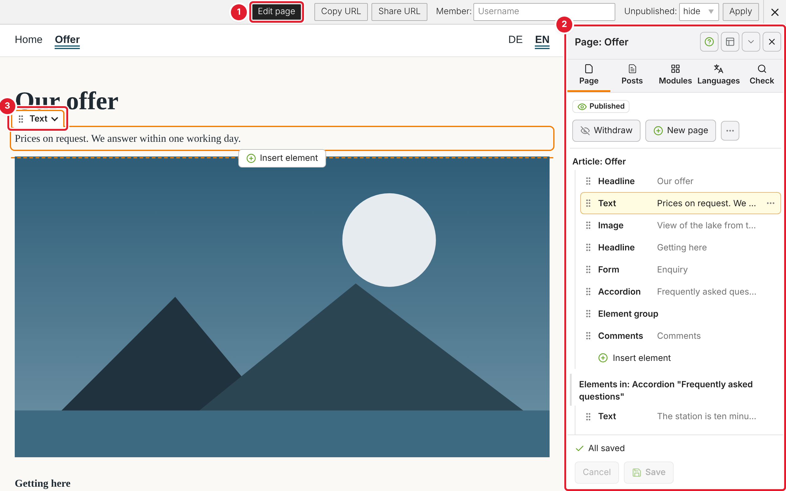

# Getting started

**Edition:** Basic.

The editor works only in Contao's **preview**. The website your visitors see is
never changed while you work; changes appear there once you save them.

## Open the editor

**Before you start:** you can log in to the back end, and your user group has
**Front end editing allowed** (ask your administrator).

1. Log in to the back end.
2. Click **Frontend Editor** at the top of the back end (next to **Preview**).
   It opens the preview with the editor switched on, of the page the back end
   shows, or of the start page. On a phone or a narrow window only its symbol
   is shown: a screen with a pen.

The other way: open the preview (**Preview** at the top of the back end, or the
preview icon next to a page in the page tree) and click **Edit page** in
Contao's preview bar.

**Result:** the editor view opens. Contao's preview bar stays at the top, the
sidebar is on the right, and the page is shown next to it, narrower by the width
of the sidebar (or the sidebar lies over the page, see below). Click an element on the
page: it gets a frame with a tab that names its type and opens its menu.

1. **Edit page** switches the editor on and off.
2. The **sidebar** shows the articles and elements of the page in their order.
   Hidden elements are marked *hidden*.
3. The **frame** of an element has a tab with its type. A click on the tab
   opens the menu of the element: **Edit**, **All fields**, **Duplicate**,
   **Hide**, **Move up**, **Move down**, **Delete** and more (see
   [Editing](editing.md#the-menu-of-an-element)); entries your permissions do not
   allow are greyed out with the reason. The grip in the tab drags the element.
   The tab sits on the line of the frame, above the element; where there is no
   room above it, the page scrolls by just enough (details in
   [Editing](editing.md#the-menu-of-an-element)).

## Find an element

- Click an element in the sidebar: it is highlighted on the page and scrolled
  into view.
- Or click the element on the page, or reach it with the Tab key. Moving the
  mouse over the page only outlines the element under it; the selected element
  stays selected, also while you move the mouse to its tab.
- A click on a link or button of the page does not lead away: the first click
  selects the element, a further one edits the text of the link or button where
  that is possible; otherwise a short note says how to follow the link.
- To another page: **Ctrl+click** (Mac: **Cmd+click**) on a link, or **Open
  link** in the context menu (right click). The sidebar then shows the structure
  of the new page. A link to another website leaves the editor.

**Quick guide:** the button with the question mark in the head of the sidebar
explains in a window how to select, edit, follow links, open the menu of an
element and work with the keyboard; on a page with language versions (Plus)
also how to translate an element. The first time the editor opens in a
browser, a note points to it.

## The sidebar

- The strip at the right edge has two buttons. The upper one (arrow) collapses
  the sidebar and expands it again; collapsed, a bar below the page shows the
  state with **Cancel** and **Save**.
- The pin below it decides where the sidebar stands:
  - **Pinned** (default): beside the page. The page gets narrower by its width;
    nothing of the editor covers it. The browser remembers whether it is
    collapsed.
  - **Not pinned:** over the page. The page keeps its whole width. The sidebar
    is collapsed at the start, opens by itself when a view needs it (**All
    fields**, **Languages**, **Posts** …), and closes again when that view is
    left. A click into the page closes it too, unless it shows a form, the
    writing aid or the languages.

  The browser remembers the choice.
- Its width can be changed: drag the grip at its left edge, or focus the edge
  and use the arrow keys. The browser remembers the width.
- Above the structure, Contao's breadcrumb of the selected element: **All
  pages** › page › article › element. A click goes up to that level; **All
  pages** opens Contao's page tree, where new pages are created (Plus).
- With Plus and Pro, the head of the sidebar has views: **Page**, **Posts**,
  **Modules**, **Languages**, **Check** (only those you may use).
- At the bottom: **All saved** or **Unsaved changes**, with **Cancel** and
  **Save**.

On a phone or a narrow window the page is at the top and the sidebar is a sheet
below it (without the strip; the arrow in its head collapses it); the tab of an element and its menu work the same way, with larger
buttons. Contao's preview bar is closed there once per
browser session when the editor starts; its button at the top right opens it
again.

A row of buttons always stays one line: where its buttons do not fit (a phone, a
narrow sidebar, the tools of a text in a narrow column), the last ones are
behind **…** at its end; **Save** always stays in the row.

## Finish

Click **Edit page** in the preview bar again, or **Stop editing** (×) in the
head of the sidebar. If something is not saved yet, the editor asks first.

## Common problems

| What you see | What to do |
| --- | --- |
| There is no **Frontend Editor** at the top of the back end and no **Edit page** in the preview bar | Your user group lacks **Front end editing allowed**; ask your administrator. |
| **Edit page** is there, but the entries in an element's menu are greyed out | You may not change this element (type or permissions); the entry names the reason. Ask your administrator. See [Permissions](../permissions.md). |
| The sidebar is empty or shows an error | The page is outside your pages (pagemounts), or the connection was lost. Reload the page. |
| You cannot see the editor on the normal website | Intended: the editor only appears in the preview. |
