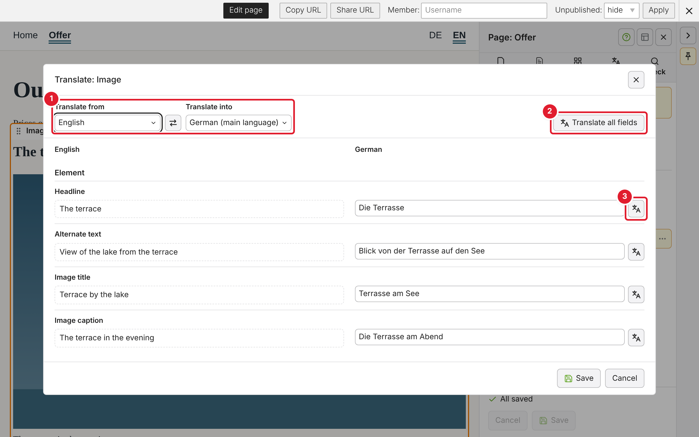
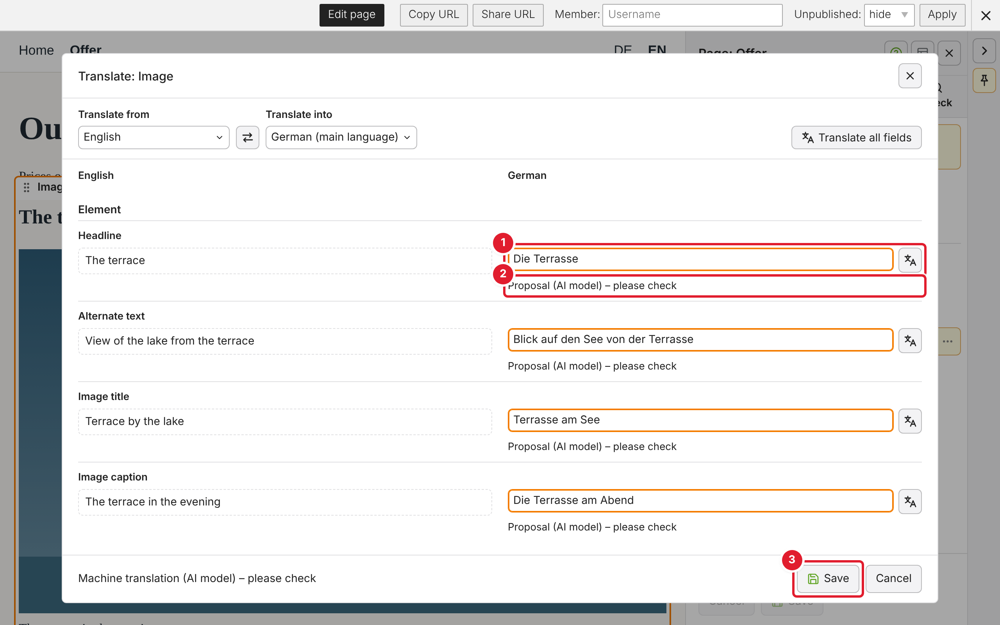
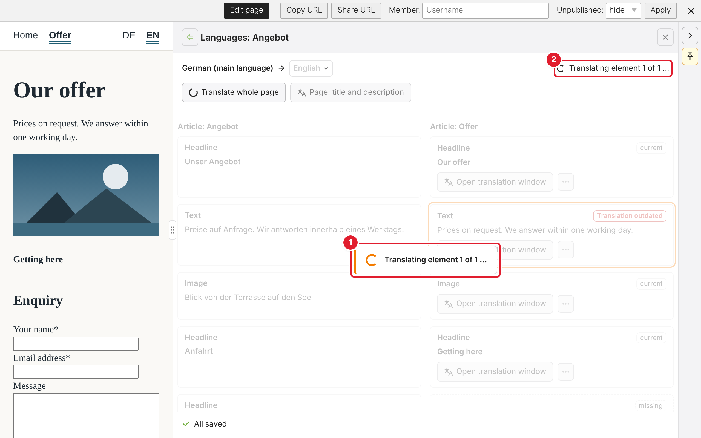

# Languages

**Edition:** Plus. **Needs:** the switch **Edit language versions (Plus)**; for
proposals also **Request translations (Plus)**. The pages of the languages must
be linked (extension changelanguage; see
[Several websites and languages](../websites-and-languages.md)).

## The page side by side

**At the element:** the tab of a selected element shows its language versions.
A translation symbol means: there is a current version in every language (on a
version: this version is current). **Translation outdated**, **not in all
languages** or **not linked** name what is missing; the context menu opens the
translation window.

1. Click **Languages** in the head of the sidebar.
2. Choose the language version. The sidebar widens and shows the page in the
   main language next to the version, element by element.

Each pair has a state:

- **current**: the translation matches the main language as it is now,
- **Translation outdated**: the element in the main language changed after the
  translation,
- **missing**: the element exists only in the main language,
- **not linked**: the element exists only in the version, or the elements are
  not connected yet.

Each element of the version shows what it says and how many of its texts are
not translated yet. **Open translation window** opens the window of the
element (below).

Elements inside another element (for example the sections of an accordion or
the elements of an element group) follow that element, indented one step per
level, and are compared the same way: with the elements inside its counterpart
in the version. On the page of a post (a news, an event and posts of other
extensions built the same way), the elements of the post follow the articles
as a group of their own, next to the elements of its post in the version (see
"Posts" below).

The view always compares the main language with one version, and **Translate
whole page** always fills in a version from the main language: the states
(*current*, *outdated*) are measured against the main language, and a whole
page translated from a version would overwrite the texts of the main language.
To translate the other way round or between two versions, open the translation
window of the element and choose the languages there.

## Translate an element

Right-click an element on the page (or use **…** in the structure, the
context-menu key or a long press) and choose **Open translation window**; in
the form **All fields** of the element, the button **Open translation window**
does the same. This works on the page of the main language and on the page of a
version, for the elements of the page, the elements inside other elements and
the elements of posts alike.

The window shows every text of the element, whatever made the field (Contao,
the website or another extension):

- text fields, text areas and formatted text,
- every row of a list and every cell of a table,
- the entries of the element (for example the cards of a card list), one group
  per entry,
- the texts of its images: title, alternative text and caption from the file
  manager in the language of the version (an image with its own texts in the
  element keeps them in the element),
- code fields: HTML is translated and its tags stay; other code (CSS,
  JavaScript …) is shown and can be changed, but gets no machine proposal.

Not in the window: choices, check boxes, links, dates, CSS ID and classes.

At the top you choose the direction: **Translate from** and **Translate into**,
any two languages of the page. The language translated from is on the left, the
language translated into on the right. At first the window translates from the
language of the page you are on: on a version into the main language, on the
page of the main language into the version you translated into last (otherwise
the first one).

- **Swap languages** (⇄, between both) turns the direction round. Choosing the
  language translated into under **Translate from** does the same.
- Under **Translate from** only languages that have the element can be chosen.
  If the element is missing in the language translated into, **Take over
  element** copies it there (below).

Every text can be changed directly. With a translation service:

- **Translate all fields** (at the top): proposals for every text you may
  change, in one go,
- **Translate this field** (the button next to a text): a proposal for this
  text only.

Until the proposals are there, a veil with a spinner and **Translating …** lies
over the texts of the window (with **Translate this field** over that text
only), the button shows a spinner, and nothing in the window can be typed or
chosen. The same applies while the window loads (**Loading …**) or saves
(**Saving …**); **Cancel** and the close button stay usable and close the
window without asking.

Proposals are marked "Proposal (service) – please check".

**Example** (the image above, the window opened on the English page, translating
into the main language German):

| Text | English | Proposal (German) |
| --- | --- | --- |
| Headline | The terrace | Die Terrasse |
| Alternate text | View of the lake from the terrace | Blick auf den See von der Terrasse |
| Image title | Terrace by the lake | Terrasse am See |
| Image caption | The terrace in the evening | Die Terrasse am Abend |

Check each proposal and change it in its field where needed; nothing is saved
before **Save**.

**Save** saves what changed into the language on the right and updates the
states:

- from the main language into a version: the version is **current**,
- from a version into the main language: the main language changed, so its
  other versions are **outdated**; the version translated from is **current**,
- from one version into another: the version translated into gets the state of
  the version translated from (**current** if that one is current, **outdated**
  if it is outdated). The reference stays the element of the main language.

A translation counts as current only once every text was saved. **Cancel**, the
close button or Esc closes the window.

If texts are changed but not saved, choosing other languages or closing the
window asks first: **Save** saves them and goes on, **Discard** drops them,
**Cancel** stays in the window.

A text you may not change is shown greyed out with the reason: no permission
for the field, or the entry does not exist in the version yet (add it to the
element first). If the element is missing in the version, **Take over
element** copies it there.

Image texts belong to the file: they apply wherever the image is shown in that
language. Changing them needs the permission to edit files in the file manager.

## Translate the whole page

In the view **Languages**, **Translate whole page** makes proposals for

- every outdated element: all its texts,
- every element with texts that are not translated yet: only those texts.

If there is nothing to translate, a note says so instead: "Nothing to translate:
all elements in (language) are up to date." If elements are missing in the
version, the note says they have to be taken over first (**Take over
element**); elements that exist only in the version are named in the note.
Without the permission to change the elements that are behind, the note says
that the permission is missing. If none of the elements gets a proposal, a note
says so: the texts that still need a translation cannot be translated by
machine (for example CSS or JavaScript code), or you cannot change them here;
**Open translation window** shows the reason at each text.

While it runs, a veil with a spinner lies over the comparison and says how far
it is (**Translating element 2 of 5 …**, also in the bar), the card being
translated is marked, and the cards and buttons are locked until it is done.
The proposals of each element appear in its card.

Nothing is saved yet. Each element shows how many proposals it has:
**Apply and save** saves them as they are, **Check** opens them in the window,
**Discard** drops them. **Apply all proposals** saves all of them. Proposals
that are not saved yet are asked about before another language is chosen, the
view is left or an element is taken over on this page (**Save**, **Discard**,
**Cancel**).

Links and other insert tags stay as they are. Which service translates is
chosen in the settings of the editor (Azure Translator, DeepL or an AI model).

## Outdated translations

When a text of an element in the main language changes (a field, an entry or
the texts of its images in the main language; in the editor or in the back
end), its translations count as outdated. You see it:

- at the element and in the sidebar of the language version (*outdated*),
- in Contao's list of content elements (a symbol),
- in the back-end list **Translations**, with a filter.

For an outdated translation, **Open translation window** is the highlighted
button. If the translation is still right, **…** › **Mark as current** confirms
it.

## Take over and link

- **Take over element**: an element missing in the version is copied there and
  linked, with a translation proposal right away. It goes into the matching
  container of the version: the article, the element it is in (for example the
  accordion), or the post. An element that contains elements takes them along;
  each of them is linked and still has to be translated. If the container
  itself is missing in the version, the element says so: take over the
  container first.
- **Take over into (main language)**: the other way round, for an element that
  exists only in the version, for example because it was written there first.
  It is copied into the page of the main language, at the matching place of
  the article that belongs to its article (after the counterpart of the
  nearest element before it, otherwise at the top), and linked; the element of
  the version counts as **current**. The translation window opens right away,
  from the version into the main language (for example "English → German
  (main language)"), with proposals where a translation service is set up.
  **Save** writes the translation into the element of the main language; the
  element of the version stays current. Until then the copy in the main
  language shows the texts of the version. Elements inside another element and
  elements of posts go into the matching element or post of the main
  language, and the elements in the element taken over come along, each
  linked and current. Where taking over is not possible, the element says why
  instead: the article, the element it is in or the post is missing in the
  main language, or you do not have the permission (see
  [Permissions](../permissions.md)).
- **Link**: connects two existing elements; **…** › **Remove link** separates
  them.

Versions made before the editor: the first time a page is compared, the editor
links the elements of each article that belong to none yet, where they stand in
the same order with the same type (an element only one side has does not shift
the rest). The elements inside two linked elements (an accordion and its
counterpart, for example) and the elements of a post and of its post in the
version are linked the same way, level by level. Such a link counts as current;
a later change in the main language marks it outdated. This happens once per
article, element or post: a link you remove is not made again, and elements
added later are taken over or linked by hand.

## Posts

The elements of a news, an event or a post of another extension built the same
way have language versions when the posts of the languages are linked with
changelanguage: the archive of the version names the archive of the main
language, and each post of the version names its post of the main language
(field **Master article** of changelanguage, see
[Several websites and languages](../websites-and-languages.md)). The pages that
show the posts (the reader pages of the archives) are linked like any page.

On such a page, the view **Languages** shows the post after the articles, its
elements next to those of the linked post; the translation window, **Take over
element**, **Take over into (main language)**, the states and **Translate whole
page** work as for the elements of the page. A post that is not linked shows
the note that it does not exist in the other language or is not linked.

## Posts, archives, page settings and records

Besides the elements, the editor translates the texts of whole records: the
title, teaser and meta fields of a post, the settings of a page (title, page
title, description), the title of an archive, the texts of a front-end module
and the records of other back-end modules. The window is the same as for an
element, with the type and title of the record in its head.

| What | Where | Edition |
| --- | --- | --- |
| Page settings (title, page title, description) | View **Languages**: **Page: title and description** | Plus |
| A post (news, event, FAQ) | View **Posts**: menu of the post → **Translate**; on the page of a post: **Translate** in its head | Plus |
| An archive (news archive, calendar, FAQ category) | View **Posts**: **Language versions of this archive** | Plus |
| A front-end module of Contao (navigation, news list …) | Its menu on the page → **Translate** | Plus |
| A front-end module of an extension or of the website | Its menu on the page → **Translate** | Pro |
| A record of a back-end module of an extension or of the website (a catalogue, offers …) | View **Modules**: the module's list → icon **Translate** at the record | Pro |

**Linking.** A record without a version in the other language says so in
the window and offers two ways:

- **Link an existing entry in (language)**, then **Link**: the list offers the
  records of that language; the one at the same place in its list is marked
  **(suggested)**.
  Posts are linked with changelanguage's field **Master article**, archives
  with its field **Master archive**; records Contao does not link (front-end
  modules, records of extensions) are linked by the editor. Linking two
  archives also links their posts by their order, when both have as many
  posts and none of the version is linked yet.
- **Create as a copy in (language)**: a copy made by Contao, linked at once. A
  post goes into the linked archive of that language, not published, with the
  same dates and author; its address is made from the translated title when
  you save the translation. A post needs its archive linked first (**Link
  archive** in the window).

Opened on a record of a version that has no record in the main language yet
(written on the English page first, for example), the window translates from
that language into the main language: it offers the records of the main
language that have no version yet, and the one you choose becomes the main
record; **Create as a copy** makes the record of the main language. The record
of the main language always stays the main record.

The language of a record comes from its page (a page; a post from the reader
page of its archive), from the pages whose elements show it (an archive), from
its own field **Language**, or from its link.

**New posts in all languages.** When you write a new post in **Posts** and save
it for the first time, the editor creates its versions in every language whose
archive is linked with the post's archive: copies, not published, linked; a
message names them. A post written first in a version (for example on the
English page) gets its record in the main language as well. Translate them
with **Translate** and publish them when they are ready.

**Modules of the website (Pro).** With Pro, the view **Modules** also lists the
back-end modules of the website and of other extensions (not Contao's own).
Their lists get the icon **Translate** before **Edit** at every record that can
be translated on its own.

## Common problems

| What you see | Why | What to do |
| --- | --- | --- |
| No **Languages** button | The page has no linked language versions, or you lack the switch | Link the pages (administrator); see [Permissions](../permissions.md). |
| "Translations need a translation service …" | No translation service is set up or chosen | Administrator: set one up under *Access keys and licences* and choose it in the settings of the editor. |
| "… refused the translation" (with the name of the service) | Key, region or model wrong, or the characters of the plan used up | Administrator: **Test connection** in the section of the service. |
| All elements of the version show as **missing** although they exist | The elements stand in another order or have other types, so they were not linked automatically | **Link** them; an element of the version without counterpart stays at the end of its article. |
| A language version is not offered | You have no access to that language's pages | Ask your administrator. |
| A text in the translation window is greyed out | You may not change that field, or the entry exists only in the main language | Ask your administrator for the field; add the entry to the element in the version. |
| Image texts are greyed out | You may not edit files in the file manager, or the file lies outside your file mounts | Ask your administrator. |
| "This element has no counterpart in the main language" | The element of the version is not linked | **Link** it in the view **Languages**, or take it over with **Take over into (main language)**. |
| "The article is missing in (main language)." at an element of the version | Its article belongs to no article of the page in the main language | Create the article on the page of the main language (or link the articles with changelanguage), then take the element over. |
| "The element it is in is missing in (language)." | The element is inside an element (an accordion, an element group …) that has no counterpart in that language | Take over or link that element first. |
| "The post does not exist in (language), or it is not linked …" | The post has no post in that language, or the posts are not linked with changelanguage | Create the post in that language and set its **Master article** (archive and post, see [Several websites and languages](../websites-and-languages.md)). |
| "You do not have permission to take this element over into (main language)." | The switch **Create, move and delete elements**, or Contao's permission to create the element in the article of the main language, is missing | Ask your administrator; see [Permissions](../permissions.md). |
| "The archive of this post has no language version in (language) yet …" | The archive of the post has no linked archive in that language | **Link archive** and link the archives (or set **Master archive** in the archive of the version). |
| A module of the website is not in the view **Modules** | It needs Pro, or your user group may not open the module | Enter a Pro licence; ask your administrator for the module (**Back end modules**). |
| "Entries of extensions and of your own modules are translated with Pro." | The record belongs to an extension or to the website | Enter a Pro licence. |
