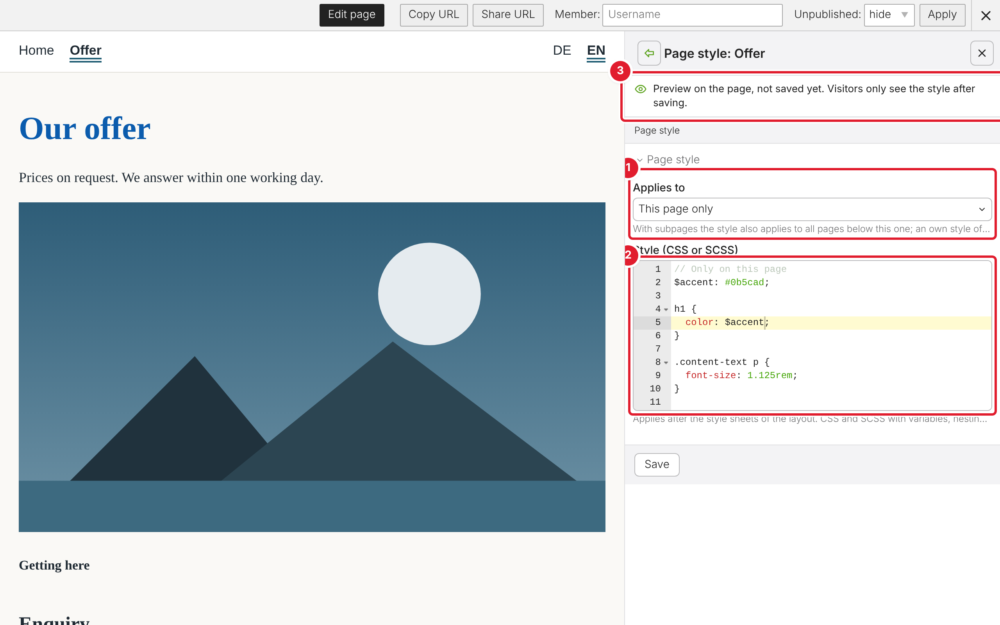

# Page style

**Edition:** Pro. **Needs:** the switch **Edit page styles (Pro)**, the back-end
module **Page styles** and *Edit page* for the page. Meant for web designers: an
error in a style can disarrange the page for visitors.

## Write a style

1. **More about the page** (…) → **Page style (CSS)**.
2. Contao's form opens in the wide sidebar. Choose where the style applies:
   **This page only** or **This page and its subpages**.
3. Write CSS or SCSS (variables, nesting, `@media`) in the code editor.
4. Half a second after you stop typing, the page shows the style, only to you.
   The line above the form says whether it is a preview, saved, or wrong.
5. Click **Save**. Visitors see the new style.

The page bar shows **Own style**, or **Style of "{page}"** when the style comes
from a page above.

## Errors

An error names the line in plain words, for example "A semicolon ";" is missing
here.". The page keeps the last valid style; saving only works without errors.

Not allowed:

- other files (`@import`, `@use`),
- addresses of other websites (they would send visitors' data to other
  servers); load fonts and images from the website itself,
- more than 32 KB of CSS per page.

## Where the style goes

Visitors get the finished CSS at the end of the page head, after every style
sheet of the layout. Equal selectors therefore win; a more specific selector in
the layout still wins, as in any CSS. Pages without a style stay unchanged.

In the back end, **Page styles** lists all styles you may edit.

**Without Pro:** if the Pro licence ends, the saved styles stay in effect and
the pages look the same. Only the tool goes: the styles can no longer be
changed or deleted until Pro is active again.

## Common problems

| What you see | Why | What to do |
| --- | --- | --- |
| No **Page style (CSS)** in the menu | Switch, back-end module or *Edit page* missing; with Plus the entry carries "Pro" | Ask your administrator. |
| The style has no effect | A more specific selector of the layout wins | Use a more specific selector. |
| "Addresses of other websites are not allowed" | The style loads something from another server | Upload the file to the website and use its address. |
