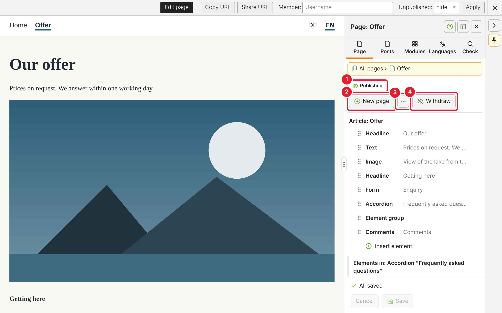
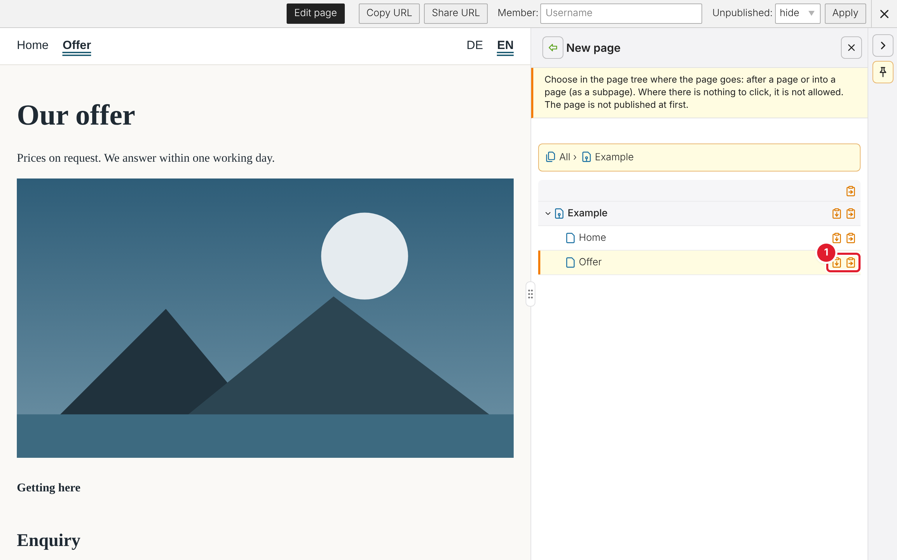
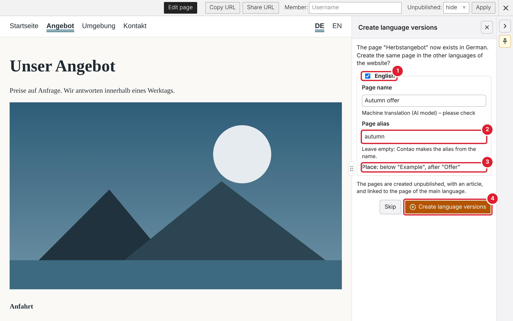

# Pages

**Edition:** Plus. **Needs:** the switch **Create and publish pages (Plus)**.

Above the structure in the sidebar (view **Page**) you see the state of the page
and its actions.

## State, publish, withdraw

The state is one of **Published**, **Not published**, **From {date}** (published
from a later date) or **Expired**.

- **Publish** puts the page online. It appears in the navigation where its place
  in the page tree says.
- **Withdraw** takes it offline after a question; visitors can no longer reach
  it. If the page has subpages, the question says that they can no longer be
  reached either.

## Page settings

**More about the page** (…) → **Page settings** opens Contao's form of the page,
narrowed to: page name, alias (the address), page title, description and the
publication dates. With Pro also **Robots** and Contao's search result preview.
Navigation, layout, cache and access protection stay in the back end.

## Create a new page

1. Click **New page**.
2. Contao's page tree opens in the sidebar, at the current page. It shows only
   this website and language. Next to each page you see the buttons "paste
   after" and "paste into" where you may create a page.
3. Click "paste after" (the new page comes after this page) or "paste into" (the
   new page becomes a subpage).
4. Enter the name of the page and, if you like, the **Page alias**: the address,
   e.g. `index` for a page called "Home". Left empty, Contao makes it from the
   name. If you may choose, also the page type.
5. Click **Save**.

**Result:** the new page is created **not published**, with an article, and
opens in the preview. Add content, then **Publish**. On a website with several
languages the step **Create language versions** comes first (next section).

If you close the tree or the form without saving, nothing is created.

## Create the language versions right away

Each language version is a page of its own in the page tree of its language;
changelanguage links them to the page in the **main language** (the language of
the root page with **Language fallback**).

**The main language is created automatically.** The page in the main language
is always needed. If you save a new page in another language, the editor
creates its version in the main language right away, without a click: at the
same place in that page tree, with the name translated by the translation
service of the settings (if one is set up and you may request translations;
otherwise with the same name),
with an alias Contao makes from the name, not published, with an article, and
linked. A notice names the page, e.g. *The page in the main language (German)
was created right away and linked: Herbstangebot (herbstangebot).* Name and
alias can be changed later in the page settings of that page.

**The other languages are your choice.** If the website has further languages,
the sidebar then shows the step **Create language versions**, with one row for
every language in which the page does not exist yet; if there are none, the new
page opens directly. A row has:

- the checkbox: create this language version or not,
- **Page name**: a machine translation if a translation service is set up and
  you may request translations, marked e.g. "Machine translation (DeepL) –
  please check";
  otherwise the name of the new page, marked "Not translated yet",
- **Page alias**: the address in this language. Left empty, Contao makes it from
  the name,
- **Place**: where the page goes in this language, e.g. *below "Test site",
  after "Offer"*.

1. Check the names and aliases.
2. Click **Create language versions**, or **Skip** to create none of them.

If the version in the main language cannot be created automatically (no place
found in its page tree, or a permission missing there), the step shows it as a
row with **Main language** that cannot be left out, with the reason.

**Place:** the editor looks for the same place in every language. If the new
page comes after a page, it comes after that page's version in the other
language; if it is a subpage, it becomes the first subpage of the parent
page's version. If a page before it has no version in that language, the
editor takes the nearest one before it that has; if none has, the new page
becomes the first subpage of the parent page's version.

**No counterpart:** if the parent page does not exist in a language either, the
row says *No counterpart of "…" in …* and offers the pages of that language
under **Parent page in this language**. The new page becomes its first subpage.

**Result:** the pages are created **not published**, each with an article, and
linked. A list shows them, each with **Open in the preview**. **Done** opens the
new page.

**If a language fails** (e.g. the alias exists already in that language), the
result names the reason. **Try again** brings back the step with your entries
for the languages that are still missing.

Closing the step (×) without creating leaves the page without the optional
languages; they can be created later in the back end. The step is not offered for other page types than *Regular page*
(e.g. *Forward*), because those need further mandatory fields per language;
create them in the back end. Without changelanguage or with only one language
there is no step.

## Duplicate or delete a page

**More about the page** (…):

- **Duplicate page** copies the page with its articles and elements, directly
  after it, not published.
- **Delete page** asks first; it is only offered for pages without subpages. A
  deleted page can be brought back in the back end under **Restore**.

Pages are not moved in the editor; use the page tree in the back end.

## Common problems

| What you see | Why | What to do |
| --- | --- | --- |
| No **New page**, or no buttons in the tree | You lack *Edit page* and *Edit page hierarchy* for the parent page, or the switch | Ask your administrator; see [Permissions](../permissions.md). |
| The tree shows only one website | Intended: a new page is created in the website and language of the open page | Open a page of the other website or language first. |
| **Delete page** is missing | The page has subpages, or you lack *Delete page* | Delete the subpages first, or ask your administrator. |
| No step **Create language versions** after saving | The website has one language, its languages are not linked with changelanguage, the page is not a *Regular page*, or the page exists in every language already | See [Several websites and languages](../websites-and-languages.md). |
| "Linking the language versions needs the field permission "Main language page"." | The field permission `languageMain` is missing | Ask your administrator; see [Permissions](../permissions.md). |
| "You may not create a page at this place in …" | In that language you lack *Edit page* or *Edit page hierarchy* of the parent page, its root page in your pagemounts, or the field permission Page name | Ask your administrator. |
| "… the page could not be created (This alias leads to a conflict …)" | The alias exists already in that language | **Try again** with another alias. |
| A language version has no article | You may not create articles: no field of `tl_article` under **Allowed fields** | Ask your administrator; then **Create article** on the page. |
| The new page does not appear in the navigation | It is not published, or the navigation module leaves it out (e.g. "Hide in navigation") | **Publish**; check the page settings in the back end. |
