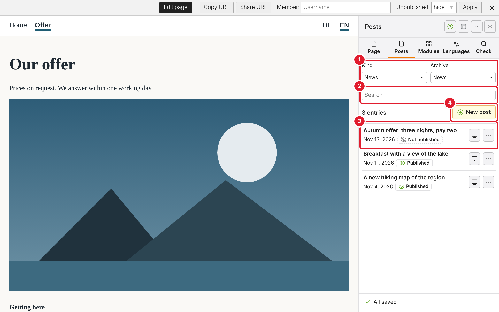

# Posts

**Edition:** Plus. **Needs:** the switch **Edit posts (Plus)** and access to the
archives in Contao.

Posts are news, events, FAQ and entries of extensions built the same way. The
view **Posts** in the head of the sidebar lists them.

## Find a post

1. Click **Posts** in the head of the sidebar.
2. Choose the kind and the archive. Archives shown on the open page come first;
   only archives of this website are listed.
3. Search by title if the list is long.

Each post shows its state (**Published**, **Not published**, **From {date}**,
**Expired**) and its actions: **Open on the page**, **Publish**/**Withdraw**,
**Properties** (Contao's form of the post), **Duplicate**, **Delete**. FAQ can be
put in order here; the order is the order on the page.

## Write a new post

1. In **Posts**, choose kind and archive and click **New post** (**New event**,
   **New question**).
2. Contao's form opens in the sidebar. Fill in at least the title, then
   **Save**.
3. The post opens on its page. Add its content like the content of a page: write
   in the text, **Insert element**, and so on (see
   [Changing the structure](structure.md)).
4. **Publish** when it is ready.

On a website with language versions (Plus) the first save also creates the
post in every other language whose archive is linked: copies, not published,
linked with the new post. Translate and publish them there (see
[Languages](languages.md#posts-archives-page-settings-and-records)).

A post that is not published is shown in the preview only when Contao's preview
bar says "Unpublished: show"; the editor switches it when it opens a draft.

## The page of a post

On the page of a post the sidebar shows **Post: {title}** with its state,
**Properties** and **Publish**/**Withdraw**, and below **Content of the post**
with its elements. Its headline and teaser, where the page shows them, are
edited right on the page: click the post once to select it, click the text
again to write; **Save** saves into the post.

## Edit a post in a list

On a page with a news or event list, each entry of the list gets a frame when
you click it, with **Edit post**. It opens the properties of the
post (Contao's form) in the sidebar. The headline and teaser of the entry are
edited right in the list like any text of the page (a second click on the
text); they are saved into the post.

## Common problems

| What you see | Why | What to do |
| --- | --- | --- |
| A kind of post or an archive is missing | You lack the back-end module, the archive or **Edit posts (Plus)**; or the archive belongs to another website | Ask your administrator. |
| A post opens as "Not found" | It is not published and the preview bar says "Unpublished: hide" | Set it to "show" in the preview bar. |
| A new post has no address | It needs a title; the alias is made from it | Enter a title and save. |
