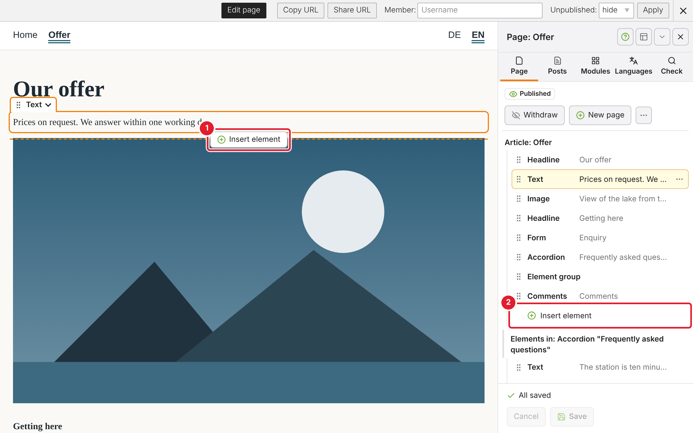
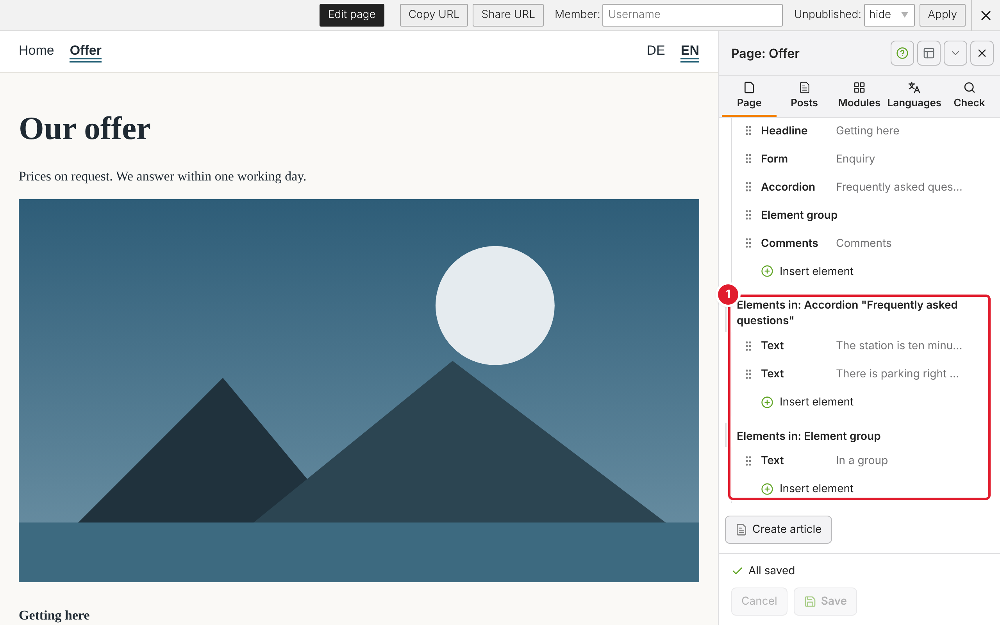

# Changing the structure

**Edition:** Basic. **Needs:** the switch **Create, move and delete elements**;
for articles **Create articles**.

All changes are carried out by Contao's own operations, with versions and with
Contao's undo list (**Restore** in the back end). After a change the page loads
again with the same element selected.

## Insert an element

1. Choose the place:
   - on the page: click the element after which the new one should come and
     click **Insert element** below it (above the first element of an article
     there is one too),
   - or in the sidebar: **Insert element** at the end of an article.
2. Contao's form opens in the sidebar. Choose the **Element type** (only the
   types you may create are offered) and fill in the fields.
3. Click **Save**.

**Result:** the new element is on the page. If you close the form without
saving, the new element is removed again.

## Move an element

- On the page: drag the element by the grip in its tab to its new place, or
  choose **Move up** or **Move down** in its menu, or press Alt+Arrow up /
  Alt+Arrow down on the element or its tab.
- In the sidebar: drag the row by its handle, or select the row and press
  Alt+Arrow up / Alt+Arrow down.

Elements can be moved within the articles of the page. Elements inside an
accordion, slider or element group move within that element.

## Duplicate, hide, delete

- **Duplicate** creates a copy directly after the element.
- **Hide** hides the element from visitors (it stays in the sidebar, marked
  *hidden*); click again to show it.
- **Delete** asks first. A deleted element can be brought back in the back end
  under **Restore**.

On the page these are entries in the menu of the element's tab.

In the sidebar, Shift+F10 (or the **More** button of a row) opens a menu with all
actions of the element; Delete deletes the selected element.

## Create an article

1. Click **Create article** below the structure in the sidebar.
2. If the layout has several columns, choose the column.
3. Contao's form opens; enter the title and click **Save**.

## Elements inside an accordion, slider or element group

Some element types contain elements (Contao's accordion, slider and element
group, and similar elements of extensions). Their elements appear in the sidebar
as a group of their own, directly after the article: **Elements in: Accordion
"…"**.

- Edit, insert, move, duplicate, hide and delete them as any other element.
- **Insert element** in the group inserts an element into that accordion,
  slider or group.
- Sections of a closed accordion are not visible on the page; reach them through
  the sidebar.

## Common problems

| What you see | Why | What to do |
| --- | --- | --- |
| No **Insert element**, **Duplicate** or **Delete** | Your group lacks **Create, move and delete elements** or Contao's permission to create or delete elements | Ask your administrator; see [Permissions](../permissions.md). |
| The element type you need is not offered | It is not among the element types allowed for your group, or it may not be placed inside this element | Ask your administrator. |
| An element cannot be moved to another place | Elements move only within the articles of the page or within their own accordion, slider or group | Duplicate it at the new place and delete the old one. |
| A deleted element should come back | – | Back end → **Restore**. |
