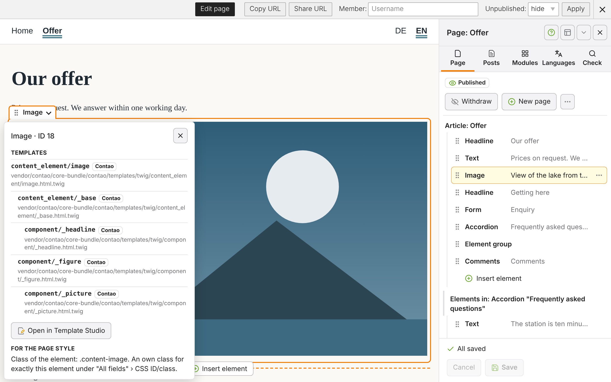
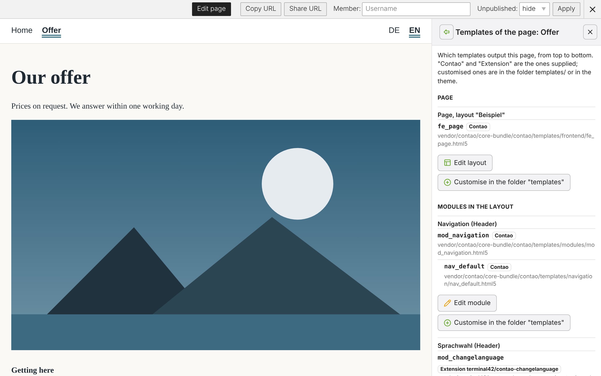
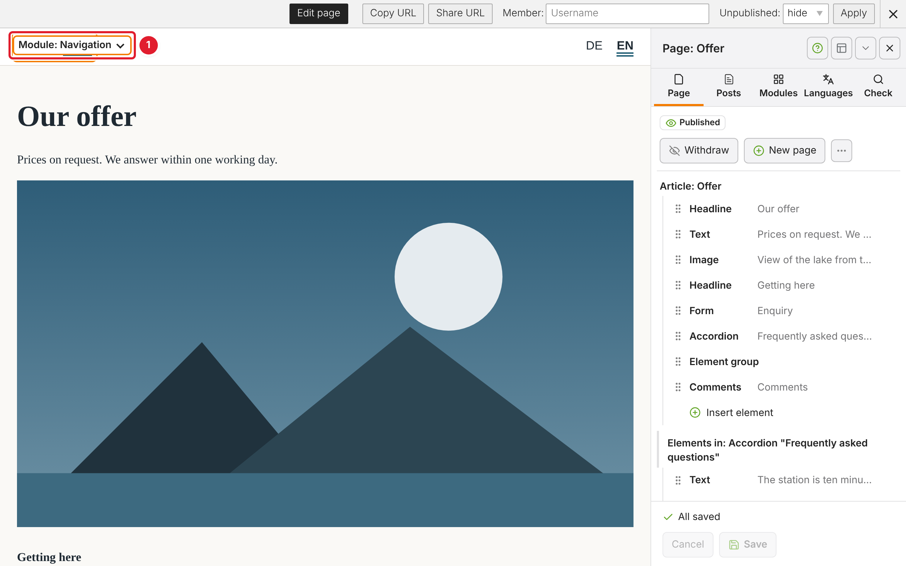
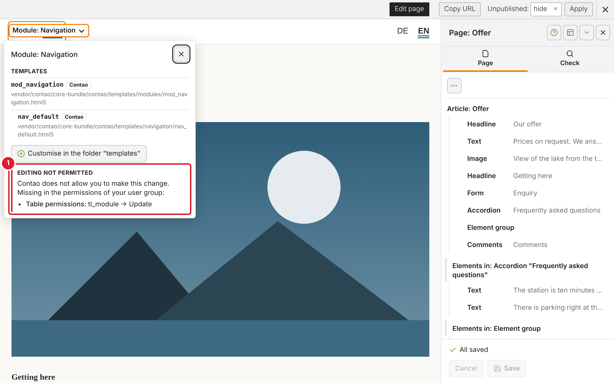

# Templates and modules

**Edition:** Basic. **Needs:** the switch **Templates and modules (for web
designers)** and Contao's permissions for the parts (see
[Permissions](../permissions.md)).

## Which templates output an element

1. Click an element on the page, then its tab and **Info**.
2. The card lists the templates that output the element and the templates they
   use (for example `component/_figure` in an image), each with its origin:
   **Contao**, **Extension …**, **Customised** or **Customised in the theme**,
   and its path.
3. To change a template:
   - Twig templates: **Open in Template Studio**. Contao's Template Studio opens
     in the wide sidebar with the template already chosen.
   - Older `.html5` templates: **Customise in the folder "templates"** or **Edit
     the customised template**.
4. **For the page style**: the CSS class of the element, and where it gets an
   own class (**All fields** › CSS ID/class).

The card stays open until you close it (× or Esc). It is not shown on screens up
to 768 px wide; use **Templates of the page** there.

## Templates of the page

**More about the page** (…) → **Templates of the page** lists, from top to
bottom: the page and its layout, the modules of the layout, the content elements
(equal ones grouped) and the other parts of the page, each with its templates
and its form. Every part is reachable with the keyboard here.

## Front-end modules, layout, form fields, comments

On the page these parts get a frame with a tab with their name when you click
them (the mouse over them only outlines them); the tab opens their menu:

- **Module: {name}** (navigation, lists …) → **Edit module**,
- **Form field: {name}** → **Edit field**, **Insert field after**, **Delete
  field**,
- **Comment: {name}** → **Edit comment**.

Each opens Contao's form in the sidebar. After closing the form the page loads
again with the change. **More about the page** (…) → **Edit layout** opens the
form of the page's layout.

**Insert field after** opens the form of a new field directly after this one;
closed without saving, it is removed again. **Delete field** asks first; the
field can be brought back in the back end under **Restore**.

## When an entry is missing

When Contao does not allow you to change a part, its menu has no edit entry, or shows it greyed out. **Info**
at the part (for the layout: **Templates of the page**) shows **Editing not
permitted** and names what is missing in the permissions of your user group,
with Contao's own label, for example "Table permissions: tl_module → Update".

Give this to your administrator; [Permissions](../permissions.md) has the full
list.
