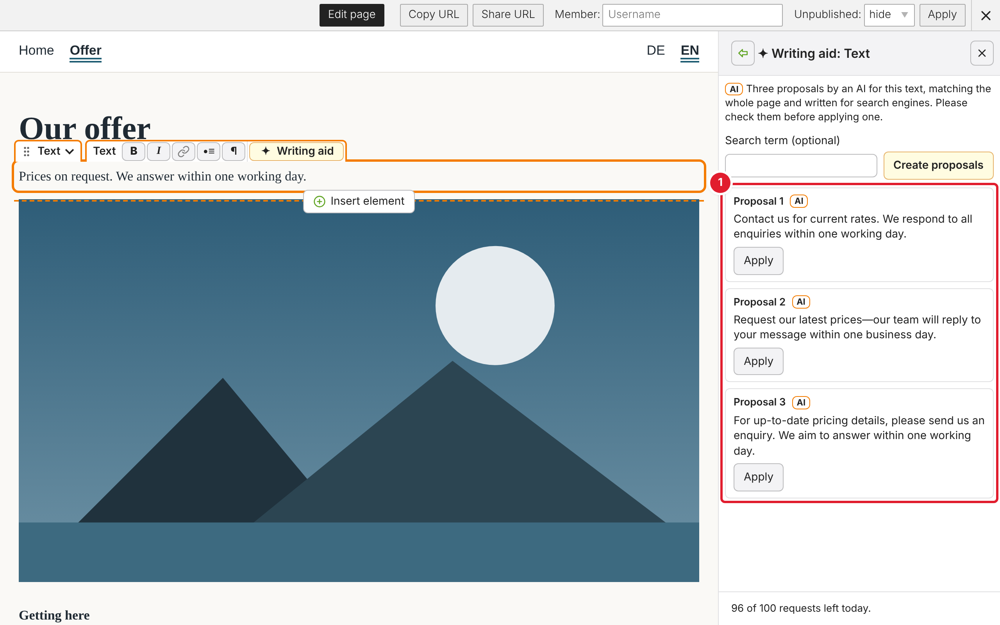

# Writing aid

**Edition:** Pro. **Needs:** **Change texts and images**; the AI connection and
a model must be set up (administrator, see [Setup](../setup.md)).

1. Start editing a headline or a text (**Edit**).
2. Click into the headline or the text, then **Writing aid** in the text tools next to the element's tab.
3. Optional: enter a **Search term** the text should be found for.
4. Click **Create proposals**. Three proposals appear, marked as AI proposals.
5. Click **Apply** at the one you want. It replaces the text in the element.
6. Check and change the text, then **Save**.

Nothing is saved before you click **Save**. The proposals use the whole page as
context (page title, description, the texts of the elements).

The number of requests per day is limited for all editors together; the panel
shows how many are left today.

## Common problems

| What you see | What to do |
| --- | --- |
| "The writing aid needs the AI connection and a model." | Administrator: set up the AI connection and the model. |
| "The writing aid has reached its limit for today." | Try again tomorrow, or the administrator raises **Requests per day**. |
| "The writing aid cannot be reached right now." | Try again later. |
| No **Writing aid** in the text tools | The cursor is in another field than the headline or the text, or the website has no Pro licence. |
